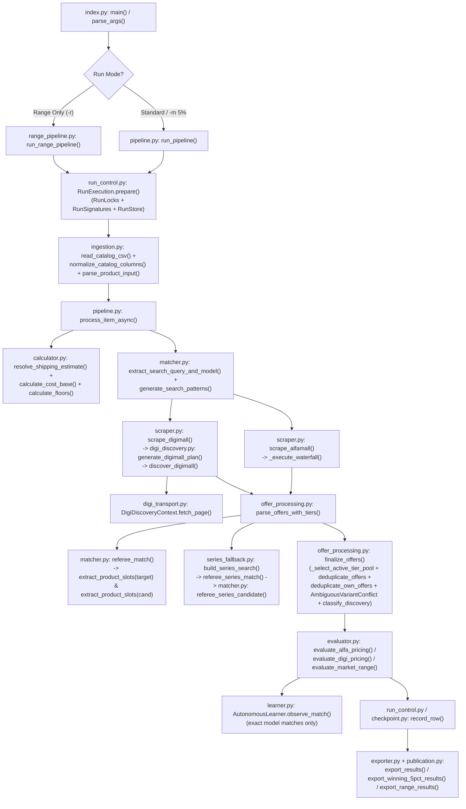
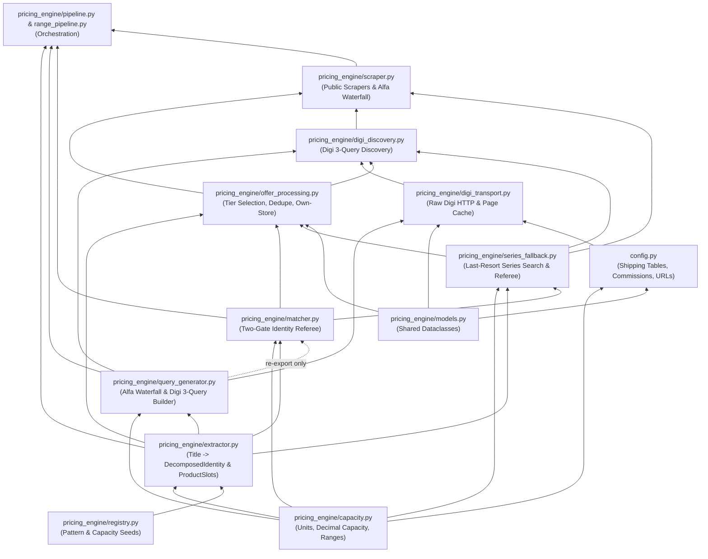
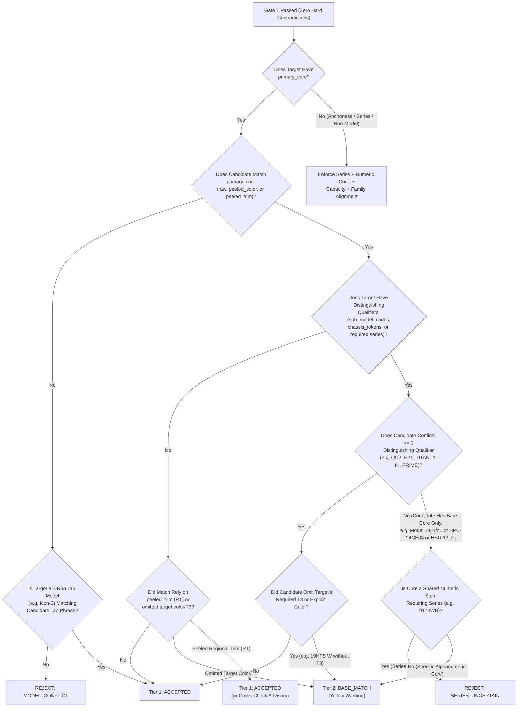

# PRICE GENERATOR — MASTER FORENSIC ARCHITECTURE & MATCHING PLAN

> [!IMPORTANT]
> **Argon Mission Mode**: Forensic Investigation + Architecture Design + Implementation-Ready Plan Only.
> **Application Code & Working Tree Status**: Untouched during this audit. All implementation phases are gated on explicit user approval and will execute on a dedicated new Git branch (`feat/clean-extractor-query-matcher-architecture`).

---

## 1. Executive Summary and Scope

### Goal Description
`pricing_engine/matcher.py` has grown into a **6,435-line monolith** (`sha=4923833cf786`) that simultaneously owns four distinct architectural responsibilities:
1. **Capacity / Measurement Normalization Helpers** (`normalize_screen_units`, `_bind_standalone_measurement_units`, `_strip_category_measurements`, `get_capacity_tonnage`).
2. **Product Title Extraction & Decomposition** (`extract_product_slots`, `normalize_color`, `_strip_trailing_seller_clauses`, `_decompose_ac_sku`, `extract_tag`, `clean_marketplace_noise`, `normalize_series_tokens`).
3. **Search Query & Pattern Construction** (`extract_search_query_and_model`, `generate_search_patterns`, `_generate_single_branch_patterns`, `generate_model_first_queries`, `expand_cartesian_branches`, `normalize_search_query`).
4. **Candidate Identity Matching & Referee Decisions** (`referee_match`, `_referee_match`, `referee_series_candidate`, `_evaluate_anchor_compatibility`, `is_strict_model_match`, `normalize_model_identity`, `model_identity_parts`).

In addition to mixed module ownership, the current extraction and matching pipeline suffers from **destructive single-string anchor selection**:
- Multi-segment SKUs (`MSEZ1C-18HRFN1-QC2` vs. `18HRFN1-QC2W-IDU-INV-EZ1-TITAN`) fail when marketplace sellers reorder or omit the outdoor/chassis prefix (`MSEZ1C`) while retaining the core (`18HRFN1`), sub-code (`QC2`), chassis family (`EZ1`), and series (`TITAN`).
- Subordinate slash stripping (`SUBORDINATE_AC_SLASH_RE`) runs **before** color extraction (`normalize_color`), silently erasing explicit opposing color codes inside `/023WDC(B)` or `/013WDC(G)` and causing false-positive Tier 1 matches across different colors.
- Glued single-letter color suffixes (`19HFSW`, `13HFSS`, `QC2W`, `YL2037SB`) and regional trim suffixes (`WA80CK4240BWRT` vs. `WA80CK4240BW`) are either rejected as `MODEL_CONFLICT` or misparsed as 2-letter hardware capabilities (`YL2037SB` $\rightarrow$ `anchor='YL2037'` + `extra capability SB`).
- Slash-attached cabinet qualifiers (`HPU-24CE03/X-IK`) are split by `extract_tag` at `-IK` (`anchor='HPU-24CE03/X'`, `residuals=['IK']`), allowing false positives against `/KB` or `Haier 24 X-IK` and generating bogus queries (`'X-IK Conventional Cabinet 24'`).
- `normalize_screen_units` erases bare `"32 in"` / `"40 in"` screen sizes on LED TVs (`capacity=None`) while corrupting model numbers followed by English `"in"` (`DW-255 in White` $\rightarrow$ `255INCH`).
- Spaced measurement ranges (`2 - 3 Taps`, `2 / 3 Taps`) bypass `is_numeric_range_continuation` and collapse to exact endpoint `3TAP`.

### Scope of This Plan
1. **Strict Single-Responsibility Module Ownership**:
   - `pricing_engine/capacity.py`: Canonical measurement, unit, and range interpretation only (`CONFIRMED`, `AMBIGUOUS_RANGE`, `SECONDARY_SPEC`).
   - `pricing_engine/extractor.py` (**[NEW]**): Canonical, lossless, non-destructive title-to-structured-evidence extraction (`DecomposedIdentity` + `ProductSlots`) for **both** catalog target titles and marketplace candidate titles.
   - `pricing_engine/query_generator.py` (**[NEW]**): Canonical search query and pattern construction for AlfaMall and DigiMall from extracted target identity.
   - `pricing_engine/matcher.py` (**[MODIFY]**): Focused product identity comparison and referee decision engine (`referee_match`, `referee_series_candidate`, `is_strict_model_match`) + thin backward-compatible re-exports so zero existing callers or tests break.
   - All other 25 repository modules retain their single verified responsibilities without duplication.
2. **Evidence-Based, Role-Aware Dynamic Identity Resolution**:
   - Replaces brittle single-string regex matching with **Two-Gate Role-Aware Token Alignment** (Gate 1: Hard Contradiction Vetoes; Gate 2: Primary Core + Distinguishing Sub-Code / Series / Suffix Alignment) while preserving all existing exact, base (Tier 2), sibling (Tier 3), series-only, non-model, and hybrid contracts.

---

## 2. Exact Repository Baseline

| Attribute | Verified Value | Evidence Label |
| :--- | :--- | :--- |
| **Repository Root** | `D:/Pricing Script` (`https://github.com/hassanwaheedali/dynamic-repricing-engine.git`) | Verified in current source |
| **Current Branch** | `codex/smart-targeted-reruns` | Verified in current source |
| **HEAD Commit** | `dd05a45b7e62bca92819cba1f1b9f2db3bfb2af6` (`feat: publish recoverable repricing results and refine rerun selection`) | Verified in current source |
| **Divergence vs `origin/main`** | `HEAD` is **3 commits ahead** (`dd05a45`, `799d9dd`, `849e795`) and **0 commits behind** `origin/main` | Verified in current source |
| **Tracked Modified Files (5)** | `AGENTS.md`, `data/inputs/100_Products/Book1.csv`, `pricing_engine/capacity.py`, `pricing_engine/matcher.py`, `tests/test_matcher.py` | Verified in current source |
| **Untracked Files (1)** | `docs/decisions/ADR-008-canonical-anchor-fallback-and-descriptor-subtraction.md` | Verified in current source |
| **Working-Tree Preservation** | **100% Unchanged** during this forensic audit (0 source/test/data edits performed) | Verified in current source |

### Inspected Application File Inventory & Git Blob SHAs

| File Path | Lines | Git Blob SHA (12-char) | Primary Role |
| :--- | ---: | :--- | :--- |
| `index.py` | 333 | `748372693d37` | CLI entrypoint & interactive/headless mode selector |
| `config.py` | 534 | `622c0a81cfac` | Declarative shipping tables, vendor commissions, platform URLs/headers |
| `pyproject.toml` | 67 | `0b0180d8513a` | Project dependencies, Ruff, Mypy (`strict = true`), Pytest config |
| `AGENTS.md` | 358 | `7fb0d7aa836e` | Engineering handbook & mandatory invariants |
| `.github/workflows/ci.yml` | 46 | `67f45d4bb82b` | GitHub Actions quality gates (Python 3.11 & 3.12) |
| `pricing_engine/__init__.py` | 6 | `bf7849267cd5` | Package init & `source_provenance` bootstrap |
| `pricing_engine/async_utils.py` | 25 | `9d1771141e7c` | Bounded async worker & task cancellation utilities |
| `pricing_engine/calculator.py` | 655 | `4b18527f6f10` | Pure pricing, shipping, floor, and psychological price math |
| `pricing_engine/capacity.py` | 122 | `b055a9450239` | Unit vocabularies, Decimal capacity parsing, range continuation |
| `pricing_engine/checkpoint.py` | 239 | `0cff95deac60` | Row fingerprinting & legacy/atomic checkpoint persistence |
| `pricing_engine/db.py` | 211 | `c74920179138` | Async Supabase client with offline resilience |
| `pricing_engine/digi_discovery.py` | 397 | `c10ef4349ccd` | DigiMall 3-query model-first discovery & pagination orchestration |
| `pricing_engine/digi_transport.py` | 180 | `5b1ca9a06ff8` | DigiMall raw HTTP page retrieval, retry, and in-flight page sharing |
| `pricing_engine/evaluator.py` | 762 | `4a7ef66fa001` | AlfaMall & DigiMall competitor evaluation & reason formatting |
| `pricing_engine/exporter.py` | 1,012 | `180b20b0b3c3` | CSV & dynamic XLSX formula export + winning 5% & range exports |
| `pricing_engine/ingestion.py` | 339 | `cd55af201e81` | CSV catalog reader, alias normalization, pre-flight brand/name validation |
| `pricing_engine/learner.py` | 175 | `c16bcf8caad8` | Autonomous residual token & synonym co-occurrence learner |
| `pricing_engine/matcher.py` | 6,435 | `4923833cf786` | Monolithic extraction + query generation + identity referee |
| `pricing_engine/models.py` | 379 | `be6886aba3f8` | Shared typed dataclasses, status constants, non-competitor vendor rules |
| `pricing_engine/offer_processing.py` | 644 | `c96e21d93901` | Offer parsing, tier selection, stock/own-store deduplication, finalization |
| `pricing_engine/pipeline.py` | 2,408 | `e9521fda6ded` | Repricing concurrency orchestration & `InOrderCardDispatcher` UI |
| `pricing_engine/publication.py` | 206 | `02d5738bb93b` | Atomic artifact staging, publication receipts, safe winner cleanup |
| `pricing_engine/range_pipeline.py` | 573 | `b4a439c42eb6` | Market Range (`-r`) pipeline orchestration |
| `pricing_engine/registry.py` | 241 | `c86a7f221763` | In-memory & Supabase-synced pattern/capacity registry |
| `pricing_engine/run_control.py` | 302 | `963ff9c1ae02` | Smart targeted/full rerun reconciliation & lifecycle controller |
| `pricing_engine/run_lock.py` | 81 | `05b2b9f49d72` | Cross-process OS file locking for input, state, and output paths |
| `pricing_engine/run_signature.py` | 96 | `a6c86f92fbd2` | Audited processing & export dependency digest computation |
| `pricing_engine/run_state.py` | 290 | `91016f9b1721` | Working generation & completed snapshot store (`data/.checkpoints/`) |
| `pricing_engine/scraper.py` | 1,033 | `f871747f7cfd` | Public scraper entrypoints & AlfaMall 3-tier waterfall transport |
| `pricing_engine/series_fallback.py` | 61 | `ff09bc901cb5` | Last-resort named-series query builder & series referee wrapper |
| `pricing_engine/source_provenance.py` | 32 | `fd5a369df1eb` | Import-time module hash capture for rerun invalidation |
| `pricing_engine/state_io.py` | 54 | `98bf2081dfe0` | Atomic JSON I/O and SHA-256 digest primitives |

---

## 3. Skills Discovered, Used, and Unavailable

Per Section 2, `d:\Pricing Script\.agents\skills\using-agent-skills\SKILL.md` was read completely first to govern skill discovery.

| Skill Name | Path | Status | How Applied in This Mission |
| :--- | :--- | :--- | :--- |
| `using-agent-skills` | `.agents/skills/using-agent-skills/SKILL.md` | **Read & Used** | Governed skill discovery, explicit assumption surfacing, and scope discipline |
| `interview-me` | `.agents/skills/interview-me/SKILL.md` | **Read & Used** | Used in pre-plan interview to resolve tiering, glued suffix peeling, and module split |
| `idea-refine` | `.agents/skills/idea-refine/SKILL.md` | **Read & Used** | Used to stress-test token-graph alignment vs. fuzzy/regex approaches |
| `spec-driven-development` | `.agents/skills/spec-driven-development/SKILL.md` | **Read & Used** | Defined contracts, invariants, boundaries (Always/Ask First/Never), and acceptance gates |
| `context-engineering` | `.agents/skills/context-engineering/SKILL.md` | **Read & Used** | Curated exact source slices, AST symbol maps, Book1 rows, and subagent reports |
| `planning-and-task-breakdown` | `.agents/skills/planning-and-task-breakdown/SKILL.md` | **Read & Used** | Structured bottom-up dependency graph, vertical slices, task sizing (S/M), and checkpoints |
| `doubt-driven-development` | `.agents/skills/doubt-driven-development/SKILL.md` | **Read & Used** | Subjected architecture and matching claims to fresh-context adversarial subagent review |
| `test-driven-development` | `.agents/skills/test-driven-development/SKILL.md` | **Read & Used** | Designed failing-first (RED-GREEN-REFACTOR) test matrix across 16 layers |
| `code-review-and-quality` | `.agents/skills/code-review-and-quality/SKILL.md` | **Read & Used** | Applied 5-axis review (correctness, readability, architecture, security, performance) |
| `code-simplification` | `.agents/skills/code-simplification/SKILL.md` | **Read & Used** | Enforced Chesterton's Fence and rejected over-engineered multi-file subpackage sprawl |
| `documentation-and-adrs` | `.agents/skills/documentation-and-adrs/SKILL.md` | **Read & Used** | Matched `docs/decisions/ADR-00X-*.md` convention and documented rationale/alternatives |
| `deprecation-and-migration` | `.agents/skills/deprecation-and-migration/SKILL.md` | **Read & Used** | Designed zero-breakage facade re-exports in `matcher.py` and expand/contract migration |
| `performance-optimization` | `.agents/skills/performance-optimization/SKILL.md` | **Read & Used** | Analyzed hot-path slot extraction caching and bounded API query budgets |
| `security-and-hardening` | `.agents/skills/security-and-hardening/SKILL.md` | **Read & Used** | Audited untrusted API payload handling, header digest secrecy, and `.env` isolation |
| `ci-cd-and-automation` | `.agents/skills/ci-cd-and-automation/SKILL.md` | **Read & Used** | Audited `.github/workflows/ci.yml` quality gates (`ruff`, `mypy`, `pytest`) |
| `prompt-engineer` | `.agents/skills/prompt-engineer/SKILL.md` | **Read & Evaluated** | Available in `.agents/skills/prompt-engineer/SKILL.md`; inspected and used for structured adversarial subagent prompts (note: runtime pricing engine itself is deterministic Python, not LLM-in-the-loop) |
| Irrelevant Skills Not Invoked | `frontend-ui-engineering`, `fastapi-expert`, `fastapi-templates`, `playwright-expert`, `browser-testing-with-devtools`, `supabase`, `supabase-postgres-best-practices`, `typescript-conventions`, `vibe-proof` | **Available but Not Used** | Not applicable to this offline/CLI Python architecture & entity-resolution planning mission |

---

## 4. Evidence Ledger and Source Inventory

Every material statement in this plan carries an explicit provenance label:
- **`[SRC]`** — Verified in current source code (`D:/Pricing Script` at `HEAD = dd05a45` + current working tree).
- **`[TEST]`** — Verified by executed pytest / Python reproduction in `.venv`.
- **`[API]`** — Verified by live read-only HTTP query against AlfaMall / DigiMall storefront endpoints (`2026-11-18T10:55:29Z`).
- **`[USER]`** — Explicitly confirmed by the user during the design interview.
- **`[HIST]`** — Historical documentation, ADR, or commit evidence (`docs/`, `tasks/`, `git log`).
- **`[INF]`** — Inference requiring confirmation (flagged explicitly in Section 33).

### Primary Sources Inspected
1. **Application Code (`[SRC]`)**: All 29 Python modules listed in Section 2.
2. **Test Suite (`[TEST]`)**: 45 test modules in `tests/` (`1,383 passed, 0 failed` in current working tree; `ruff check --no-cache .` $\rightarrow$ `0 errors`; `mypy --strict pricing_engine/capacity.py pricing_engine/matcher.py` $\rightarrow$ `0 errors`).
3. **Catalog & Stock Data (`[SRC]`)**:
   - `data/inputs/100_Products/Book1.csv` (100 products; 3 unstaged working-tree edits on rows 10, 20, 98).
   - `data/outputs/Book1/option_3/csv/Book1_repriced_20261116_182727.csv`, `Book1_repriced_20261117_162055.csv`, `Book1_repriced_20261117_183242.csv`, `Book1_repriced_latest.csv`.
   - `data/inputs/DigiMall/Washing Machine/Dawlance/Dawlance_Stock.csv` (31 items) & `Haier/Haier_Stock.csv` (34 items).
   - `tests/fixtures/selected_100_stress_products.csv`, `tests/fixtures/hardware_query_regressions.json`.
4. **Architecture & Audit Docs (`[HIST]`)**:
   - `docs/architecture-consolidation.md`, `docs/digimall-discovery.md`, `docs/model-identity-evidence.md`, `docs/smart-reruns.md`, `docs/HARDWARE_MATCHING_IMPLEMENTATION_REPORT.md`, `docs/decisions/ADR-001` through `ADR-008`.
   - Prior subagent review transcripts (`ced1daa5`, `95332c35`, `1cfc244e`, `f2fda90e`) and external Codex/ChatGPT diff review findings.

---

## 5. Existing Architecture and End-to-End Flow Diagrams

### 5.1 Current End-to-End Runtime Flow (`[SRC]`)



### 5.2 Exact Runtime Symbol & Contract Trace (17 Transitions, `[SRC]`)

1. **CLI & Input Selection (`index.py`)**: `parse_args()` $\rightarrow$ `find_input_catalogs()` / `interactive_catalog_picker()` $\rightarrow$ `prompt_run_mode()` $\rightarrow$ dispatches to `run_pipeline()` (`pipeline.py:2166`) or `run_range_pipeline()` (`range_pipeline.py:422`).
2. **Rerun & Lock Initialization (`run_control.py`, `run_lock.py`, `run_signature.py`, `source_provenance.py`)**: `RunExecution.prepare()` acquires non-blocking OS file locks (`RunLocks`), hashes all processing source files via `processing_sources()` (`source_provenance.py:27`), builds `RunSignatures`, and reconciles unchanged vs. dirty rows via `reconcile_rows()` (`run_state.py:216`).
3. **CSV Ingestion & Validation (`ingestion.py`, `pipeline.py`)**: `read_catalog_csv()` auto-detects comma/tab delimiters; `normalize_catalog_columns()` maps aliases (`Title` $\rightarrow$ `Name`, `Cost` $\rightarrow$ `Net Price`) without collision; `parse_product_input()` (`pipeline.py:242`) validates non-empty `Brand` and `Name` against `INVALID_BRAND_VALUES` / `INVALID_NAME_VALUES` and constructs `ProductInput` (`models.py:324`).
4. **Shipping & Floor Calculation (`calculator.py`, `config.py`)**: `resolve_shipping_estimate()` (`pipeline.py:182`) computes volumetric weight (`L*W*H/5000 * 70.0`) or looks up `DEFAULT_CATEGORY_SHIPPING` / `DEFAULT_CAPACITY_RULES` in `config.py` using `explicit_capacity_pattern` from `capacity.py`. `calculate_floors()` returns `CostFloors` using strictly fixed per-vendor commission rates (`ALFA_COMMISSION_PCT = 10.0`, `DIGI_COMMISSION_PCT = 8.0`).
5. **Search Query Generation (`matcher.py`)**: `extract_search_query_and_model(product.name, product.brand)` (`matcher.py:1660`) returns `(search_query, target_model)`. `generate_search_patterns(product.name, product.brand)` (`matcher.py:3358`) returns `{"tier_1": [...], "tier_2": [...], "tier_3": [...]}`.
6. **AlfaMall Discovery & Waterfall (`scraper.py`)**: `scrape_alfamall()` (`scraper.py:854`) calls `_execute_waterfall()` (`scraper.py:286`). Executes `tier_1` queries sequentially; exits early after `tier_1` if `>= 2` in-stock compatible offers exist (` and >= 1 above floor_price` when `floor_price` is set). Otherwise proceeds to `tier_2` and `tier_3`. If `not has_active_model_offers(...)` and no HTTP outage occurred, invokes `build_series_search(target_desc, brand)` (`series_fallback.py:34`) for one last-resort series query.
7. **DigiMall Discovery & Transport (`digi_discovery.py`, `digi_transport.py`)**: `scrape_digimall()` (`scraper.py:926`) delegates to `generate_digimall_plan()` (`digi_discovery.py:130`), which calls `expand_cartesian_branches()` and `generate_model_first_queries(branch, brand, budget=3)` (`matcher.py:6350`). `discover_digimall()` (`digi_discovery.py:216`) fetches up to 3 queries per branch (`limit=100`, up to 3 pages via `DigiDiscoveryContext.fetch_page()`), stopping after a query only if an **exact Tier 1 in-stock external offer** is found. If all model queries finish with `not has_active_model_offers(...)` and no failed/incomplete pages, executes one last-resort `build_series_search()` query.
8. **Candidate Offer Parsing (`offer_processing.py`)**: Both scrapers call `parse_offers_with_tiers()` (`offer_processing.py:295`), which extracts price (`parse_price_value`), stock (`sold_out`), vendor (`vendor_title`), and API brand metadata (`_listing_brands`), then invokes `referee_match(target_str, title, brand=brand, candidate_brand=candidate_brand)` (`matcher.py:6300`) or `referee_series_match()` (`series_fallback.py:47`).
9. **Target & Candidate Slot Extraction (`matcher.py`)**: Inside `_referee_match` (`matcher.py:4971-4972`), `extract_product_slots()` (`matcher.py:3560`) is called on `target` and `candidate_title` on **every comparison** (no caching of `target_slots` across candidates when `target` is passed as `str`).
10. **Matching Referee Decision (`matcher.py`)**: `_referee_match()` returns `MatchDecision` (`is_match`, `reason`, `target_slots`, `candidate_slots`, `is_base_match`, `missing_modifier`, `modifier_source`, `detected_variant`, `match_tier`, `compatibility_notice`, `reason_code`, `match_basis`).
11. **Tier Pool Selection & Ambiguity Guard (`offer_processing.py`)**: `finalize_offers()` (`offer_processing.py:466`) calls `_select_active_tier_pool(exact_offers, base_offers, sibling_offers)` (`offer_processing.py:101`), which selects based on **in-stock presence** (`Tier 1 exact > Tier 2 base > Tier 3 sibling`). If the active pool is `base_offers` (Tier 2) and in-stock external offers exhibit `>= 2` distinct `detected_variant` values, it raises `AmbiguousVariantConflict`, quarantine-blocking blind pricing.
12. **Own-Store & Deduplication Protections (`offer_processing.py`, `models.py`)**: `is_non_competitor_vendor()` (`models.py:111`) separates `Kia Chahiye` / `Ajmer` (`OWN_STORE`) and `Haier Official Store` (`OFFICIAL_STORE`) from external competitors. `deduplicate_offers()` (`offer_processing.py:127`) deduplicates external offers over the complete pool using prefix consensus (`model_identity_parts`). `deduplicate_own_offers()` (`offer_processing.py:204`) deduplicates own/official store offers by `product_handle`.
13. **Competitor Evaluation (`evaluator.py`)**: `evaluate_alfa_pricing()` and `evaluate_digi_pricing()` filter sub-floor offers, apply undercut or dynamic adaptive sweet-spot split, or apply Monopoly / Safe Fallback pricing, and call `_apply_compatibility_and_fallback_annotations()` to attach `[FALLBACK MODEL: ...]`, `[SIBLING SUB-MODEL FALLBACK: ...]`, or `⚠️ [CROSS-CHECK NOTICE: ...]` once.
14. **Autonomous Learning (`learner.py`, `registry.py`)**: `AutonomousLearner.observe_match()` (`pipeline.py:1739`) runs **only** when `match_basis == "model"`, `match_tier == 1`, and `missing_modifier is None`.
15. **Checkpoint & Rerun Persistence (`run_control.py`, `run_state.py`, `checkpoint.py`)**: Saves atomic working generation and completed snapshot records keyed by `compute_row_fingerprint` (which includes `MATCHER_POLICY_VERSION` and `DIGI_DISCOVERY_POLICY_VERSION`) and `RunSignatures.processing`.
16. **Publication & Dual Export (`exporter.py`, `publication.py`)**: `export_results()`, `export_winning_5pct_results()`, and `export_range_results()` stage and atomically publish timestamped + `_latest` CSV and XLSX workbooks (highlighting any cell where `has_compatibility_or_fallback_notice(reason)` is `True` with yellow `#00FFF9C4`).

---

## 6. Current File & Function Responsibility Matrix (All 29 Modules)

| Module | Current Responsibility | Responsibilities That Do NOT Belong Here | Proposed Responsibility | Moves Out / Remains | Compatibility / Re-Exports | Protecting Tests |
| :--- | :--- | :--- | :--- | :--- | :--- | :--- |
| `pricing_engine/capacity.py` | Unit regexes, `Decimal` normalization, `parse_capacity`, `find_capacity`, `is_numeric_range_continuation` | Missing spaced range `2 - 3` check; missing `IN` in `PROSE_UNIT_PATTERNS`; missing `WATT` secondary spec classification | **Canonical Measurement & Unit Interpretation Only** (`CONFIRMED`, `AMBIGUOUS_RANGE`, `SECONDARY_SPEC`) | Absorbs screen-unit & measurement-binding logic from `matcher.py`; zero SKU or matching logic | Keep all existing exports (`Capacity`, `parse_capacity`, `find_capacity`, `explicit_capacity_pattern`, etc.) | `test_capacity_contract.py`, `test_shipping_capacity_units.py`, `test_matcher.py` |
| `pricing_engine/extractor.py` (**[NEW]**) | Currently embedded inside `matcher.py` (lines 140–1659, 2087–2397, 3560–4270) | N/A (new module) | **Canonical Title-to-Structured-Identity Extraction Only** (`DecomposedIdentity`, `ProductSlots`, `GuardedFacets`, `extract_product_slots`, color/facet/noise/trailer parsing) | Receives 100% of extraction & token decomposition from `matcher.py`. Zero query generation, zero candidate matching | Re-exported by `matcher.py` for backward compatibility | New `test_extractor.py` + `test_hardware_interpretation.py`, `test_structural_measurements.py` |
| `pricing_engine/query_generator.py` (**[NEW]**) | Currently embedded inside `matcher.py` (lines 1660–2085, 2715–3460, 6318–6426) | N/A (new module) | **Canonical Search Query & Pattern Construction Only** (`extract_search_query_and_model`, `generate_search_patterns`, `generate_model_first_queries`, `expand_cartesian_branches`, `normalize_search_query`) | Receives 100% of query planning from `matcher.py`, consuming `extractor.py` tokens. Zero HTTP, zero matching | Re-exported by `matcher.py` for backward compatibility | New `test_query_generator.py` + `test_architecture_contract.py`, `test_digimall_discovery.py` |
| `pricing_engine/matcher.py` | 6,435-line monolith mixing capacity helpers, extraction, query generation, and matching | Extraction (`~2,200` lines) and query generation (`~1,400` lines) do not belong in `matcher.py` | **Canonical Product Identity Comparison & Referee Decisions Only** (`MatchDecision`, `MatchReasonCode`, `referee_match`, `referee_series_candidate`, `is_strict_model_match`, `model_identity_parts`) | Keeps referee logic & policy version; delegates extraction to `extractor.py` and re-exports moved symbols | Thin re-exports of `extractor.py` and `query_generator.py` public symbols | `test_matcher.py`, `test_model_identity_evidence.py`, `test_series_contract.py` |
| `pricing_engine/series_fallback.py` | Last-resort named-series query builder (`build_series_search`) & referee wrapper (`referee_series_match`) | Hard `len(words) > 4` series word cap duplicated with `matcher.py:6371` | Bounded series-fallback eligibility & query wrapper | Imports `extract_product_slots` from `extractor` and `referee_series_candidate` from `matcher` | Unchanged public signatures | `test_series_fallback.py`, `test_series_contract.py` |
| `pricing_engine/offer_processing.py` | Offer parsing, tier selection, stock/own-store deduplication, ambiguity detection, discovery classification | Calls `referee_match(target_str, ...)` repeatedly per candidate without pre-extracted `target_slots` | Offer processing, stock/own-store deduplication, tier selection | Pre-extracts `target_slots = extract_product_slots(target_str, brand)` once per batch and passes `ProductSlots` to `referee_match` | Unchanged public signatures | `test_offer_processing_contract.py`, `test_own_store_deduplication.py` |
| `pricing_engine/scraper.py` | Public scraper entrypoints & AlfaMall 3-tier waterfall orchestration | None (already delegates parsing/finalization to `offer_processing.py`) | Public scraper entrypoints & AlfaMall retrieval/waterfall | Unchanged | Unchanged | `test_scraper.py`, `test_phase2_alfa_discovery.py`, `test_slice3_scraper_diagnostics.py` |
| `pricing_engine/digi_discovery.py` | DigiMall 3-query model-first discovery & pagination orchestration | None | DigiMall discovery policy & audit summary | Imports query functions from `query_generator.py` | Unchanged | `test_digimall_discovery.py` |
| `pricing_engine/digi_transport.py` | Raw DigiMall HTTP page retrieval, retries, in-flight page sharing | None | DigiMall HTTP transport & page cache | Imports `normalize_search_query` from `query_generator.py` | Unchanged | `test_digimall_discovery.py`, `test_import_boundaries.py` |
| `pricing_engine/evaluator.py` | AlfaMall & DigiMall pricing evaluation, sweet-spot split, reason/warning annotation | None | Competitor & pricing decision engine | Unchanged | Unchanged | `test_evaluator.py`, `test_hardware_advisories.py` |
| `pricing_engine/calculator.py` | Volumetric weight, fallback shipping lookup, floors, psychological endings | None | Pure financial & shipping mathematics | Unchanged | Unchanged | `test_calculator.py`, `test_shipping_fallback.py`, `test_strict_vendor_commission.py` |
| `pricing_engine/pipeline.py` | Async repricing orchestration, `InOrderCardDispatcher`, Rich terminal UI | None | Repricing pipeline orchestration & terminal UI | Imports `extract_product_slots` from `extractor` and query functions from `query_generator` | Unchanged | `test_pipeline.py`, `test_pipeline_resilience.py` |
| `pricing_engine/range_pipeline.py` | Market Range (`-r`) pipeline orchestration & `_derive_brand_from_title` | Imports internal token sets (`ALL_COLOR_WORDS`, `CATEGORY_PATTERNS`, `NON_SKU_TOKENS`) from `matcher` | Market Range pipeline orchestration | Imports vocabulary constants from `extractor` and query functions from `query_generator` | Unchanged | `test_range_mode.py` |
| `pricing_engine/ingestion.py` | CSV loading, alias normalization, pre-flight brand/name validation | None | Catalog ingestion & pre-flight validation | Unchanged | Unchanged | `test_ingestion.py` |
| `pricing_engine/exporter.py` | CSV & XLSX workbook formatting, formulas, yellow warning fills | None | Dual CSV/XLSX export formatting | Unchanged | Unchanged | `test_exporter.py`, `test_hardware_output.py` |
| `pricing_engine/publication.py` | Atomic file staging, publication journals, safe winner cleanup | None | Atomic artifact publication | Unchanged | Unchanged | `test_publication.py` |
| `pricing_engine/checkpoint.py` | Row fingerprint calculation & checkpoint file I/O | None | Row fingerprinting & checkpoint state | Unchanged (`MATCHER_POLICY_VERSION` bumped) | Unchanged | `test_checkpoint.py` |
| `pricing_engine/run_control.py` | Targeted/full rerun lifecycle & row reconciliation | None | Rerun execution controller | Unchanged | Unchanged | `test_run_control.py`, `test_targeted_reruns.py` |
| `pricing_engine/run_state.py` | Working generation & completed snapshot persistence | None | Run state & row diff store | Unchanged | Unchanged | `test_run_state.py` |
| `pricing_engine/run_signature.py` | Audited processing & export dependency digest computation | None | Dependency signature builder | Automatically hashes new `extractor.py` & `query_generator.py` via `processing_sources()` | Unchanged | `test_run_signature.py` |
| `pricing_engine/source_provenance.py` | Import-time `pricing_engine/*.py` hash snapshot | None | Source provenance guard | Automatically discovers `extractor.py` & `query_generator.py` via `package.glob("*.py")` | Unchanged | `test_run_signature.py` |
| `pricing_engine/run_lock.py` | Cross-process OS locks | None | Resource locking | Unchanged | Unchanged | `test_run_lock.py` |
| `pricing_engine/state_io.py` | Atomic JSON write & SHA-256 helpers | None | Low-level state I/O | Unchanged | Unchanged | `test_run_state.py` |
| `pricing_engine/models.py` | Shared dataclasses (`ScrapedOffer`, `ScrapeResult`, `CostFloors`, etc.) | None | Shared domain models & vendor classification | Unchanged | Unchanged | `test_offer_processing_contract.py` |
| `pricing_engine/registry.py` | In-memory & Supabase-synced pattern/capacity registry | None | Dynamic pattern & capacity registry | Unchanged | Unchanged | `test_registry.py` |
| `pricing_engine/learner.py` | Autonomous co-occurrence residual learner | None | Synonym & residual learner | Unchanged | Unchanged | `test_learner.py` |
| `pricing_engine/db.py` | Async Supabase REST client | None | Cloud database persistence | Unchanged | Unchanged | `test_db.py` |
| `config.py` (root) | Declarative shipping tables, commission rates, platform URLs | None | Global declarative configuration | Unchanged | Unchanged | `test_strict_vendor_commission.py` |
| `index.py` (root) | CLI parser & interactive menu | None | CLI entrypoint | Unchanged | Unchanged | `test_cli.py` |

---

## 7. Import, Dependency, and Call Graph (`[SRC]`)

### 7.1 Verified Callers of `pricing_engine.capacity` and `pricing_engine.matcher`
An AST scan of all `.py` files in the repository established that no caller uses `matcher.<attr>` module attribute access; every caller uses explicit `from pricing_engine.matcher import ...` or `from pricing_engine.capacity import ...`:

- **`pricing_engine.capacity` callers**:
  - `config.py`: `explicit_capacity_pattern`
  - `pricing_engine/calculator.py`: `parse_amount`
  - `pricing_engine/series_fallback.py`: `parse_capacity`
  - `pricing_engine/matcher.py`: `CAPACITY_MEASUREMENT_PATTERN`, `NON_TAP_MEASUREMENT_UNIT_PATTERN`, `TOKEN_MEASUREMENT_UNIT_PATTERN`, `UNIT_PATTERNS`, `find_capacity`, `format_amount`, `is_numeric_range_continuation`, `parse_capacity`
- **`pricing_engine.matcher` application callers**:
  - `pricing_engine/checkpoint.py`: `MATCHER_POLICY_VERSION`
  - `pricing_engine/digi_transport.py`: `normalize_search_query`
  - `pricing_engine/digi_discovery.py`: `MatchDecision`, `expand_cartesian_branches`, `generate_model_first_queries`, `normalize_search_query`
  - `pricing_engine/offer_processing.py`: `MatchDecision`, `model_identity_parts`, `normalize_model_identity`, `referee_match`
  - `pricing_engine/series_fallback.py`: `MatchDecision`, `ProductSlots`, `extract_product_slots`, `normalize_series_tokens`, `referee_series_candidate`
  - `pricing_engine/pipeline.py`: `extract_product_slots`, `extract_search_query_and_model`, `generate_search_patterns`, `referee_match`
  - `pricing_engine/range_pipeline.py`: `ALL_COLOR_WORDS`, `CATEGORY_PATTERNS`, `NON_SKU_TOKENS`, `extract_search_query_and_model`, `generate_search_patterns`

---

## 8. Complete Existing Matching-Logic Inventory & Fallback Truth Table (`[SRC]`)

### 8.1 Current Decision Hierarchy in `_referee_match` (`matcher.py:4896–6316`)

The user's prompt notes: *"The user refers to three existing fallback types and a separate series-only fallback. Do not assume their labels, order, semantics, or exact conditions. Read the current code and identify them."*

Reading `pricing_engine/matcher.py`, `pricing_engine/offer_processing.py`, `pricing_engine/series_fallback.py`, and `pricing_engine/evaluator.py` establishes the exact **five acceptance/fallback mechanisms** in the current codebase:

| Path / Mechanism | Match Tier | `reason_code` | `match_basis` | `is_match` / `is_base_match` | Eligibility & Required Evidence (`[SRC]`) | Rejection / Blockers | Warning / Notice Behavior (`evaluator.py`) | Caller Pool & Selection (`offer_processing.py`) |
| :--- | :---: | :---: | :---: | :---: | :--- | :--- | :--- | :--- |
| **1. Exact Acceptance (with Optional Exact Advisory)** | `1` | `"ACCEPTED"` | `"model"` | `True` / `False` | Anchor/model matches (`exact`, `brand_prefix`, `sub_stem`, `attached_tag`, `tap_series`, or `series_only` for anchorless products) AND zero guarded facet conflicts AND all target capabilities/sub-codes satisfied. If candidate has a loose seller-added code (e.g. `ECO`, `MB`) or `[OPT: ...]` tag or Dual-Color slash chain (`White/Grey`), stays **Tier 1** with `compatibility_notice` (`_cross_check_notice`). | Any brand, anchor, capacity, color, inverter, category, physical facet, or capability contradiction. | Clean Tier 1 has no warning. If `compatibility_notice` is set on the winning offer, emits yellow `⚠️ [CROSS-CHECK NOTICE: ...]` once. | `exact_offers` pool (Priority 1 in `_select_active_tier_pool`). |
| **2. Fallback Type A — Base Model / Omitted Target Modifier Fallback** | `2` | `"BASE_MATCH"` | `"model"` | `True` / `True` | Target has an explicit secondary modifier/tag/suffix/color, and candidate matches the primary base model with **zero conflicting codes**, but **omits** the target's secondary modifier: (a) omitted attached/separate sub-model tag (`DWSI 2322 CX` $\rightarrow$ `DWSI 2322`, `DS-6080 CB` $\rightarrow$ `DS-6080`, `HWM 130-1217E` $\rightarrow$ `130-1217`), (b) omitted capacity-led trailing alphabetic suffix (`55Q7FAA` $\rightarrow$ `55Q7F`), (c) omitted target hardware capability (`T3`, `GD` Glass Door, `ADS+`), or (d) omitted target color when `color_family` is set on target and `None` on candidate (`missing_modifier="Color (White)"`). | Blocked if candidate has a **different** modifier (`CX` vs `CY`, `T3` vs `T4`, `White` vs `Black`). Also blocked at finalization by `AmbiguousVariantConflict` if `>= 2` distinct `detected_variant` values exist in `base_offers`. | Yellow `[FALLBACK MODEL: Target specified '<mod>', but market listings omitted it; matched base model]` (`#00FFF9C4` fill in XLSX). | `base_offers` pool (Priority 2; used only when `exact_offers` has zero in-stock offers). |
| **3. Fallback Type B — Extra Market Modifier Fallback (`modifier_source="market"`)** | `2` | `"BASE_MATCH"` | `"model"` | `True` / `True` | Target is a bare base model (e.g. `9173WB` without `GD` or `T3`), and candidate matches the base model but explicitly adds a guarded hardware feature (`GD` Glass Door, `T3`, `UV`) not specified in target (`matcher.py:5538, 6086`). Sets `is_base_match=True, match_tier=2, missing_modifier=feat, modifier_source="market"`. | Blocked if target explicitly negates the capability (`Non-T3`) or specifies an opposing finish (`INOX` vs `GD`). | Yellow `[COMPATIBILITY NOTICE: Market listing includes '<mod>' not specified in target catalog]` (`evaluator.py:137`). | `base_offers` pool (Priority 2). |
| **4. Fallback Type C — Sibling Sub-Model Fallback** | `3` | `"SIBLING_MATCH"` | `"model"` | `True` / `False` | Both target and candidate share the same `base_stem` (e.g. `18HFP`) and all guarded facets (capacity, color, inverter, capabilities), and **both** carry explicit, non-empty, differing `sub_model_tag` codes (`target_slots.sub_model_tag != cand_slots.sub_model_tag`, e.g. `HSU-18HFPA` vs `HSU-18HFPB`, `matcher.py:4465, 6226`). Sets `match_tier=3, reason_code="SIBLING_MATCH", missing_modifier=f"{t_sub} -> {c_sub}", modifier_source="sibling"`. | Blocked if single-letter difference is an opposing color suffix (`W` vs `B`/`G`/`S`) or if any guarded facet conflicts. | Yellow `[SIBLING SUB-MODEL FALLBACK: Target sub-model '<A>' not found in stock; matched compatible sibling '<B>']` (`evaluator.py:124`). | `sibling_offers` pool (Priority 3; used only when both `exact_offers` and `base_offers` have zero in-stock offers). |
| **5. Dedicated Series-Only Discovery & Fallback (`series_fallback.py`)** | `2` (or `1` if exact SKU found) | `"BASE_MATCH"` | `"series"` | `True` / `True` | Last-resort stage (`series_fallback.py:34–61`, `matcher.py:4973–5010`). Eligible **only** when: (1) catalog title explicitly contains the word `SERIES`, (2) `brand` is non-empty, (3) `capacity` is parsed and valid, (4) `series` has 1–4 non-numeric words, (5) all normal model queries succeeded with **zero active in-stock model offers** (including own-store offers). Candidate must have: leading catalog `brand`, **empty `cand_slots.anchor` (no explicit unverified SKU)**, identical normalized series tokens, identical `Capacity`, explicit appliance family, and zero facet conflicts. | Blocked if any model query failed/timed out, if any active model offer exists (competitor or own-store), or if candidate has an explicit SKU (`cand_slots.anchor != ""`). | Sets `match_basis="series"`, `match_tier=2`, `missing_modifier=f"Series Match ({series})"`, emitting yellow fallback warning. Never feeds `AutonomousLearner`. | Routed into `base_offers` with `match_basis="series"`. Ranked below `match_basis="model"` in `deduplicate_offers`. |

### 8.2 Anchorless Series, Non-Model, and Hybrid Matching (`[SRC]`)
1. **Anchorless Series Products** (e.g. `Dawlance Frost Inverter 20 1.25 Ton`, `Dawlance Mega Flex Inverter 15 1 Ton`, `Dawlance EnerCon X Inverter 15 1 Ton`):
   - `extract_product_slots` extracts `anchor=""`, `series="Frost"`, `capacity="1.25T"`.
   - `_evaluate_anchor_compatibility` returns `("series_only", False)` when `not target_slots.anchor and not cand_slots.anchor`.
   - Matcher enforces exact series token inclusion (`matcher.py:5770–5972`), numeric series-code parity (`20` vs `30` / `15`), capacity equality (`1.25T` vs `1.5T`), inverter parity, and capability parity (`T3`).
2. **Non-Model / Keyword Products**:
   - When neither target nor candidate has a model anchor or named series, `_keyword_match` / token overlap + strict category, capacity, and facet guards govern compatibility.
3. **Hybrid Series + Model Products** (e.g. `Orient VCM Series Icon 2`, `Dawlance 9173WB Avante+`, `Dawlance 9140WB Chrome`):
   - Have **both** an `anchor` (`Icon-2`, `9173WB`, `9140WB`) AND a `series` (`VCM`, `Avante PLUS`, `Chrome`).
   - Crucially, on shared numeric stems like Dawlance `9173WB` / `9140WB` / `9169WB` / `9193LF` (where the same numeric body is sold across `Avante`, `Avante+`, `Chrome`, `Chrome Pro`, `E-Chrome`, and `IceMax`), `_complete_sku_evidence_level` (`matcher.py:4273`) recognizes that `9173WB` is **not** a self-contained specific SKU—so the `series` check (`Avante PLUS` vs `E-Chrome` vs `IceMax`) is **mandatory** and prevents cross-series false matches!

---

## 9. Existing Query, Discovery, and Scraping Behavior (`[SRC]`)

### 9.1 AlfaMall Multi-Pattern Waterfall (`matcher.py:3358`, `scraper.py:286`)
- `generate_search_patterns(raw_title, brand)` expands Cartesian slash/multivariant branches and calls `_generate_single_branch_patterns()` to produce:
  - `tier_1`: Brand + full model, brand + prefix/capacity stem, exact model, color-qualified model queries.
  - `tier_2`: Bare model anchor, prefix-stripped core (`18PITH17G`), brand + core, hyphen/space variants.
  - `tier_3`: Spaced/glued permutations, drum-sliced washer queries (`HW-90-BP12357-S8`), fallback series/keyword queries.
- `_execute_waterfall()` runs `tier_1`, checks early-exit (`>= 2` in-stock compatible offers, with `>= 1` above `floor_price`), then `tier_2`, then `tier_3`, then optional `build_series_search()` if `not has_active_model_offers(...)`.

### 9.2 DigiMall Model-First Bounded Discovery (`digi_discovery.py:130`, `matcher.py:6350`)
- `generate_digimall_plan()` calls `generate_model_first_queries(branch, brand, budget=3)`:
  1. Primary extracted model (without brand prefix).
  2. Distinct separator variant (hyphen $\leftrightarrow$ space, or capacity-led base `55Q7FAA` $\rightarrow$ `55Q7F`).
  3. First distinct brandless numeric stem from `generate_search_patterns(branch, brand)["tier_2"]`.
- Each query fetches `limit=100` up to `DIGI_MAX_PAGES = 3` (300 items). Stops between queries only when an in-stock external **Tier 1** match is found. Appends one last-resort `build_series_search()` query if `not has_active_model_offers(...)` and all model queries completed cleanly.

---

## 10. Current Defects and Reproduced Root Causes (`[SRC]`, `[TEST]`, `[API]`)

Every defect below was reproduced against current `HEAD` (`dd05a45` + working tree):

### Defect Group 1: Multi-Part Reordered SKU & Chassis/Sub-Code Isolation (Midea Titan vs. Go-Easy / Xtreme Plus)
- **Evidence**: `[SRC]` `Book1.csv` Row 89 (`Midea MSEZ1C-18HRFN1-QC2 1.5 Ton Titan Series`, Net Rs. 185,000) vs. Row 3 (`Midea Go-Easy Series MSEF1C-18HRFN1-QC6 1.5 Ton`, Net Rs. 148,000); `[API]` AlfaMall query `18HRFN1-QC2` returns `Midea 1.5 Ton Heat & Cool Inverter Split Ac 18HRFN1-QC2W-IDU-INV-EZ1-TITAN Low Noise Operation for quiet comfort`; DigiMall query `18HRFN1` returns `MSEZ2C-18HRFN1-QC6-B Xtreme Plus`, `MSAG2C-18HRDN1-QC2 ECO`, and `Model 18Hrfn1`.
- **Root Cause**:
  1. `extract_search_query_and_model` (`matcher.py:2097`) splits `MSEZ1C-18HRFN1-QC2` into `anchor='MSEZ1C-18HRFN1'` and `residuals=['QC2']`.
  2. On the candidate `18HRFN1-QC2W-IDU-INV-EZ1-TITAN Low Noise Operation for quiet comfort`, `extract_product_slots` extracts `anchor='18HRFN1'`, `residuals=['QC2W', 'IDU', 'INV']`, and `series='EZ1-TITAN Operation comfort'`.
  3. `_strip_leading_sku_prefix` (`matcher.py:4238`) only strips `^[A-Z]{2,4}` (2–4 pure letters), so it cannot strip 6-char alphanumeric outdoor/chassis prefix `MSEZ1C` from `MSEZ1C18HRFN1` $\rightarrow$ rejects with `MODEL_CONFLICT (Anchor model mismatch: MSEZ1C-18HRFN1 vs 18HRFN1)`.
  4. Even if `18HRFN1` matched, `QC2` vs `QC2W` fails because `W` (White) is glued to sub-code `QC2W`, and `Operation comfort` leaks into candidate `series`.
  5. Query generator (`_generate_single_branch_patterns`) only emits `MSEZ1C-18HRFN1-QC2` (0 results on AlfaMall `[API]`) and `MSEZ1C-18HRFN1` (0 results on AlfaMall `[API]`), never emitting `18HRFN1-QC2` or `18HRFN1`!

### Defect Group 2: Subordinate AC Slash Stripping Erases Explicit Color & Breaks After Hyphenated Sub-Series (Haier HFS & PRIME)
- **Evidence**: `[SRC]` `Book1.csv` Rows 82 (`HSU-19HFS/023WDC(W)-T3 ... White`), 83 (`HSU-13HFS/013WDC(S)-T3 ... Silver`), 10 (`HSU-13LF-PRIME/023DC(W)` before manual edit); `[API]` live AlfaMall/DigiMall listings `HAIER 1.0 Ton Split Inverter AC | HSU-13HFSS T3`, `Haier HSU-13HFS/013WDC(G)-T3 Pro 1 Ton Super T3 Pro Air Conditioner`, `HAIER 1.5 Ton Split Inverter AC | HSU-19HFSG T3`.
- **Root Cause**:
  1. In `extract_product_slots` (`matcher.py:3604`), `SUBORDINATE_AC_SLASH_RE` deletes `/023WDC(B)` and `/013WDC(G)` **before** `normalize_color` (`matcher.py:3837`) runs! As a result, `Haier HSU-13HFS/013WDC(G)-T3` (Grey!) has `col=None` and is **falsely accepted as Tier 1 `ACCEPTED`** against Silver target `HSU-13HFS/013WDC(S)-T3` (`[TEST]` verified!).
  2. In `normalize_color` (`matcher.py:258, 288`), `anchor` is masked before `m_code` runs, and single-letter color codes require a preceding digit (`\d`), so `19HFS/B`, `19HFS W`, `19HFSW`, and `13HFSS` fail to extract color or fail anchor matching (`HSU-13HFS vs HSU-13HFSS` $\rightarrow$ `MODEL_CONFLICT`).
  3. `SUBORDINATE_AC_SLASH_RE` (`r"(?<=\b[A-Za-z]{2,4}-\d{2}[A-Za-z]{1,6})/[0-9]{2,3}[A-Za-z]{2,5}(?:\([A-Za-z]+\))?"`) uses a fixed-structure lookbehind that fails when `-PRIME` precedes `/023DC(W)` in `HSU-13LF-PRIME/023DC(W)`, leaving `anchor='HSU-13LF-PRIME/023DC'` and rejecting both `HSU-13LF-PRIME` and `HSU-13LF`!

### Defect Group 3: Slash-Attached Sub-Model Split & False Acceptance (Haier Cabinet `HPU-24CE03/X-IK`)
- **Evidence**: `[SRC]` `Book1.csv` Row 85 (`Haier HPU-24CE03/X-IK 2 Ton Conventional Floor Standing Cabinet Air Conditioner`); `[API]` live listings `Haier HPU-24CE03/X-IK`, `Haier HPU-24CE03/YB(IK)`, `Haier HPU-24CE03`.
- **Root Cause**:
  1. `extract_tag` (`matcher.py:2097`) splits `HPU-24CE03/X-IK` at the hyphen in `/X-IK`, producing `anchor='HPU-24CE03/X'` and `residuals=['IK']`.
  2. When compared against `Haier HPU-24CE03/KB` (opposing sub-model `/KB`!), `expand_cartesian_branches` splits the slash into branches `HPU-24CE03` and `HPU-X` vs `HPU-24CE03` and `HPU-KB`; the first branch (`HPU-24CE03 == HPU-24CE03`) matches as **Tier 1 `ACCEPTED`**, completely ignoring `/X-IK` vs `/KB`!
  3. Even worse, because the second branch of `HPU-24CE03/X-IK` is `HPU-X-IK`, a candidate `Haier 24 X-IK 2 Ton Conventional Floor Standing Cabinet AC` (missing `24CE03`!) matches the second branch as **Tier 1 `ACCEPTED`**!
  4. In `extract_search_query_and_model` Step 4 (`matcher.py:1988`), the second branch produces the bogus DigiMall query `'X-IK Conventional Cabinet 24'` (which returned 283 unrelated items like `Bingo DELUXE INSECT KILLER 1.5ft IK-112` in `Book1_repriced_latest.csv` `[SRC]`).

### Defect Group 4: Glued Color & Regional Trim Suffixes (`YL2037SB`, `WA80CK4240BWRT`, `ES-18AR01WT3`)
- **Evidence**: `[API]` live AlfaMall listing `MIDEA WER DISPESER BLACK with Refrigeror YL2037SB BLACK` for `Book1.csv` Row 90 (`YL2037S-B`); `[API]` live AlfaMall/DigiMall listings `WA80CK4240BW` and `WA80CK4240BWRT` for Row 98; `[SRC]` `Book1.csv` Rows 63, 64, 93, 94 (`ES-18AR01WT3`, `ES-12NV01WT3`).
- **Root Cause**:
  1. On `YL2037SB`, `extract_tag` chops `SB` off `YL2037SB` as a 2-letter hardware capability (`anchor='YL2037'`, `capabilities={'SB'}`), rejecting `YL2037S-B` with `FACET_CONFLICT (SB mismatch)`!
  2. On `WA80CK4240BWRT` vs `WA80CK4240BW`, `RT` is a 2-letter regional trim suffix following color code `BW` on a `>= 10`-character SKU, causing `MODEL_CONFLICT` and preventing `WA80CK4240BWRT` from querying `WA80CK4240BW`.
  3. On `EcoStar ES-18AR01WT3` and `ES-12NV01WT3` (Rows 63, 64, 93, 94), `T3` is peeled from `WT3` (`anchor='ES-18AR01W'`), but: (a) `T3` is NOT added to `guarded_facets.capabilities` (`caps=[]`!), and (b) `18AR01WT3` is NOT removed from `series` (`series='Ario 18AR01WT3'`), causing false `SERIES_UNCERTAIN` rejections whenever a candidate writes `ES-18AR01W-T3` or `ES-18AR01W T3`!

### Defect Group 5: `normalize_screen_units` Screen-Size Erasure & English `"in"` Model Corruption
- **Evidence**: `[SRC]` `matcher.py:1101–1155` (`normalize_screen_units`); `[TEST]` subagent `f2fda90e` reproduction.
- **Root Cause**:
  1. `_replace_bare_in` returns `f"{num} "` (stripping `"in"` instead of converting to `"INCH"`) whenever `not _has_earlier_model_anchor(prefix)`. Consequently, `Haier Pro 32 in Black LED TV` vs `Haier Pro 40 in Black LED TV` erases both `32 in` and `40 in` to `capacity=None` and **falsely accepts a 40-inch TV for a 32-inch TV as Tier 1 `ACCEPTED`**!
  2. Conversely, when a model number precedes English `"in"` (`Dawlance DW-255 in White 10 KG`, `Dawlance DW 255 IN White 10 KG` uppercase `IN` missing from `PROSE_UNIT_PATTERNS`, `Dawlance DW 255 in Stock 10 KG`, `Orient Crystal 12 in Black`), `_has_earlier_model_anchor` is `True` (or `255` is treated as a 3-digit screen size) and rewrites the model number `255 in` $\rightarrow$ `255 INCH`!

### Defect Group 6: Spaced Measurement Ranges, Unparsed Litre/Watt Units, and Reverse Tap-Bridge Collisions
- **Evidence**: `[SRC]` `capacity.py:48–122`, `matcher.py:5785–5845`, `Book1.csv` Rows 4, 15, 17, 20, 31, 32, 44, 54, 58, 61, 62, 68, 69, 75, 76, 79, 97, 99.
- **Root Cause**:
  1. `is_numeric_range_continuation` (`capacity.py:48`) uses `r"(?<![A-Za-z0-9\-_/])\d+(?:\.\d+)?[-/]$"`, which requires an unspaced hyphen/slash before `match.start()`. Spaced ranges `"2 - 3 Taps"` and `"2 / 3 Taps"` bypass the guard and return exact `"3TAP"`!
  2. Reverse tap-bridge (`matcher.py:5785–5845`) checks candidate against target's `series + tap_num` without checking if candidate's number is followed by a non-tap unit (`Orient Icon 2 Taps` falsely accepts `Orient Icon 2 Ltr` and `Orient Icon 2 Watt`) and without stripping intermediate measurements (`Orient VCM Icon 2 Taps` rejects `Orient VCM 20 Ltr Icon 2 Taps`).
  3. `Bottle` in `Orient VCM Series Icon 2 20 Ltr Top Load Bottle Water Dispenser Black` leaks into `series='VCM Bottle'`; `1000 W` and `600 W Electric Meat Mincer` leak into `series` on Rows 54 and 99; duplicate hyphen/space series words (`Dual Pro Dual-Pro`, `Aura X Aura-X`, `Crystal Crystal`) leak into `series` on Rows 42, 77, 86, 92, 100.

### Defect Group 7: `_is_product_spec_trailer` Over-Preservation via `NON_SKU_TOKENS`
- **Evidence**: `[SRC]` `matcher.py:1369–1405`; `[TEST]` subagent `f2fda90e` reproduction.
- **Root Cause**:
  1. `_is_product_spec_trailer` subtracts `NON_SKU_TOKENS` from trailing seller clauses before checking if remaining words are colors/specs. Because `STAR`, `TECH`, `HOUSE`, `NEW`, `FREE`, `WARRANTY`, `KARACHI` are in `NON_SKU_TOKENS`, seller clauses like `- Red Star`, `- Black Tech House`, `- White New`, `- Free Black` reduce to `{RED}` / `{BLACK}` / `{WHITE}` and are **preserved as product specs**, causing a Black product sold by `- Red Star` to suffer a false `FACET_CONFLICT (Color collision: Black vs Red)`!
  2. `_strip_trailing_seller_clauses` uses `break` when encountering a preserved spec trailer (`... - ET - Black Color`), failing to strip the earlier seller tag `- ET`.

---

## 11. Book1, Input, and Stock Audit with Complete 100-Row Evidence (`[SRC]`, `[TEST]`)

### 11.1 Workspace Input & Stock Files Inventory
- **Primary 100-Product Benchmark**: `data/inputs/100_Products/Book1.csv` (100 rows, columns: `Title, Categories, Brand, Net Price`).
  - **Working-Tree Modifications Detected (`git diff data/inputs/100_Products/Book1.csv`)**:
    - Row 10: `Haier HSU-13LF-PRIME/023DC(W) 1 Ton...` $\rightarrow$ edited in working tree to `Haier HSU-13LF 1 Ton...`
    - Row 20: `Orient VCM Series Icon 2 20 Ltr Top Load Bottle Water Dispenser Black` $\rightarrow$ edited in working tree to `Orient VCM Series Icon 2 Top Load Bottle Water Dispenser`
    - Row 98: `Samsung WA80CK4240BWRT 8 KG...` $\rightarrow$ edited in working tree to `Samsung WA80CK4240BW 8 KG...`
- **Additional Input & Stock Catalogs Inspected**:
  - `data/inputs/DigiMall/Washing Machine/Dawlance/Dawlance_Stock.csv` (31 rows; `Row_No,Brand,Stock,Net Price,Title`).
  - `data/inputs/DigiMall/Washing Machine/Haier/Haier_Stock.csv` (34 rows; `Row_No,Brand,Stock,Net Price,Title`).
  - `data/inputs/Alfa Air Conditioner - List.csv` (67 products), `data/inputs/Dawlance_Products_List.csv` (270 products), `data/inputs/Gree_AC.csv` (25 products), `data/inputs/Haier_Products_List.csv` (219 products), `data/inputs/Haier_Washers.csv` (38 products), `data/inputs/Haier_Washing_Machines.csv` (894 rows), `data/inputs/Midea_Eco_Series.csv` (2 products).
- **Stock & Own-Store Protection Verification (`[SRC]`, `[TEST]`)**:
  - `NON_COMPETITOR_VENDORS` (`models.py:73–113`) classifies `Kia Chahiye` / `KiaChahiye PVT LTD` / `Ajmer Electronics` as `OWN_STORE` and `Haier Official Store` as `OFFICIAL_STORE`.
  - Own-store and official-store offers are **never** used as competitor undercut targets (`_select_winning_offer` filters `not is_non_competitor_vendor(o.vendor_name)` at `offer_processing.py:59`).
  - Active in-stock own-store model offers **do** suppress last-resort series-only widening (`has_active_model_offers` at `series_fallback.py:18`), preventing a product with an active own-store exact listing from widening to a generic series search.
  - Incomplete or failed API responses (`DISCOVERY_SEARCH_FAILED`, `DISCOVERY_PAGINATION_INCOMPLETE`, `PROVISIONAL_COVERAGES = {"INCOMPLETE", "UNKNOWN", "CAPPED"}`) never produce blind monopoly pricing on `UNKNOWN`/`INCOMPLETE`/`FAILED` scans (`evaluator.py`, `models.py:17–38`).

### 11.2 Complete 100-Row Book1 Forensic Table (All 100 Rows Accounted For)

| Row | Brand | Catalog Title (`Book1.csv`) | Current `anchor` | Current `series` | Current `cap` | Current `color` | Current Digi Queries | Latest Output (`Alfa / Digi`) | Forensic Status & Required Action |
| ---: | :--- | :--- | :--- | :--- | :--- | :--- | :--- | :--- | :--- |
| 1 | Dawlance | `Dawlance Frost Inverter 20 1.25 Ton Inverter Wall Mounted Split Air Conditioner` | `""` | `Frost` | `1.25T` | `None` | `['Frost 20', 'Frost20']` | `104899 (NONE) / 112499 (CAPPED)` | **OK** (Preserve anchorless series + numeric code `20`) |
| 2 | Dawlance | `Dawlance Mega Flex Inverter 15 1 Ton Inverter Wall Mounted Split Air Conditioner` | `""` | `Mega Flex` | `1T` | `None` | `['Mega Flex 15', 'MegaFlex15']` | `124499 (NONE) / 126099 (CAPPED)` | **OK** (Preserve anchorless series + numeric code `15`) |
| 3 | Midea | `Midea Go-Easy Series MSEF1C-18HRFN1-QC6 1.5 Ton Inverter Wall Mounted Split Air Conditioner` | `MSEF1C-18HRFN1` | `Go-Easy` | `1.5T` | `None` | `['MSEF1C-18HRFN1-QC6', 'MSEF1C 18HRFN1 QC6', 'MSEF1C-18HRFN1']` | `172999 (NONE) / 169499 (CAPPED)` | **DEFECT-1**: Decompose `primary_core='18HRFN1'`, `chassis={'MSEF1C','EF1'}`, `sub_codes={'QC6'}`, `series={'GO-EASY'}`; query `18HRFN1-QC6` & `18HRFN1`; reject `QC2`/`EZ1`/`TITAN` |
| 4 | Dawlance | `Dawlance Classic Series MD 15 20 Ltr Solo Microwave Oven` | `MD-15` | `Classic` | `None` | `None` | `['MD-15', 'MD 15']` | `17299 (NONE) / 17199 (CAPPED)` | **NOTE**: `20 Ltr` unparsed (`cap=None`); `MD-15` model match works |
| 5 | Kenwood | `Kenwood Hydro-Wash Series KWM-899 8 KG Non-Inverter Single Tub Semi-Automatic Washing Machine` | `KWM-899` | `Hydro-Wash` | `8KG` | `None` | `['KWM-899', 'KWM 899']` | `27299 (NONE) / 29199 (NONE)` | **OK** |
| 6 | Kenwood | `Kenwood KEC-1267S 1 Ton Inverter Wall Mounted Split Air Conditioner` | `KEC-1267S` | `""` | `1T` | `None` | `['KEC-1267S', 'KEC 1267S', 'KEC-1267']` | `128499 (NONE) / 125099 (NONE)` | **OK** |
| 7 | Dawlance | `Dawlance DWSI 2322 CX Handheld Corded Garment Steam Iron` | `DWSI-2322` | `Handheld Corded Steam` | `None` | `None` | `['DWSI-2322 CX', 'DWSI 2322 CX', 'DWSI-2322']` | `9899 (THIN) / 10499 (NONE)` | **OK** (Iron `CX` sub-code contract preserved) |
| 8 | Dawlance | `Dawlance REF 9106 6 Cu Ft Non-Inverter Single Door Refrigerator Silver` | `9106` | `""` | `6CFT` | `Grey / Silver` | `['9106 Silver', '9106Silver', '9106']` | `63999 (NONE) / 59499 (NONE)` | **OK** |
| 9 | Haier | `Haier HSU-19LF 1.5 Ton Inverter Wall Mounted Split Air Conditioner` | `HSU-19LF` | `""` | `1.5T` | `None` | `['HSU-19LF', 'HSU 19LF', 'HSU-19']` | `133499 (THIN) / 130899 (NONE)` | **OK** |
| 10 | Haier | `Haier HSU-13LF 1 Ton...` (HEAD: `Haier HSU-13LF-PRIME/023DC(W) 1 Ton...`) | `HSU-13LF` (HEAD: `HSU-13LF-PRIME/023DC`) | `""` | `1T` | `None` | `['HSU-13LF', 'HSU 13LF', 'HSU-13']` | `106299 (THIN) / 103899 (THIN)` | **DEFECT-2**: In HEAD `HSU-13LF-PRIME/023DC(W)`, strip `/023DC(W)` after `-PRIME` & extract `(W)` White; match `HSU-13LF-PRIME` (Tier 1) and `HSU-13LF` (Tier 2 `BASE_MATCH`) |
| 11 | Dawlance | `Dawlance 9149WB E-Chrome 9 Cu Ft Non-Inverter Top Mount Refrigerator Metallic Grey` | `9149WB` | `E-Chrome` | `9CFT` | `Grey / Silver` | `['9149WB']` | `75499 (NONE) / 74999 (SAFE_FB)` | **OK** (Preserve `E-Chrome` series guard on numeric refrigerator stem) |
| 12 | Dawlance | `Dawlance 9101 4 Cu Ft Non-Inverter Single Door Refrigerator` | `9101` | `""` | `4CFT` | `None` | `['9101']` | `49499 (THIN) / 48799 (NONE)` | **OK** |
| 13 | Dawlance | `Dawlance Frost Inverter 30 1.5 Ton Inverter Wall Mounted Split Air Conditioner` | `""` | `Frost` | `1.5T` | `None` | `['Frost 30', 'Frost30']` | `124299 (NONE) / 123499 (CAPPED)` | **OK** |
| 14 | Dawlance | `Dawlance Infinity Pro 15 1 Ton Non-Inverter Wall Mounted Split Air Conditioner` | `""` | `Infinity Pro` | `1T` | `None` | `['Infinity Pro 15', 'InfinityPro15']` | `95099 (THIN) / 96499 (CAPPED)` | **OK** |
| 15 | Dawlance | `Dawlance DW-MD4 20 Ltr Solo Microwave Oven` | `DW-MD4` | `""` | `None` | `None` | `['DW-MD4', 'DW MD4', 'MD4']` | `20799 (NONE) / 19199 (CAPPED)` | **OK** |
| 16 | Kenwood | `Kenwood Glory-Pro Series KGP-18C01S 1.5 Ton Inverter Wall Mounted Split Air Conditioner` | `KGP-18C01S` | `Glory-Pro` | `1.5T` | `Grey / Silver` | `['KGP-18C01S', 'KGP 18C01S', 'KGP-18']` | `138499 (NONE) / 133499 (CAPPED)` | **OK** |
| 17 | Dawlance | `Dawlance DW-MD10 20 Ltr Solo Microwave Oven` | `DW-MD10` | `""` | `None` | `None` | `['DW-MD10', 'DW MD10', 'MD10']` | `18499 (NONE) / 17799 (CAPPED)` | **OK** |
| 18 | Dawlance | `Dawlance 9173WB E-Chrome 12 Cu Ft Non-Inverter Top Mount Refrigerator Hairline Golden` | `9173WB` | `E-Chrome Hairline` | `12CFT` | `Gold / Bronze / Copper` | `['9173WB']` | `95299 (NONE) / 94099 (NONE)` | **OK** |
| 19 | EcoStar | `EcoStar Duke Series ES-12DU01GC 1 Ton Inverter Wall Mounted Split Air Conditioner Grey` | `ES-12DU01GC` | `Duke` | `1T` | `Grey / Silver` | `['ES-12DU01GC', 'ES 12DU01GC', 'ES-12']` | `108390 (THIN) / 107299 (CAPPED)` | **OK** |
| 20 | Orient | `Orient VCM Series Icon 2 Top Load Bottle Water Dispenser` (HEAD: `...Icon 2 20 Ltr Top Load Bottle Water Dispenser Black`) | `Icon-2` | `VCM Bottle` | `None` | `None` (HEAD: `Black`) | `['Icon-2', 'Icon 2']` | `40499 (NONE) / 42999 (CAPPED)` | **DEFECT-6**: Strip `Bottle` and `20 Ltr` from `series` (`series='VCM'`); preserve `Icon-2` $\leftrightarrow$ `Icon 2 Taps` bridge without unit collision |
| 21 | Dawlance | `Dawlance AeroMax Inverter 15 1 Ton Inverter Wall Mounted Split Air Conditioner` | `""` | `AeroMax` | `1T` | `None` | `['AeroMax 15', 'AeroMax15']` | `108199 (NONE) / 107999 (CAPPED)` | **OK** |
| 22 | Dawlance | `Dawlance Cruise Plus Inverter 15 1 Ton Inverter Wall Mounted Split Air Conditioner` | `""` | `Cruise Plus` | `1T` | `None` | `['Cruise Plus 15', 'CruisePlus15']` | `108899 (NONE) / 108099 (CAPPED)` | **OK** |
| 23 | EcoStar | `EcoStar Duke Series ES-18DU01GC 1.5 Ton Inverter Wall Mounted Split Air Conditioner Grey` | `ES-18DU01GC` | `Duke` | `1.5T` | `Grey / Silver` | `['ES-18DU01GC', 'ES 18DU01GC', 'ES-18']` | `129299 (NONE) / 128899 (CAPPED)` | **OK** |
| 24 | Kenwood | `Kenwood Luxury-Pro Series KLP-18B02S 1.5 Ton Inverter Wall Mounted Split Air Conditioner` | `KLP-18B02S` | `Luxury-Pro` | `1.5T` | `Grey / Silver` | `['KLP-18B02S', 'KLP 18B02S', 'KLP-18']` | `167499 (NONE) / 161499 (THIN)` | **OK** |
| 25 | Samsung | `Samsung 55Q7FAA 55 Inch Qled Smart Led TV` | `55Q7FAA` | `""` | `55INCH` | `None` | `['55Q7FAA', '55Q7F', 'Q7FAA']` | `214999 (SAFE_FB) / 209499 (NONE)` | **OK** (Preserve `55Q7FAA` $\rightarrow$ `55Q7F` Tier 2 suffix fallback) |
| 26 | Dawlance | `Dawlance 9173WB Avante+ 12 Cu Ft Inverter Glass Door Top Mount Refrigerator Ruby Red` | `9173WB` | `Avante PLUS` | `12CFT` | `Red / Maroon` | `['9173WB']` | `107499 (NONE) / 106999 (SAFE_FB)` | **OK** |
| 27 | Dawlance | `Dawlance 9173WB Avante+ 12 Cu Ft Inverter Glass Door Top Mount Refrigerator Sapphire Purple` | `9173WB` | `Avante PLUS Sapphire` | `12CFT` | `Purple / Pink` | `['9173WB']` | `111999 (NONE) / 106999 (SAFE_FB)` | **OK** |
| 28 | Gree | `Gree Pular-T3 Series GS-18PITH15G-T3 1.5 Ton Inverter Wall Mounted Split Air Conditioner Grey` | `GS-18PITH15G` | `Pular` | `1.5T` | `Grey / Silver` | `['GS-18PITH15G-T3', 'GS 18PITH15G T3', 'GS-18PITH15G']` | `181099 (NONE) / 176499 (CAPPED)` | **OK** |
| 29 | Dawlance | `Dawlance 9169WB Chrome Pro 11 Cu Ft Non-Inverter Double Door Top Mount Refrigerator Hairline Silver` | `9169WB` | `Chrome Pro Hairline` | `11CFT` | `Grey / Silver` | `['9169WB']` | `95499 (NONE) / 95999 (NONE)` | **OK** |
| 30 | Candy | `Candy CSU-19HF 1.5 Ton Inverter Wall Mounted Split Air Conditioner` | `CSU-19HF` | `""` | `1.5T` | `None` | `['CSU-19HF', 'CSU 19HF', 'CSU-19']` | `124799 (NONE) / 125999 (NONE)` | **OK** |
| 31 | Dawlance | `Dawlance DBD-1034 5.1 Ltr Glass Door Bottom Load Water Dispenser` | `DBD-1034` | `Bottom` | `None` | `None` | `['DBD-1034', 'DBD 1034', '1034']` | `50999 (SAFE_FB) / 49999 (SAFE_FB)` | **OK** |
| 32 | Haier | `Haier HMW-20SKB 20 Ltr Solo Microwave Oven` | `HMW-20SKB` | `""` | `None` | `None` | `['HMW-20SKB', 'HMW 20SKB', 'HMW-20']` | `15899 (NONE) / 15299 (NONE)` | **OK** |
| 33 | Dawlance | `Dawlance Sprinter X Inverter 15 T3 1 Ton Inverter Wall Mounted Split Air Conditioner` | `""` | `Sprinter X` | `1T` | `None` | `['Sprinter X 15 T3', 'SprinterX15T3', 'Sprinter X T3']` | `122499 (NONE) / 120199 (CAPPED)` | **OK** |
| 34 | Gree | `Gree Pular-T3 Series GS-12PITH17W-T3 1 Ton Inverter Wall Mounted Split Air Conditioner` | `GS-12PITH17W` | `Pular` | `1T` | `White` | `['GS-12PITH17W-T3', 'GS 12PITH17W T3', 'GS-12PITH17W']` | `147499 (NONE) / 147799 (CAPPED)` | **OK** |
| 35 | Gree | `Gree Charmo Series GS-18CM12 1.5 Ton Non-Inverter Wall Mounted Split Air Conditioner` | `GS-18CM12` | `Charmo` | `1.5T` | `None` | `['GS-18CM12', 'GS 18CM12', 'GS-18']` | `185199 (NONE) / 178199 (CAPPED)` | **OK** |
| 36 | Samsung | `Samsung UA65DU7000 65 Inch Smart Led TV` | `UA65DU7000` | `""` | `65INCH` | `None` | `['UA65DU7000', 'UA-65-DU7000']` | `233999 (NONE) / 231799 (NONE)` | **OK** |
| 37 | Dawlance | `Dawlance Mega T+ Inverter 10 CO 0.75 Ton Inverter Wall Mounted Split Air Conditioner` | `""` | `Mega CO` | `0.75T` | `None` | `['Mega T 10 CO', 'MegaT10CO']` | `91999 (NONE) / 90499 (CAPPED)` | **OK** |
| 38 | Gree | `Gree Pular Series GS-18PIT10W 1.5 Ton Inverter Wall Mounted Split Air Conditioner` | `GS-18PIT10W` | `Pular` | `1.5T` | `White` | `['GS-18PIT10W', 'GS 18PIT10W', 'GS-18']` | `157899 (THIN) / 159299 (CAPPED)` | **OK** |
| 39 | Haier | `Haier HSU-13HFAB/013WDC(Grey)-T3 Pro 1 Ton Inverter Wall Mounted Split Air Conditioner Grey` | `HSU-13HFAB` | `Pro` | `1T` | `Grey / Silver` | `['HSU-13HFAB-T3', 'HSU 13HFAB T3', 'HSU-13HFAB']` | `132499 (NONE) / 132099 (CAPPED)` | **DEFECT-2**: Extract color from `/013WDC(Grey)` before stripping subordinate slash |
| 40 | Dawlance | `Dawlance 9140WB Avante 8 Cu Ft Non-Inverter Top Mount Refrigerator Pearl Red` | `9140WB` | `Avante` | `8CFT` | `Red / Maroon` | `['9140WB']` | `78499 (NONE) / 75999 (SAFE_FB)` | **OK** |
| 41 | Dawlance | `Dawlance 9140WB Avante 8 Cu Ft Non-Inverter Top Mount Refrigerator Pearl Burgundy` | `9140WB` | `Avante` | `8CFT` | `Red / Maroon` | `['9140WB']` | `78499 (NONE) / 75999 (SAFE_FB)` | **OK** |
| 42 | Dawlance | `Dawlance Chrome Series 9140WB Chrome 8 Cu Ft Non-Inverter Top Mount Refrigerator Pearl Copper` | `9140WB` | `Chrome Chrome` | `8CFT` | `Gold / Bronze / Copper` | `['9140WB']` | `72499 (NONE) / 71999 (CAPPED)` | **DEFECT-6**: Deduplicate repeated series tokens (`Chrome Chrome` $\rightarrow$ `Chrome`) |
| 43 | Dawlance | `Dawlance DS-6080 CB 6 KG Single Tub Spin Dryer` | `DS-6080` | `""` | `6KG` | `None` | `['DS-6080 CB', 'DS 6080 CB', 'DS-6080']` | `22799 (THIN) / 22499 (NONE)` | **OK** (`CB` base fallback works) |
| 44 | Dawlance | `Dawlance DW-297 GSS 20 Ltr Grill Microwave Oven` | `DW-297` | `""` | `None` | `None` | `['DW-297 GSS', 'DW 297 GSS', 'DW-297']` | `24499 (NONE) / 24099 (CAPPED)` | **OK** (`GSS` tag preserved) |
| 45 | Haier | `Haier C43H5FX 43 Inch Full HD Google Smart Led TV` | `C43H5FX` | `""` | `43INCH` | `None` | `['C43H5FX']` | `77999 (NONE) / 73999 (SAFE_FB)` | **OK** |
| 46 | Haier | `Haier HSU-20HFTEX/023WDC(OW)-T3 Plus 1.5 Ton Inverter Wall Mounted Split Air Conditioner Ocean White` | `HSU-20HFTEX` | `""` | `1.5T` | `White` | `['HSU-20HFTEX-T3', 'HSU 20HFTEX T3', 'HSU-20HFTEX']` | `178950 (THIN) / 175099 (CAPPED)` | **DEFECT-2**: Extract `(OW)` Ocean White before stripping `/023WDC(OW)` |
| 47 | Dawlance | `Dawlance Econo Plus X Inverter 15 1 Ton Inverter Wall Mounted Split Air Conditioner` | `""` | `Econo Plus X` | `1T` | `None` | `['Econo Plus X 15', 'EconoPlusX15']` | `124199 (NONE) / 117990 (CAPPED)` | **OK** |
| 48 | Dawlance | `Dawlance 9193LF Avante+ 16 Cu Ft Inverter Top Mount Refrigerator Ruby Red` | `9193LF` | `Avante PLUS` | `16CFT` | `Red / Maroon` | `['9193LF']` | `131899 (NONE) / 127999 (NONE)` | **OK** |
| 49 | Dawlance | `Dawlance 9193LF Avante+ 16 Cu Ft Inverter Top Mount Refrigerator Sapphire Purple` | `9193LF` | `Avante PLUS Sapphire` | `16CFT` | `Purple / Pink` | `['9193LF']` | `128499 (NONE) / 127999 (NONE)` | **OK** |
| 50 | Dawlance | `Dawlance 9169WB Avante+ 11 Cu Ft Inverter Top Mount Refrigerator Cloud White` | `9169WB` | `Avante PLUS Cloud` | `11CFT` | `White` | `['9169WB']` | `102899 (NONE) / 100299 (NONE)` | **OK** |
| 51 | EcoStar | `EcoStar Emperor Series ES-12EM02WS 1 Ton Inverter Wall Mounted Split Air Conditioner White` | `ES-12EM02WS` | `Emperor` | `1T` | `White` | `['ES-12EM02WS', 'ES 12EM02WS', 'ES-12']` | `108899 (NONE) / 105499 (CAPPED)` | **OK** |
| 52 | Haier | `Haier HDF-285IG 10 Cu Ft Inverter Chest Freezer Deep Freezer` | `HDF-285` | `""` | `10CFT` | `None` | `['HDF-285IG', 'HDF 285IG', 'HDF-285']` | `94499 (THIN) / 93999 (CAPPED)` | **OK** (`IG` tag attached) |
| 53 | Candy | `Candy CSU-13HF 1 Ton Inverter Wall Mounted Split Air Conditioner` | `CSU-13HF` | `""` | `1T` | `None` | `['CSU-13HF', 'CSU 13HF', 'CSU-13']` | `99299 (NONE) / 99499 (NONE)` | **OK** |
| 54 | Dawlance | `Dawlance DWDI 1020 1000 W Dry Iron Black` | `DWDI-1020` | `1000W` | `None` | `Black` | `['DWDI-1020', 'DWDI 1020', '1020']` | `12299 (NONE) / 14999 (NONE)` | **DEFECT-6**: Strip secondary wattage `1000W` from `series` |
| 55 | Dawlance | `Dawlance DW 10115 10 KG Single Tub Semi-Automatic Washing Machine Black` | `DW-10115` | `""` | `10KG` | `Black` | `['DW-10115', 'DW 10115', '10115']` | `29899 (NONE) / 27499 (CAPPED)` | **OK** |
| 56 | Dawlance | `Dawlance DWT 1471 FLP 12 KG Top Load Fully Automatic Washing Machine` | `DWT-1471` | `""` | `12KG` | `None` | `['DWT-1471 FLP', 'DWT 1471 FLP', 'DWT-1471']` | `90499 (NONE) / 91899 (CAPPED)` | **OK** (`FLP` tag preserved) |
| 57 | Gree | `Gree Pular Series GS-12PITC12W-T3 1 Ton Inverter Wall Mounted Split Air Conditioner` | `GS-12PITC12W` | `Pular` | `1T` | `White` | `['GS-12PITC12W-T3', 'GS 12PITC12W T3', 'GS-12PITC12W']` | `145099 (NONE) / 140899 (CAPPED)` | **OK** |
| 58 | Haier | `Haier Solo Series HMW-20MX12 20 Ltr Solo Microwave Oven` | `HMW-20MX12` | `""` | `None` | `None` | `['HMW-20MX12', 'HMW 20MX12', 'HMW-20']` | `18899 (THIN) / 18899 (NONE)` | **OK** |
| 59 | Samsung | `Samsung UA55U8000FUSMM 55 Inch Smart Led TV` | `UA55U8000FUSMM` | `""` | `55INCH` | `None` | `['UA55U8000FUSMM', 'UA-55-U8000FUSMM']` | `253999 (SAFE_FB) / 248999 (SAFE_FB)` | **OK** |
| 60 | Dawlance | `Dawlance IceMax Series 9160LF 10 Cu Ft Inverter Top Mount Refrigerator Mist Green` | `9160LF` | `IceMax Mist` | `10CFT` | `Green` | `['9160LF Mist', '9160LFMist', '9160LF']` | `95499 (NONE) / 88899 (NONE)` | **OK** |
| 61 | Dawlance | `Dawlance WD-1060 4 Ltr Top Load Bottle Water Dispenser` | `WD-1060` | `Bottle` | `None` | `None` | `['WD-1060', 'WD 1060', '1060']` | `47499 (NONE) / 46999 (CAPPED)` | **DEFECT-6**: Strip `Bottle` from `series` |
| 62 | Dawlance | `Dawlance DW 393 GSS 23 Ltr Grill Microwave Oven` | `DW-393` | `""` | `None` | `None` | `['DW-393 GSS', 'DW 393 GSS', 'DW-393']` | `32700 (THIN) / 34099 (CAPPED)` | **OK** |
| 63 | EcoStar | `EcoStar Ario Series ES-18AR01WT3 1.5 Ton Inverter Wall Mounted Split Air Conditioner` | `ES-18AR01W` | `Ario 18AR01WT3` | `1.5T` | `White` | `['ES-18AR01WT3', 'ES 18AR01WT3', 'ES-18AR01W']` | `14999 / 14499` (Net Price blank in CSV) | **DEFECT-4**: Remove raw SKU `18AR01WT3` from `series` (`series='Ario'`) & add `T3` to `capabilities` |
| 64 | EcoStar | `EcoStar Ario Series ES-12AR01WT3 1 Ton Inverter Wall Mounted Split Air Conditioner` | `ES-12AR01W` | `Ario 12AR01WT3` | `1T` | `White` | `['ES-12AR01WT3', 'ES 12AR01WT3', 'ES-12AR01W']` | `14299 / 14099` (Net Price blank in CSV) | **DEFECT-4**: Remove raw SKU `12AR01WT3` from `series` (`series='Ario'`) & add `T3` to `capabilities` |
| 65 | Dawlance | `Dawlance Powercon 15 1 Ton Inverter Wall Mounted Split Air Conditioner` | `""` | `Powercon` | `1T` | `None` | `['Powercon 15', 'Powercon15']` | `123199 (NONE) / 119799 (CAPPED)` | **OK** |
| 66 | Gree | `Gree Pular Series GS-18PITH11W 1.5 Ton Inverter Wall Mounted Split Air Conditioner` | `GS-18PITH11W` | `Pular` | `1.5T` | `White` | `['GS-18PITH11W', 'GS 18PITH11W', 'GS-18']` | `160499 (NONE) / 156590 (CAPPED)` | **OK** |
| 67 | Dawlance | `Dawlance Prima PurSense Inverter 30 1.5 Ton Inverter Wall Mounted Split Air Conditioner` | `""` | `Prima PurSense` | `1.5T` | `None` | `['Prima PurSense 30', 'PrimaPurSense30']` | `181999 (NONE) / 172899 (CAPPED)` | **OK** |
| 68 | Dawlance | `Dawlance DW-115-CHZP 25 Ltr Combination Convection Microwave Oven` | `DW-115` | `Combination Convection` | `None` | `None` | `['DW-115-CHZP', 'DW 115 CHZP', 'DW-115']` | `41999 (NONE) / 41499 (CAPPED)` | **OK** |
| 69 | Dawlance | `Dawlance DW-128-G 28 Ltr Grill Microwave Oven` | `DW-128` | `""` | `None` | `Gold / Bronze / Copper` | `['DW-128-G', 'DW 128 G', 'DW-128']` | `38299 (NONE) / 36799 (CAPPED)` | **OK** |
| 70 | Dawlance | `Dawlance DW-7500 C 10 KG Semi Automatic Twin Tub Washing Machine` | `DW-7500` | `""` | `10KG` | `None` | `['DW-7500', 'DW 7500', '7500']` | `47099 (NONE) / 46199 (CAPPED)` | **OK** |
| 71 | EcoStar | `EcoStar Emperor-Cool Series ES-12EMC1WS 1 Ton Inverter Wall Mounted Split Air Conditioner` | `ES-12EMC1WS` | `Emperor-Cool` | `1T` | `None` | `['ES-12EMC1WS', 'ES 12EMC1WS', 'ES-12']` | `101499 (NONE) / 99899 (CAPPED)` | **OK** |
| 72 | Gree | `Gree Pular-T3 Series GS-12PITH15W-T3 1 Ton Inverter Wall Mounted Split Air Conditioner` | `GS-12PITH15W` | `Pular` | `1T` | `White` | `['GS-12PITH15W-T3', 'GS 12PITH15W T3', 'GS-12PITH15W']` | `147499 (NONE) / 145799 (CAPPED)` | **OK** |
| 73 | Gree | `Gree Pular-T3 Series GS-18PITC12W-T3 1.5 Ton Inverter Wall Mounted Split Air Conditioner` | `GS-18PITC12W` | `Pular` | `1.5T` | `White` | `['GS-18PITC12W-T3', 'GS 18PITC12W T3', 'GS-18PITC12W']` | `174899 (NONE) / 171199 (CAPPED)` | **OK** |
| 74 | Haier | `Haier HWM 130-1217E 13 KG Non-Inverter Semi Automatic Single Tub Washing Machine` | `130-1217` | `HWM` | `13KG` | `None` | `['130-1217E', '130 1217E', '130-1217']` | `30899 (NONE) / 31499 (CAPPED)` | **DEFECT-6**: Strip leading SKU prefix `HWM` from `series` |
| 75 | Haier | `Haier High-End-Solo Series HMW-20MHES 20 Ltr Solo Microwave Oven` | `HMW-20MHES` | `High-End` | `None` | `None` | `['HMW-20MHES', 'HMW 20MHES', 'HMW-20']` | `18899 (NONE) / 19299 (NONE)` | **OK** |
| 76 | Haier | `Haier Solo Series HMW-20MPB 20 Ltr Solo Microwave Oven` | `HMW-20MPB` | `""` | `None` | `None` | `['HMW-20MPB', 'HMW 20MPB', 'HMW-20']` | `16799 (NONE) / 16299 (NONE)` | **OK** |
| 77 | Dawlance | `Dawlance Aura X Inverter 15 1 Ton Aura-X Series Inverter Wall Mounted Split Air Conditioner` | `""` | `Aura X Aura-X` | `1T` | `None` | `['Aura X 15 Aura-X', 'Aura X 15 Aura X']` | `126799 (NONE) / 125499 (CAPPED)` | **DEFECT-6**: Deduplicate hyphen/space series tokens (`Aura X`) |
| 78 | Dawlance | `Dawlance 9173 WB 12 Cu Ft IceMax Series Inverter Top Mount Double Door Refrigerator Mist Green` | `9173` | `IceMax Mist` | `12CFT` | `Green` | `['9173']` | `105499 (NONE) / 102999 (NONE)` | **OK** |
| 79 | Dawlance | `Dawlance DWAF 6321 L XL 5.5 L Manual Air Fryer` | `DWAF-6321-L` | `""` | `None` | `None` | `['DWAF-6321-L XL', 'DWAF 6321 L XL', 'DWAF-6321-L']` | `13899 (NONE) / 13499 (NONE)` | **OK** (Protected structural model span `DWAF 6321 L` preserved) |
| 80 | Gree | `Gree GS-12AITH21W-T3 1 Ton Airy-Plus Series Inverter Wall Mounted Split Air Conditioner` | `GS-12AITH21W` | `Airy-Plus` | `1T` | `White` | `['GS-12AITH21W-T3', 'GS 12AITH21W T3', 'GS-12AITH21W']` | `167799 (NONE) / 164499 (CAPPED)` | **OK** |
| 81 | Gree | `Gree GS-12PITH17G-T3 1 Ton Pular-T3 Series Inverter Wall Mounted Split Air Conditioner Grey` | `GS-12PITH17G` | `Pular` | `1T` | `Grey / Silver` | `['GS-12PITH17G-T3', 'GS 12PITH17G T3', 'GS-12PITH17G']` | `150299 (NONE) / 150499 (CAPPED)` | **OK** |
| 82 | Haier | `Haier HSU-19HFS/023WDC(W)-T3 Pro 1.5 Ton Super-T3-Pro Series Inverter Wall Mounted Split Air Conditioner White` | `HSU-19HFS` | `Pro Super Pro` | `1.5T` | `White` | `['HSU-19HFS-T3', 'HSU 19HFS T3', 'HSU-19HFS']` | `164499 (NONE) / 159899 (CAPPED)` | **DEFECT-2**: Extract `(W)` before stripping `/023WDC(W)`; match `19HFSW` / `19HFS W` / `19HFS/W`; reject `/023WDC(B)` & `19HFSG` |
| 83 | Haier | `Haier HSU-13HFS/013WDC(S)-T3 Pro 1 Ton Super-T3-Pro Series Inverter Wall Mounted Split Air Conditioner Silver` | `HSU-13HFS` | `Pro Super Pro` | `1T` | `Grey / Silver` | `['HSU-13HFS-T3', 'HSU 13HFS T3', 'HSU-13HFS']` | `132099 (NONE) / 128899 (CAPPED)` | **DEFECT-2**: Extract `(S)` before stripping `/013WDC(S)`; match `HSU-13HFSS T3` & `13HFS/S` |
| 84 | Haier | `Haier HSU-20HFTEX/023WDC(DG)-T3 Plus 1.5 Ton T3-Plus Series Inverter Wall Mounted Split Air Conditioner Dark Grey` | `HSU-20HFTEX` | `Plus` | `1.5T` | `Grey / Silver` | `['HSU-20HFTEX-T3', 'HSU 20HFTEX T3', 'HSU-20HFTEX']` | `185899 (NONE) / 181799 (CAPPED)` | **DEFECT-2**: Extract `(DG)` Dark Grey before stripping `/023WDC(DG)` |
| 85 | Haier | `Haier HPU-24CE03/X-IK 2 Ton Conventional Floor Standing Cabinet Air Conditioner` | `HPU-24CE03/X` | `""` | `2T` | `None` | `['HPU-24CE03/X-IK', 'HPU 24CE03/X IK', 'HPU-24CE03/X']` | `251499 (NONE) / 246199 (CAPPED)` | **DEFECT-3**: Decompose `primary_core='24CE03'`, `sub_model_codes={'X-IK'}`; match `24CE03/X-IK` & `24CE03 X-IK` (Tier 1), bare `HPU-24CE03` (Tier 2), reject `HPU-24CE03/KB` & `Haier 24 X-IK` |
| 86 | Dawlance | `Dawlance Inspire Pro Inverter 15 1 Ton Inspire-Pro Series Inverter Wall Mounted Split Air Conditioner` | `""` | `Inspire Pro Inspire-Pro` | `1T` | `None` | `['Inspire Pro 15 Inspire-Pro', 'Inspire Pro 15 Inspire Pro']` | `14299 / 14099` (Net Price blank in CSV) | **DEFECT-6**: Deduplicate hyphen/space series tokens (`Inspire Pro`) |
| 87 | Midea | `Midea MSEF1D-24HRFN1-QC6 2 Ton Go-Easy Series Inverter Wall Mounted Split Air Conditioner` | `MSEF1D-24HRFN1` | `Go-Easy` | `2T` | `None` | `['MSEF1D-24HRFN1-QC6', 'MSEF1D 24HRFN1 QC6', 'MSEF1D-24HRFN1']` | `231999 (NONE) / 226999 (CAPPED)` | **DEFECT-1**: Decompose `primary_core='24HRFN1'`, `chassis={'MSEF1D','EF1'}`, `sub_codes={'QC6'}`; query `24HRFN1-QC6` & `24HRFN1` |
| 88 | Midea | `Midea MSEZ1B-12HRFN1-QC2 1 Ton Titan Series Inverter Wall Mounted Split Air Conditioner` | `MSEZ1B-12HRFN1` | `Titan` | `1T` | `None` | `['MSEZ1B-12HRFN1-QC2', 'MSEZ1B 12HRFN1 QC2', 'MSEZ1B-12HRFN1']` | `158799 (NONE) / 160799 (NONE)` | **DEFECT-1**: Decompose `primary_core='12HRFN1'`, `chassis={'MSEZ1B','EZ1'}`, `sub_codes={'QC2'}`; query `12HRFN1-QC2` & `12HRFN1` |
| 89 | Midea | `Midea MSEZ1C-18HRFN1-QC2 1.5 Ton Titan Series Inverter Wall Mounted Split Air Conditioner` | `MSEZ1C-18HRFN1` | `Titan` | `1.5T` | `None` | `['MSEZ1C-18HRFN1-QC2', 'MSEZ1C 18HRFN1 QC2', 'MSEZ1C-18HRFN1']` | `213499 (NONE) / 213899 (NONE)` | **DEFECT-1**: Decompose `primary_core='18HRFN1'`, `chassis={'MSEZ1C','EZ1'}`, `sub_codes={'QC2'}`; match `18HRFN1-QC2W-IDU-INV-EZ1-TITAN` (Tier 1) & bare `18HRFN1` (Tier 2); reject `QC6`/`EF1` |
| 90 | Midea | `Midea YL2037S-B 3 Taps Top Load with Refrigerator Cabinet Water Dispenser Black` | `YL2037S` | `""` | `3TAP` | `Black` | `['YL2037S-B', 'YL2037S B', 'YL2037S']` | `NONE (REJECTED) / 45999 (SAFE_FB)` | **DEFECT-4**: Peel `B` from glued `YL2037SB` (`peeled_color=('YL2037S','B','Black')`) so live AlfaMall listing `YL2037SB BLACK` matches instead of failing on fake `SB` capability |
| 91 | Samsung | `Samsung UA65U8000FUSMM 65 Inch Crystal-UHD-U8000F Series 4K UHD Smart LED TV` | `UA65U8000FUSMM` | `Crystal U8000F` | `65INCH` | `None` | `['65 Crystal-UHD-U8000F', '65 Crystal UHD U8000F', 'UA65U8000FUSMM']` | `252790 (THIN) / 248999 (CAPPED)` | **OK** |
| 92 | Dawlance | `Dawlance EnerCon X Inverter 15 1 Ton EnerCon-X Series Inverter Wall Mounted Split Air Conditioner Midnight Black` | `""` | `EnerCon X EnerCon-X` | `1T` | `Black` | `['EnerCon X 15 EnerCon-X Midnight Black', ...]` | `126999 (SAFE_FB) / NONE (INCOMPLETE)` | **DEFECT-6**: Deduplicate hyphen/space series tokens (`EnerCon X`) |
| 93 | EcoStar | `EcoStar ES-12NV01WT3 1 Ton Novo Series Inverter Wall Mounted Split Air Conditioner` | `ES-12NV01W` | `12NV01WT3 Novo` | `1T` | `White` | `['ES-12NV01WT3 Novo', 'ES 12NV01WT3 Novo', 'ES-12NV01W']` | `118799 (NONE) / 116799 (CAPPED)` | **DEFECT-4**: Remove raw SKU `12NV01WT3` from `series` (`series='Novo'`) & add `T3` to `capabilities` |
| 94 | EcoStar | `EcoStar ES-18NV01WT3 1.5 Ton Novo Series Inverter Wall Mounted Split Air Conditioner` | `ES-18NV01W` | `18NV01WT3 Novo` | `1.5T` | `White` | `['ES-18NV01WT3 Novo', 'ES 18NV01WT3 Novo', 'ES-18NV01W']` | `145799 (THIN) / 144499 (CAPPED)` | **DEFECT-4**: Remove raw SKU `18NV01WT3` from `series` (`series='Novo'`) & add `T3` to `capabilities` |
| 95 | Gree | `Gree GS-18PITH17G-T3 1.5 Ton Pular-T3 Series Inverter Wall Mounted Split Air Conditioner Grey` | `GS-18PITH17G` | `Pular` | `1.5T` | `Grey / Silver` | `['GS-18PITH17G-T3', 'GS 18PITH17G T3', 'GS-18PITH17G']` | `181299 (NONE) / 179299 (CAPPED)` | **OK** |
| 96 | Haier | `Haier HSU-13HFN/013WDC(W)-T3 1 Ton T3-Inverter Series Inverter Wall Mounted Split Air Conditioner` | `HSU-13HFN` | `""` | `1T` | `None` | `['HSU-13HFN-T3', 'HSU 13HFN T3', 'HSU-13HFN']` | `124499 (NONE) / 124999 (CAPPED)` | **DEFECT-2**: Extract `(W)` White from `/013WDC(W)` before stripping subordinate slash (currently `col=None`!) |
| 97 | Dawlance | `Dawlance DW-MD 7 20 L Solo Microwave Oven` | `DW-MD-7` | `""` | `None` | `None` | `['DW-MD-7', 'DW MD 7', 'MD-7']` | `19999 (NONE) / 18499 (CAPPED)` | **OK** |
| 98 | Samsung | `Samsung WA80CK4240BW 8 KG...` (HEAD: `Samsung WA80CK4240BWRT 8 KG...`) | `WA80CK4240BW` (HEAD: `WA80CK4240BWRT`) | `WA4000C` | `8KG` | `None` | `['WA80CK4240BW', 'WA-80-CK4240BW']` | `93799 (NONE) / 95299 (NONE)` | **DEFECT-4**: Peel trailing regional trim `RT` on `WA80CK4240BWRT` (`peeled_trim=('WA80CK4240BW','RT')`) & emit `WA80CK4240BW` query |
| 99 | Dawlance | `Dawlance DWMM 6001 W 600 W Electric Meat Mincer` | `DWMM-6001` | `600W Electric Meat Mincer` | `None` | `White` | `['DWMM-6001 W', 'DWMM 6001 W', 'DWMM-6001']` | `11499 / 7999` (Net Price blank in CSV) | **DEFECT-6**: Strip `600W` and `Electric Meat Mincer` from `series` |
| 100 | Dawlance | `Dawlance Dual Pro T3 Inverter 15 1 Ton Dual-Pro-T3 Series Inverter Wall Mounted Split Air Conditioner` | `""` | `Dual Pro Dual-Pro` | `1T` | `None` | `['Dual Pro T3 15 Dual-Pro-T3', ...]` | `132999 (NONE) / 128899 (CAPPED)` | **DEFECT-6**: Deduplicate hyphen/space series tokens (`Dual Pro`) |

---

## 12. Live API Evidence and Limitations (`[API]`)

Read-only HTTP `GET` queries were executed at `2026-11-18T10:55:29Z` via `curl_cffi.requests.AsyncSession(impersonate="chrome120")` against `config.ALFAMALL_CONFIG` (`https://be.alfamall.com/storefront/search_products`) and `config.DIGIMALL_CONFIG` (`https://digimall-be.faysalbank.com/storefront/search_products`) with `page=1, limit=18` and zero state/file modifications:

| Seed / Product | Platform | Query | HTTP Status | Total Count | Key Observed Candidate Titles (`[API]`) | Architectural Implication |
| :--- | :--- | :--- | :---: | ---: | :--- | :--- |
| **Midea Titan 1.5T** (`MSEZ1C-18HRFN1-QC2`) | AlfaMall | `MSEZ1C-18HRFN1-QC2` | 200 | **0** | *(No results)* | Full outdoor-prefixed SKU returns 0 results on AlfaMall. |
| **Midea Titan 1.5T** | AlfaMall | `18HRFN1-QC2` | 200 | **1** | `Midea 1.5 Ton Heat & Cool Inverter Split Ac 18HRFN1-QC2W-IDU-INV-EZ1-TITAN Low Noise Operation for quiet comfort` | `query_generator.py` **must** emit `18HRFN1-QC2` (`primary_core + sub_code`), and `matcher.py` **must** align `18HRFN1` + `QC2` (from `QC2W`) + `EZ1` + `TITAN` as Tier 1 `ACCEPTED`. |
| **Midea Titan 1.5T** | AlfaMall | `18HRFN1` | 200 | **60** | `Midea 1.5 Ton Inverter Heat & Cool Split Air Conditioner Model 18Hrfn1 ByTech House86` | Bare `18HRFN1` listings omit `QC2`/`EZ1`/`TITAN`; must classify as **Tier 2 `BASE_MATCH`** (never Tier 1, and only used if Tier 1 is empty). |
| **Midea Titan / Go-Easy** | DigiMall | `MSEZ1C-18HRFN1-QC2` / `MSEF1C-18HRFN1-QC6` | 200 | **50 / 48** | `Midea MSEZ1C-18 HRFN1-QC2 Titan...`, `Midea AC 1.5 Ton MSEZ2C-18HRFN1-QC6-B Xtreme Plus...`, `Midea 1.5 Ton Inverter Air Conditioner - MSAG2C-18HRDN1-QC2 ECO` | DigiMall relevance search returns mixed Midea `18HRFN1` / `18HRDN1` families; Gate 1 must veto `QC6 != QC2`, `MSEZ2C != MSEZ1C`, `MSAG2C != MSEZ1C`, `18HRDN1 != 18HRFN1`. |
| **Haier 19HFS & 13HFS** | AlfaMall & DigiMall | `HSU-19HFS`, `19HFSW`, `HSU-13HFS`, `13HFSS` | 200 | **57 / 245 / 39 / 1 / 60** | `HAIER 1.0 Ton Split Inverter AC \| HSU-13HFSS T3`, `HAIER 1.5 Ton Split Inverter AC \| HSU-19HFSG T3`, `Haier HSU-13HFS/013WDC(G)-T3 Pro 1 Ton...`, `Haier 1 Ton HSU-13HFS/W-T3 Pro...`, `Haier HSU-19HFS-W T3 Pro...` | Both glued (`HSU-13HFSS`, `HSU-19HFSG`), slashed (`HSU-13HFS/W-T3`), hyphenated (`HSU-19HFS-W`), and subordinate (`HSU-13HFS/013WDC(G)-T3`) color forms exist in live market data. |
| **Haier Cabinet** (`HPU-24CE03/X-IK`) | AlfaMall & DigiMall | `HPU-24CE03`, `24CE03/X-IK`, `24CE03` | 200 | **5 / 224 / 2 / 221 / 9** | `Haier HPU-24CE03/X-IK 2 Ton Cabinet Air Conditioner`, `Haier HPU-24CE03/YB(IK) 2.0 Ton...`, `Haier 2 Ton Non-Inverter Floor Standing Cool Only Air Conditioner (White) \| HPU-24CE03 \| T3 Rotary Compressor` | Exact `HPU-24CE03/X-IK` is Tier 1; bare `HPU-24CE03` is Tier 2 `BASE_MATCH`; `HPU-24CE03/YB(IK)` or `/KB` has conflicting sub-code `YB` / `KB` and must be rejected. |
| **Haier PRIME** (`HSU-13LF-PRIME/023DC(W)`) | AlfaMall & DigiMall | `HSU-13LF-PRIME`, `HSU-13LF` | 200 | **1 / 305 / 30 / 251** | `Haier HSU-13LF-PRIME/023DC(W) 1 Ton Prime Series Air Conditioner`, `Haier HSU-13LF DC Inverter Split AC`, `Haier 1.0 Ton Split Air conditioner HSU-13LFCB` | `HSU-13LF-PRIME` is Tier 1; bare `HSU-13LF` is Tier 2 `BASE_MATCH`; `HSU-13LFCB` has extra sub-code `CB` and must not match `PRIME`. |
| **Samsung Washer** (`WA80CK4240BWRT`) | AlfaMall & DigiMall | `WA80CK4240BWRT`, `WA80CK4240BW` | 200 | **12 / 6 / 23 / 6** | `Samsung Automatic Washing Machine 8kg WA80CK4240BWRT...`, `Samsung Top Load Fully Automatic Washing Machine 8kg White (WA80CK4240BW)` | Both `WA80CK4240BWRT` and `WA80CK4240BW` co-exist on both platforms; peeling regional trim `RT` bridges them cleanly. |
| **Orient Water Dispenser** | AlfaMall & DigiMall | `Orient Icon 2`, `Icon-2` | 200 | **24 / 1106 / 29 / 884** | `Orient Icon 2 Taps Water Dispenser`, `ORIENT TWO TAP WATER DISPENSER Model ICON2 MASH GREY...`, `Orient 2 Taps Water Dispenser Model Icon 2 MB...`, `Orient Icon 2 Taps Black Water Dispenser WD-529...` | `Icon 2` / `ICON2` matches when no conflicting SKU (`WD-529`) is present; `Bottle` must not pollute `series`. |
| **Midea Dispenser** (`YL2037S-B`) | AlfaMall & DigiMall | `YL2037S-B`, `YL-2037S` | 200 | **1 / 40 / 23 / 3** | `MIDEA WER DISPESER BLACK with Refrigeror YL2037SB BLACK`, `Midea YL-2037S-B Top Load Water Dispenser Black...`, `Midea Water Dispenser 3 Taps Model Yl-2037S Black color...` | Glued `YL2037SB` must peel `B` (Black) onto `YL2037S`, not slice `SB` as a fake hardware capability! |


---

## 13. Subagent Report Reconciliation (`[SRC]`, `[TEST]`)

All findings from the external Codex/ChatGPT diff review and Antigravity subagent `f2fda90e-9622-48fa-bf83-5f6b1174b2ca` (plus prior review cycles `ced1daa5`, `95332c35`, `1cfc244e`) were independently tested against current `HEAD`:

| # | Source Report | Finding & Exact Location | Reproduced in Current Checkout? | Root Cause or Symptom? | Disposition & Planned Resolution |
| ---: | :--- | :--- | :---: | :--- | :--- |
| 1 | Codex & `f2fda90e` | `normalize_screen_units` (`matcher.py:1101–1155`): `_replace_bare_in` drops `"in"` when `not _has_earlier_model_anchor(prefix)`, erasing `"32 in"` / `"40 in"` on LED TVs (`capacity=None`), while rewriting `DW-255 in White` / `DW 255 IN White` / `Crystal 12 in Black` to `255INCH` / `12INCH`. | **Yes (`[TEST]`)** | Root Cause | **ACCEPTED**: Replace `_has_earlier_model_anchor` heuristic in `capacity.py` with positive screen-context & non-English-preposition disambiguation; add uppercase `IN` to `PROSE_UNIT_PATTERNS`; cap unquoted bare `in` screen sizes to valid 2-digit display range (`10–99`). |
| 2 | Codex & `f2fda90e` | `is_numeric_range_continuation` (`capacity.py:48–51`): regex `r"(?<![A-Za-z0-9\-_/])\d+(?:\.\d+)?[-/]$"` misses spaced ranges `"2 - 3 Taps"` and `"2 / 3 Taps"`, returning exact `"3TAP"`. | **Yes (`[TEST]`)** | Root Cause | **ACCEPTED**: Allow optional whitespace around range separator (`r"(?<![A-Za-z0-9\-_/])\d+(?:\.\d+)?\s*[-/]\s*$"`), and record `AMBIGUOUS_RANGE` on `GuardedFacets.capacity_range_ambiguous` so ranges never match exact capacities. |
| 3 | Codex & `f2fda90e` | Reverse TAP-bridge (`matcher.py:5785–5845`): `Orient Icon 2 Taps` falsely accepts `Orient Icon 2 Ltr` and `Orient Icon 2 Watt`, and rejects `Orient VCM 20 Ltr Icon 2 Taps` when `20 Ltr` sits between `VCM` and `Icon 2 Taps`. | **Yes (`[TEST]`)** | Root Cause | **ACCEPTED**: Enforce `not _has_trailing_non_tap_unit` on reverse tap-bridge and strip intermediate measurement spans before matching series tokens. |
| 4 | Codex & `f2fda90e` | `_is_product_spec_trailer` (`matcher.py:1369–1405`): subtracting `NON_SKU_TOKENS` preserves `- Red Star`, `- Black Tech House`, `- White New`, `- Free Black`, `- Warranty`; `break` in `_strip_trailing_seller_clauses` leaves `- ET` before `- Black Color`. | **Yes (`[TEST]`)** | Root Cause | **ACCEPTED**: Replace `NON_SKU_TOKENS` subtraction in `_is_product_spec_trailer` with a strict `SPEC_CONNECTOR_WORDS = frozenset({"COLOR", "COLOUR", "FINISH", "EDITION", "SERIES", "AND", "WITH", "IN"})` allowlist, and strip seller clauses before/after spec trailers without premature `break`. |
| 5 | `f2fda90e` | `SUBORDINATE_AC_SLASH_RE` (`matcher.py:358–363, 3604`): runs before `normalize_color` (`3837`), deleting `/023WDC(B)` and `/013WDC(G)` so opposing colors are accepted as Tier 1; lookbehind fails after `-PRIME/023DC(W)`. | **Yes (`[TEST]`, `[API]`)** | Root Cause | **ACCEPTED**: In `extractor.py`, extract parenthesized color `(W)`/`(B)`/`(G)`/`(S)`/`(DG)`/`(OW)` from subordinate slash segments **before** stripping `/023WDC(...)`, and generalize subordinate slash regex to allow hyphenated sub-series before `/0\d{2}[A-Z]{2,5}`. |
| 6 | `f2fda90e` | `generate_model_first_queries` (`matcher.py:6371`) and `build_series_search` (`series_fallback.py:41`): hard `len(series_words) <= 4` cutoff raises `ValueError: No usable model query` on 5-word series + tap titles. | **Yes (`[TEST]`)** | Root Cause | **ACCEPTED**: Remove arbitrary 4-word cutoff in `generate_model_first_queries` tap-series discovery. |
| 7 | `f2fda90e` | Duplicate regexes (`_TOKEN_MEASUREMENT_RE` vs `TOKEN_MEASUREMENT_UNIT_PATTERN`), repeated `normalize_screen_units` calls (`matcher.py:3572, 3593, 3622`), and `brand_tokens` hyphen-split gap (`Mega-Cool`). | **Yes (`[SRC]`)** | Root Cause | **ACCEPTED**: Single-pass normalization in `extractor.py` using canonical `capacity.py` patterns; split `brand_tokens` on `[\s\-_/]+`. |
| 8 | `f2fda90e` | `tests/test_matcher.py:1853, 1868, 1881`: 3 strict `mypy` errors (`None` passed to `extract_product_slots(target)` and `tuple[str | None, ...]` passed to `", ".join`). | **Yes (`[TEST]`)** | Test Type Defect | **ACCEPTED**: Fix type annotations in `tests/test_matcher.py` during implementation so `mypy` is 100% clean. |

---

## 14. New Architecture Goals and Non-Goals

### Goals
1. **One File = One Clear Responsibility**:
   - `capacity.py` $\rightarrow$ measurements, units, and ranges only.
   - `extractor.py` $\rightarrow$ title-to-structured-identity extraction only (shared identically by catalog targets and marketplace candidates).
   - `query_generator.py` $\rightarrow$ search query and waterfall pattern construction only.
   - `matcher.py` $\rightarrow$ structured identity comparison and referee decisions only.
2. **Lossless, Role-Aware Token Decomposition (`DecomposedIdentity`)**:
   - Never destroy primary cores, sub-model codes, chassis prefixes, or subordinate colors before matching.
   - Represent glued color (`19HFSW`, `13HFSS`, `QC2W`, `YL2037SB`) and regional trim (`WA80CK4240BWRT`) suffixes non-destructively in **both** raw and peeled forms.
3. **Two-Gate Dynamic Identity Resolution**:
   - Gate 1 (Hard Contradiction Vetoes) + Gate 2 (Role-Aware Token Alignment & Tier Classification).
   - Preserve all 5 existing acceptance/fallback paths (Exact Tier 1, Base Omission Tier 2, Market Extra Modifier Tier 2, Sibling Sub-Model Tier 3, and Series-Only Last-Resort Fallback).

### Non-Goals
- Do **not** replace the existing multi-pattern API search waterfall (`scraper.py`, `digi_discovery.py`, `digi_transport.py`, `offer_processing.py`).
- Do **not** use whole-title Levenshtein/fuzzy string similarity or uncalibrated probability percentages to override SKU or facet contradictions.
- Do **not** alter pricing mathematics, vendor commissions (`10.0%` Alfa, `8.0%` Digi), shipping tables, own-store exclusions, or CSV/XLSX output schemas.
- Do **not** explode `matcher.py` into a complex subpackage of tiny wrapper files; 4 cohesive domain modules (`capacity.py`, `extractor.py`, `query_generator.py`, `matcher.py`) provide the cleanest boundary.

---

## 15. Proposed Folder and Package Tree

```text
d:\Pricing Script\
├── index.py                              # CLI entrypoint & interactive/headless mode dispatcher
├── config.py                             # Declarative shipping brackets, vendor commissions, API configs
├── pyproject.toml                        # Dependencies, Ruff, Mypy strict, Pytest settings
├── AGENTS.md                             # Engineering handbook & invariants
├── pricing_engine/
│   ├── __init__.py                       # Package init & source_provenance bootstrap
│   ├── capacity.py          [MODIFY]     # 1. Measurement, unit & range interpretation ONLY
│   ├── extractor.py         [NEW]        # 2. Title -> DecomposedIdentity & ProductSlots extraction ONLY
│   ├── query_generator.py   [NEW]        # 3. AlfaMall & DigiMall search query/pattern generation ONLY
│   ├── matcher.py           [MODIFY]     # 4. ProductSlots comparison & MatchDecision referee ONLY (+ re-exports)
│   ├── series_fallback.py   [MODIFY]     # Bounded last-resort named-series query & referee wrapper
│   ├── offer_processing.py  [MODIFY]     # Offer parsing, tier pool selection, stock/own-store deduplication
│   ├── scraper.py                        # Public scraper entrypoints & AlfaMall 3-tier waterfall
│   ├── digi_discovery.py    [MODIFY]     # DigiMall 3-query model-first discovery orchestration
│   ├── digi_transport.py    [MODIFY]     # DigiMall raw HTTP page retrieval, retry & page cache
│   ├── evaluator.py                      # AlfaMall & DigiMall competitor evaluation & reason formatting
│   ├── calculator.py                     # Pure volumetric, shipping, floor & psychological price math
│   ├── pipeline.py          [MODIFY]     # Async repricing worker orchestration & Rich terminal UI
│   ├── range_pipeline.py    [MODIFY]     # Market Range (-r) pipeline orchestration
│   ├── ingestion.py                      # CSV catalog loader, alias normalization & pre-flight validation
│   ├── exporter.py                       # Dual CSV & dynamic XLSX export formatting
│   ├── publication.py                    # Atomic artifact staging, receipts & winner cleanup
│   ├── checkpoint.py                     # Row fingerprinting & checkpoint state I/O
│   ├── run_control.py                    # Smart targeted/full rerun reconciliation controller
│   ├── run_state.py                      # Working generation & completed snapshot store
│   ├── run_signature.py                  # Audited processing & export dependency signatures
│   ├── run_lock.py                       # Cross-process OS resource locks
│   ├── source_provenance.py              # Import-time source hash capture
│   ├── state_io.py                       # Atomic JSON & SHA-256 primitives
│   ├── models.py                         # Shared typed dataclasses & non-competitor vendor rules
│   ├── registry.py                       # In-memory & Supabase-synced pattern/capacity registry
│   ├── learner.py                        # Autonomous residual token & synonym learner
│   ├── db.py                             # Async Supabase client with offline resilience
│   └── async_utils.py                    # Bounded async worker utilities
└── tests/
    ├── test_capacity_contract.py         # Unit, screen-size, range & secondary spec tests
    ├── test_extractor.py    [NEW]        # Canonical target/candidate extraction & decomposition tests
    ├── test_query_generator.py [NEW]     # AlfaMall waterfall & DigiMall 3-query generation tests
    ├── test_matcher.py      [MODIFY]     # Referee alignment, contradiction veto & fallback tier tests
    └── test_import_boundaries.py [MODIFY]# Strict DAG import & fresh-process boundary tests
```

---

## 16. Single Responsibility & Public API Contracts per Core Module

### 16.1 `pricing_engine/capacity.py`
- **Responsibility**: Parse, normalize, format, and classify numeric measurements, units, and numeric ranges. Zero SKU extraction, zero query generation, zero candidate matching.
- **Public API**:
  - `Capacity(value: Decimal, unit: str)` (`normalized()`, `query_text()`)
  - `ParsedMeasurement(capacity: Capacity | None, status: Literal["CONFIRMED", "AMBIGUOUS_RANGE", "SECONDARY_SPEC"], raw_span: str)`
  - `format_amount(value: Decimal) -> str`, `parse_amount(raw: str | int | float | Decimal) -> Decimal | None`
  - `is_numeric_range_continuation(text: str, match_start: int) -> bool`
  - `explicit_capacity_pattern(unit_key: str) -> str`, `prose_capacity_pattern() -> Pattern[str]`
  - `parse_capacity(raw: str | None) -> Capacity | None`, `find_capacity(text: str) -> Capacity | None`
  - `scan_capacity_with_status(text: str) -> tuple[str | None, bool]` (returns `(canonical_capacity, is_ambiguous_range)`)
  - `normalize_screen_units(text: str) -> str` (moved from `matcher.py` and fixed so it belongs to capacity unit normalization)
- **Allowed Internal Imports**: None (leaf module).
- **Forbidden Imports**: `extractor`, `query_generator`, `matcher`, `scraper`, `digi_discovery`, `offer_processing`, `pipeline`.

### 16.2 `pricing_engine/extractor.py` (**[NEW]**)
- **Responsibility**: Convert any raw product title (catalog target OR marketplace candidate) and optional brand into a lossless `ProductSlots` containing `DecomposedIdentity` and `GuardedFacets`.
- **Public API**:
  - Dataclasses: `DecomposedIdentity`, `GuardedFacets`, `_ModelTag`, `ProductSlots`
  - Functions: `extract_product_slots(raw_title: str, brand: str = "") -> ProductSlots`, `decompose_sku_tokens(cleaned_title: str, brand: str = "") -> DecomposedIdentity`, `normalize_color(text: str, anchor: str = "") -> tuple[str | None, str | None, Literal["none", "explicit", "code", "sku"]]`, `is_color_token(token: str) -> bool`, `get_all_color_families() -> dict[str, set[str]]`, `normalize_series_tokens(series: str) -> tuple[str, ...]`, `normalize_technical_slashes(text: str) -> str`, `clean_marketplace_noise(text: str) -> str`, `extract_and_strip_opt_tags(text: str) -> tuple[str, set[str]]`, `extract_tag(model_str: str, brand: str = "") -> tuple[str, list[str]]`, `split_runs(token: str) -> list[str]`, `distribute_runs(prefix_runs: list[str], right_str: str) -> str | None`, `expand_slash_word(word: str) -> list[str]`, `expand_multivariant_titles(title: str) -> list[str]`, `expand_cartesian_branches(text: str) -> list[str]`, `is_dimension_or_spec_token(token: str) -> bool`, `is_sku_variant_tag(token: str, brand: str = "") -> bool`, `get_capacity_map(brand: str = "") -> dict[str, str]`, `get_tonnage_map(brand: str = "") -> dict[str, float]`, `get_capacity_tonnage(text: str, brand: str = "") -> float | None`
  - Shared Vocabularies: `COLOR_FAMILIES`, `COLOR_SUFFIX_MAP`, `COLOR_CODE_FULL_NAMES`, `ALL_COLOR_WORDS`, `CATEGORY_PATTERNS`, `NON_SKU_TOKENS`, `SAFEGUARD_PATTERN`, `SPEC_CONNECTOR_WORDS`
- **Allowed Internal Imports**: `pricing_engine.capacity`, `pricing_engine.registry`.
- **Forbidden Imports**: `query_generator`, `matcher`, `scraper`, `digi_discovery`, `digi_transport`, `offer_processing`, `pipeline`.

### 16.3 `pricing_engine/query_generator.py` (**[NEW]**)
- **Responsibility**: Construct prioritized search queries and waterfall patterns for AlfaMall and DigiMall from extracted target identity.
- **Public API**:
  - `extract_search_query_and_model(raw_title: str, brand: str = "") -> tuple[str, str]`
  - `generate_search_patterns(raw_title: str, brand: str = "") -> dict[str, list[str]]`
  - `generate_model_first_queries(raw_title: str, brand: str = "", budget: int = 3) -> tuple[str, ...]`
  - `normalize_search_query(query: str) -> str`
- **Allowed Internal Imports**: `pricing_engine.capacity`, `pricing_engine.extractor`, `pricing_engine.registry`.
- **Forbidden Imports**: `matcher`, `scraper`, `digi_discovery`, `digi_transport`, `offer_processing`, `pipeline`.

### 16.4 `pricing_engine/matcher.py` (**[MODIFY]**)
- **Responsibility**: Compare target and candidate `ProductSlots` (`DecomposedIdentity` + `GuardedFacets`) and return a structured, explainable `MatchDecision`.
- **Public API**:
  - `MATCHER_POLICY_VERSION: str = "product-evidence-v9-decomposed-identity"`
  - `MatchReasonCode`, `MatchDecision`
  - `referee_match(target: ProductSlots | str, candidate_title: str, brand: str = "", *, candidate_brand: str = "", match_basis: Literal["model", "series"] = "model") -> MatchDecision`
  - `referee_series_candidate(target_slots: ProductSlots, candidate_title: str, brand: str) -> MatchDecision`
  - `is_strict_model_match(target_model: str, candidate_title: str, brand: str = "", target_desc: str = "") -> bool`
  - `normalize_model_identity(model: str) -> str`, `model_identity_parts(model: str, brand: str = "") -> tuple[str, str]`
  - `tonnage_matches_title(tonnage: float, title: str, brand: str = "") -> bool`, `reverse_tonnage_matches(target_desc: str, candidate_title: str, brand: str = "") -> bool`
  - **Backward-Compatible Re-Exports**: Re-exports `ProductSlots`, `GuardedFacets`, `DecomposedIdentity`, `extract_product_slots`, `extract_search_query_and_model`, `generate_search_patterns`, `generate_model_first_queries`, `expand_cartesian_branches`, `normalize_search_query`, `normalize_series_tokens`, and legacy helper names from `extractor.py` and `query_generator.py`.
- **Allowed Internal Imports**: `pricing_engine.capacity`, `pricing_engine.extractor`, `pricing_engine.query_generator`, `pricing_engine.registry`.
- **Forbidden Imports**: `scraper`, `digi_discovery`, `digi_transport`, `offer_processing`, `pipeline`.

---

## 17. Dependency Direction and Forbidden Coupling



All arrows point strictly upward from foundational parsing (`capacity.py` $\rightarrow$ `extractor.py` $\rightarrow$ `query_generator.py` / `matcher.py`) to orchestration (`offer_processing.py` $\rightarrow$ `digi_discovery.py` / `scraper.py` $\rightarrow$ `pipeline.py`). Zero cycles exist. `tests/test_import_boundaries.py` will enforce these boundaries via AST inspection and fresh-process import checks.

---

## 18. Extractor Design and Typed Identity Representation (`extractor.py`)

### 18.1 Same Canonical Pipeline for Both Sides
`extract_product_slots(raw_title: str, brand: str = "") -> ProductSlots` executes the exact same 7-stage deterministic pipeline on catalog target titles and marketplace candidate titles:

1. **Stage 1 — Pre-Clean & Optional Tag Extraction**:
   - Extract `[OPT: ...]` tags (`extract_and_strip_opt_tags`).
   - Collapse spaced BTU AC prefixes (`_join_spaced_ac_btu_sku`, e.g. `MSEZ1C-18 HRFN1-QC2` $\rightarrow$ `MSEZ1C-18HRFN1-QC2`, `HSU 19 HFS` $\rightarrow$ `HSU-19HFS`).
2. **Stage 2 — Strict Trailer Stripping (`_strip_trailing_seller_clauses`)**:
   - Scan right-to-left across delimiter clauses (`-`, `|`, `—`, `–`).
   - Check `_is_product_spec_trailer(clause)` using only `SPEC_CONNECTOR_WORDS = frozenset({"COLOR", "COLOUR", "FINISH", "EDITION", "SERIES", "AND", "WITH", "IN"})` + verified color words (`ALL_COLOR_WORDS`), measurement tokens, and hardware tokens (`T3`, `T4`, `INVERTER`, `GD`).
   - Never subtract general `NON_SKU_TOKENS` inside `_is_product_spec_trailer`, so `- Red Star`, `- Black Tech House`, `- White New`, `- Free Black`, `- Warranty`, `- Karachi` are stripped as seller noise while `- White Color` and `| Black Colour` are preserved!
   - Continue scanning earlier clauses even when a final spec trailer is kept (`... - ET - Black Color` strips `- ET` and keeps `Black Color`).
3. **Stage 3 — Subordinate Slash Color & Chassis Extraction (Before Stripping)**:
   - Match generalized subordinate slash blocks:
     `SUBORDINATE_AC_SLASH_RE = re.compile(r"(?<=\b[A-Za-z0-9\-]{3,20})/[0-9]{2,3}[A-Za-z]{2,5}(?:\(([A-Za-z\s]+)\))?", re.IGNORECASE)`
   - **Before** removing the `/023WDC(...)` or `/013WDC(...)` block, inspect any parenthesized token `(W)`, `(B)`, `(G)`, `(S)`, `(DG)`, `(OW)`, `(Grey)`, `(White)`:
     - Resolve through `COLOR_CODE_FULL_NAMES` / `COLOR_FAMILIES` and record as `subordinate_color_family` (`color_source="code"`).
   - Then strip the subordinate `/023WDC(...)` block cleanly—even when preceded by a hyphenated sub-series like `HSU-13LF-PRIME/023DC(W)`!
4. **Stage 4 — Capacity, Range, and Screen-Unit Normalization (`capacity.py`)**:
   - Call `normalize_screen_units(text)` **once** (no repeated calls).
   - Call `scan_capacity_with_status(text)` to populate `guarded_facets.capacity` and `guarded_facets.capacity_range_ambiguous`.
5. **Stage 5 — Multi-Segment Non-Destructive SKU Token Decomposition (`DecomposedIdentity`)**:
   - Instead of forcing a compound SKU (`MSEZ1C-18HRFN1-QC2`, `18HRFN1-QC2W-IDU-INV-EZ1-TITAN`, `HPU-24CE03/X-IK`, `HSU-13LF-PRIME`, `WA80CK4240BWRT`, `YL2037SB`) into a single lossy string:

```python
@dataclass(frozen=True, slots=True)
class DecomposedIdentity:
    """Lossless role-classified token decomposition of a product's model & series identity."""

    raw_full_code: str = ""
    primary_core: str = ""  # Canonical primary core, e.g. '18HRFN1', '24CE03', '19HFS', '13LF', 'WA80CK4240BW', 'YL2037S'
    prefix_tokens: tuple[str, ...] = ()  # e.g. ('HSU',), ('HPU',), ('GS',), ('ES',)
    chassis_tokens: tuple[str, ...] = ()  # Outdoor/chassis codes, e.g. ('MSEZ1C', 'EZ1'), ('MSEF1C', 'EF1')
    sub_model_codes: tuple[str, ...] = ()  # Distinguishing sub-codes, e.g. ('QC2',), ('QC6',), ('X-IK',), ('PRIME',), ('CX',)
    peeled_color: tuple[str, str, str] | None = None  # (stem_without_color, color_letter, color_family), e.g. ('19HFS', 'W', 'White'), ('QC2', 'W', 'White'), ('YL2037S', 'B', 'Black')
    peeled_trim: tuple[str, str] | None = None  # (stem_without_trim, trim_code), e.g. ('WA80CK4240BW', 'RT')
    unit_role_tokens: tuple[str, ...] = ()  # Neutral unit-role tags, e.g. ('IDU', 'ODU', 'INV')
    series_tokens: tuple[str, ...] = ()  # Deduplicated canonical series tokens, e.g. ('TITAN',), ('GO-EASY',), ('VCM',)
```

   - **How Multi-Segment & Glued Tokens Decompose Generically (Zero Brand Hardcoding)**:
     - **Compound Hyphen/Slash Chains** (`A-B-C` or `A-B/C-D`):
       - When a hyphen/slash chain has multiple alphanumeric segments (e.g. `MSEZ1C-18HRFN1-QC2` or `18HRFN1-QC2W-IDU-INV-EZ1-TITAN` or `HPU-24CE03/X-IK`):
         - A leading segment matching `^[A-Z]{2,4}$` (`HSU`, `HPU`, `GS`, `ES`, `KGP`, `DWT`, `DWMM`) is recorded in `prefix_tokens`.
         - A leading segment matching `^[A-Z]{3,4}\d[A-Z]$` (`MSEZ1C`, `MSEF1C`, `MSEZ2C`, `MSAG2C`) followed by a capacity-led core (`^\d{2}[A-Z]{2,5}\d?$`, e.g. `18HRFN1`, `12HRDN1`, `24HRFN1`) is classified as `chassis_tokens` (along with its 3-char internal family stem `EZ1`, `EF1`, `EZ2`, `AG2`), while the capacity-led core (`18HRFN1`) becomes `primary_core`!
         - Slash-attached or hyphen-attached qualifier segments following `primary_core` (`QC2`, `QC6`, `X-IK` as a complete unit after `/`, `YB`, `KB`, `PRIME`) are recorded in `sub_model_codes`. Crucially, a slash-attached compound qualifier `/X-IK` is kept intact as `'X-IK'` (never split at `-` into `/X` + `IK` and never split by `expand_cartesian_branches` when the right side of `/` has no capacity/model digits of its own!).
         - Standard neutral HVAC/appliance role abbreviations (`IDU`, `ODU`, `INV`) inside a hyphenated chain are placed in `unit_role_tokens`.
         - Any segment in a hyphenated chain that matches a known capability (`T3`, `T4`) or peeled suffix (`WT3` $\rightarrow$ `W` + `T3`) is routed directly to `guarded_facets.capabilities` (`{'T3'}`) AND removed from `series` so raw SKU tokens (`18AR01WT3`, `12NV01WT3`) never leak into `series`!
     - **Two-Form Non-Destructive Glued Color & Trim Peeling (`[USER]` Confirmed)**:
       - When an alphanumeric token ends in a known single-letter color code (`W`, `B`, `G`, `S`) after a valid model stem (`^\d{2}[A-Z]{2,4}[WBGS]$` like `19HFSW`, `13HFSS`, `19HFSG`, or `^[A-Z]{2}\d{1,2}[WBGS]$` like `QC2W`, or `^[A-Z]{2}\d{3,4}[A-Z][WBGS]$` like `YL2037SB`):
         - Keep the raw token intact AND populate `peeled_color = (stem, letter, color_family)`:
           - `19HFSW` $\rightarrow$ `raw='19HFSW'`, `peeled_color=('19HFS', 'W', 'White')`
           - `13HFSS` $\rightarrow$ `raw='13HFSS'`, `peeled_color=('13HFS', 'S', 'Grey / Silver')`
           - `QC2W` $\rightarrow$ `raw='QC2W'`, `peeled_color=('QC2', 'W', 'White')`
           - `YL2037SB` $\rightarrow$ `raw='YL2037SB'`, `peeled_color=('YL2037S', 'B', 'Black')` (preventing `extract_tag` from slicing `SB` as a fake hardware capability!)
       - When a long (`>= 10` char) alphanumeric SKU ends in a 2-letter regional trim code (`RT`, `UL`, `UR`, `SG`, `PK`) immediately following a 1–2 letter color suffix (`BW`, `WW`, `GW`, `SL`, e.g. `WA80CK4240BWRT`):
         - Keep `raw='WA80CK4240BWRT'` AND populate `peeled_trim = ('WA80CK4240BW', 'RT')`.
6. **Stage 6 — Explicit / Code / SKU Color Resolution**:
   - Precedence order:
     1. Explicit named color word in title (`White`, `Silver`, `Black`, `Dark Grey`, `Ocean White`) $\rightarrow$ `color_source="explicit"`.
     2. Subordinate or separated color code (`/023WDC(B)`, `/013WDC(G)`, `19HFS/B`, `19HFS W`, `HSU-19HFS (G)`, `YL2037S-B`) $\rightarrow$ `color_source="code"`. (Fix `normalize_color` so `anchor` is **not** masked before checking trailing `/B`, `-W`, `(G)` codes, and allow single-letter color codes after alphabetic stems like `19HFS W` / `19HFS/S` when preceded by a digit-led SKU stem).
     3. Embedded/glued SKU color (`18PITH17G`, `19HFSW`, `13HFSS`) $\rightarrow$ `color_source="sku"`.
7. **Stage 7 — Series Token Extraction & Deduplication**:
   - Strip all spans consumed by `brand`, `DecomposedIdentity` (including raw unpeeled SKU tokens like `18AR01WT3`, `MSEZ1C`, `HWM`), `capacity`, `secondary_measurements` (`1000 W`, `600 W`, `20 Ltr`), `CATEGORY_PATTERNS` (including `BOTTLE`, `MEAT MINCER`, `ELECTRIC MEAT MINCER`, `CABINET`), and lower-case descriptive prose phrases (`Low Noise Operation for quiet comfort`).
   - Deduplicate hyphen/space equivalents in `series` while preserving order (`Dual Pro Dual-Pro` $\rightarrow$ `Dual Pro`, `Aura X Aura-X` $\rightarrow$ `Aura X`, `Chrome Chrome` $\rightarrow$ `Chrome`, `Crystal Crystal` $\rightarrow$ `Crystal`).

---

## 19. Capacity Parsing Design (`capacity.py`)

1. **Exact Decimal & Unit Vocabulary**:
   - Retain `UNIT_PATTERNS` (`T`, `KG`, `CFT`, `G`, `INCH`, `TAP`) as the single source of truth for shipping and capacity matching.
   - Add uppercase `IN` to `PROSE_UNIT_PATTERNS`: `r'\b(\d+(?:\.\d+)?)\s*(?:inches|inch|in\.?|IN)\b'`.
2. **Spaced & Unspaced Range Detection (`AMBIGUOUS_RANGE`)**:
   - Update `is_numeric_range_continuation(text: str, match_start: int) -> bool`:
     ```python
     return bool(
         re.search(r"(?<![A-Za-z0-9\-_/])\d+(?:\.\d+)?\s*[-/]\s*$", text[:match_start])
     )
     ```
   - Add `has_ambiguous_capacity_range(text: str) -> bool` to detect any standalone `"X - Y <unit>"` or `"X / Y <unit>"` range (e.g. `"2 - 3 Taps"`, `"2 / 3 Taps"`, `"1 - 1.5 Ton"`).
   - When a title contains an ambiguous range for a unit and no separate unambiguous capacity, `find_capacity(text)` returns `None` and `GuardedFacets.capacity_range_ambiguous` is set to `True`! In `matcher.py`, if either target or candidate has `capacity_range_ambiguous=True` against an exact capacity, `referee_match` rejects with `MODEL_CONFLICT` / `FACET_CONFLICT` (`"Ambiguous capacity range cannot match exact capacity"`).
3. **Positive Context Disambiguation for Bare `"in"` (`normalize_screen_units`)**:
   - Never convert `<num> in <Word>` to `<num> INCH` when `<Word>` is a color (`White`, `Black`, `Silver`, `Grey`, `Red`, `Blue`, `Gold`, `Green`, `Purple`), stock/commercial phrase (`Stock`, `Pakistan`, `Box`, `Warranty`, `Installments`, `Karachi`, `Lahore`), or appliance noun (`Cabinet`, `Door`, `Tub`, `Washer`, `Refrigerator`, `Dispenser`, `Oven`, `AC`), OR when `<num>` is attached to a model prefix (`DW-255 in`, `DW 255 in`, `Crystal 12 in`).
   - Convert bare `<num> in` to `<num> INCH` **only** when:
     - `<num>` is an integer in the valid 2-digit display range (`10 <= int(num) <= 99`), AND
     - Not preceded by a model prefix (`[A-Za-z]{2,4}[- ]?$`), AND
     - Either the title contains TV/display context (`TV`, `LED`, `QLED`, `OLED`, `UHD`, `FHD`, `HD`, `SMART TV`, `SCREEN`, `MONITOR`, `DISPLAY`) OR `<num> in` is immediately followed by display/resolution terms (and NOT followed by a color or English preposition object).
   - Result:
     - `Haier Pro 32 in Black LED TV` $\rightarrow$ `32INCH`; `Haier Pro 40 in Black LED TV` $\rightarrow$ `40INCH` (`32INCH != 40INCH` $\rightarrow$ `FACET_CONFLICT`!).
     - `Dawlance DW-255 in White 10 KG` / `DW 255 IN White 10 KG` / `DW 255 in Stock 10 KG` / `Orient Crystal 12 in Black` $\rightarrow$ untouched (`10KG` / `None`, never `255INCH` or `12INCH`!).

---

## 20. Query-Generator Design and Platform Boundaries (`query_generator.py`)

`pricing_engine/query_generator.py` owns all query construction and consumes `extract_product_slots()` / `DecomposedIdentity` from `extractor.py`:

1. **Slash-Qualifier Preservation in Branch Expansion (`expand_cartesian_branches`)**:
   - When a model has a slash-attached sub-model qualifier whose right-hand side has **no independent model digits** (e.g. `HPU-24CE03/X-IK`, `HSU-13HFS/W-T3`, `HPU-24CE03/KB`), do **not** split `/` into Cartesian branches (`HPU-24CE03` and `HPU-X-IK`)! Only split `/` into branches when both sides represent distinct model numbers or capacities (e.g. `GS-24ZITH1/2-T3` or `18/24HFP`).
   - This immediately eliminates the bogus `'X-IK Conventional Cabinet 24'` and `'HPU-X-IK Conventional Cabinet 24'` queries on `Book1.csv` Row 85!
2. **Multi-Segment Core + Sub-Code Queries (`generate_search_patterns` & `generate_model_first_queries`)**:
   - When `DecomposedIdentity` has `chassis_tokens` (`MSEZ1C`), `primary_core` (`18HRFN1`), and `sub_model_codes` (`QC2`):
     - **AlfaMall `tier_1`**: `Midea MSEZ1C-18HRFN1-QC2`, `MSEZ1C-18HRFN1-QC2`, `Midea 18HRFN1-QC2`, `18HRFN1-QC2`, `Midea MSEZ1C-18HRFN1`, `MSEZ1C-18HRFN1`.
     - **AlfaMall `tier_2`**: `18HRFN1-QC2`, `Midea 18HRFN1`, `18HRFN1`, `MSEZ1C-18HRFN1`.
     - **DigiMall 3-Query Budget (`generate_model_first_queries`)**:
       1. Full compound model: `'MSEZ1C-18HRFN1-QC2'`
       2. Core + sub-code stem: `'18HRFN1-QC2'` (or spaced `'MSEZ1C 18HRFN1 QC2'` where frozen by baseline contract, with `'18HRFN1-QC2'` in `tier_2` stem slot!)
       3. Bare primary core / prefix stem: `'18HRFN1'` / `'MSEZ1C-18HRFN1'`
   - When `DecomposedIdentity` has `peeled_trim` (`WA80CK4240BWRT` $\rightarrow$ `peeled_trim=('WA80CK4240BW', 'RT')`):
     - Emit `WA80CK4240BWRT` in `tier_1` AND `WA80CK4240BW` / `Samsung WA80CK4240BW` in `tier_1`/`tier_2`, and include `'WA80CK4240BW'` in DigiMall's 3-query budget `('WA80CK4240BWRT', 'WA-80-CK4240BWRT', 'WA80CK4240BW')`!
   - When `DecomposedIdentity` has `primary_core='13LF'` and `sub_model_codes=('PRIME',)` (`HSU-13LF-PRIME/023DC(W)`):
     - Emit `'HSU-13LF-PRIME'`, `'HSU 13LF PRIME'`, `'13LF-PRIME'` in `tier_1`, and `'HSU-13LF'`, `'13LF'` in `tier_2`; DigiMall 3-query budget: `('HSU-13LF-PRIME', 'HSU 13LF PRIME', 'HSU-13LF')`!

---

## 21. New Dynamic Identity-Matching Algorithm (`matcher.py`)

### 21.1 Comparison of Viable Approaches (Section 8.1)

| Approach | Precision (False-Positive Safety) | Recall on Reordered/Glued SKUs | Explainability & Auditability | Fit for Repricing Engine |
| :--- | :---: | :---: | :---: | :--- |
| 1. Whole-Title Fuzzy / Edit Distance (Levenshtein / Jaro-Winkler) | **Very Poor (Dangerous)** — `18HRFN1-QC2` vs `18HRFN1-QC6` is 91% similar; `HSU-19HFS(W)` vs `HSU-19HFS(B)` is 93% similar | High | Poor (arbitrary similarity float) | **REJECTED** (Violates `AGENTS.md` & Section 8.1) |
| 2. Uncalibrated Weighted Score Threshold (e.g. "accept if score >= 75%") | **Poor** — high score on brand + capacity + category can override conflicting sub-code | Medium | Medium | **REJECTED** (Section 8.6: a high score must never override verified incompatibility) |
| 3. Model-Specific Regex Patching | High on patched SKUs, **Poor** on unseen formats | Poor (breaks whenever seller reorders tokens) | Poor (6,435-line regex monolith) | **REJECTED** (Current failure mode) |
| **4. Two-Gate Deterministic Role-Aware Token Alignment (RECOMMENDED)** | **Highest** — Gate 1 enforces zero-tolerance hard vetoes on every contradictory dimension; Gate 2 aligns decomposed identity roles (`primary_core`, `sub_model_codes`, `chassis_tokens`, `peeled_color`, `peeled_trim`, `series_tokens`) | **Highest** — order-independent across hyphen/slash/space/glued variations | **100% Explainable** — exact agreed, missing, extra, and conflicting tokens recorded in `MatchDecision` | **SELECTED** |

### 21.2 Gate 1: Hard Contradiction Vetoes (Zero-Tolerance — Cannot Be Overridden)
Before any positive token alignment is considered, `referee_match` checks 10 hard veto invariants between `target_slots` and `cand_slots`:
1. **Brand Veto (`BRAND_CONFLICT`)**: Explicit leading title brand or API `candidate_brand` conflicts with catalog `brand`.
2. **Appliance Family / Category Veto (`FACET_CONFLICT`)**: `_detect_appliance_family` or `CATEGORY_PATTERNS` conflict (e.g. Split AC vs Floor Standing Cabinet AC, Washer vs Spin Dryer).
3. **Capacity & Ambiguous Range Veto (`FACET_CONFLICT`)**:
   - Both sides have `Capacity` and `target_cap != cand_cap` (`1T != 1.5T`, `32INCH != 40INCH`, `2TAP != 3TAP`), OR
   - One side has an exact `Capacity` and the other has `capacity_range_ambiguous=True` (`2TAP` vs `2-3 Taps`).
4. **Inverter / Polarity Veto (`FACET_CONFLICT` / `AMBIGUOUS`)**:
   - Candidate has internal `ambiguous_capabilities` (`AMBIGUOUS`), OR
   - `target.is_inverter is not None and cand.is_inverter is not None and target.is_inverter != cand.is_inverter`.
5. **Color Veto (`FACET_CONFLICT`)**:
   - Both sides have resolved `color_family` (including color extracted from `/023WDC(B)`, `/013WDC(G)`, `19HFS/B`, or corroborated `peeled_color`) and `target.color_family != cand.color_family` (unless candidate is a multi-color slash listing containing target's color, which triggers a `Dual-Color` Cross-Check Notice).
6. **Physical Facet Veto (`FACET_CONFLICT`)**:
   - Opposing `door_finish` (`GD` vs `INOX`), `door_type` (`SD` vs `DD`), `load_type` (`FL` vs `TL`), `tub_type` (`TWIN` vs `SINGLE`), `automation_type` (`AUTO` vs `SEMI`), `defrost_type` (`NO_FROST` vs `DIRECT_COOL`), `cool_only` vs `heat_and_cool`, or `tub_series` (`WB` vs `GB`).
7. **Hardware Capability Veto (`FACET_CONFLICT`)**:
   - Explicit opposing capability (`T3` vs `T4`, `ES` vs `ES8`, or target's `negative_capabilities` vs candidate's `capabilities`).
8. **Primary Core Veto (`MODEL_CONFLICT`)**:
   - Both sides have `primary_core` and they differ after legitimate prefix/color/trim peeling (`18HRFN1 != 18HRDN1`, `19HFS != 19HFP`, `24CE03 != 48CE`).
9. **Chassis / Outdoor Family Veto (`MODEL_CONFLICT`)**:
   - Both sides have explicit `chassis_tokens` and their normalized chassis family stems are disjoint (`MSEZ1C`/`EZ1` vs `MSEF1C`/`EF1` or `MSEZ2C`/`EZ2` or `MSAG2C`/`AG2`).
10. **Sub-Model Code Veto (`MODEL_CONFLICT` / `FACET_CONFLICT`)**:
    - Both sides have explicit `sub_model_codes` (after resolving corroborated `peeled_color` such as `QC2W` $\rightarrow$ `QC2` + `White`) and they conflict (`QC2` vs `QC6`, `X-IK` vs `KB`, `PRIME` vs `CB`, `CX` vs `CY`), except where eligible for Tier 3 Sibling Sub-Model Fallback (`HSU-18HFPA` vs `HSU-18HFPB`).

### 21.3 Gate 2: Role-Aware Token Alignment & Tier Classification (`[USER]` Confirmed)

Once Gate 1 passes with zero contradictions:



### 21.4 Concrete Walkthrough on All Required Regression Seeds (Section 9)

1. **Seed 9.1 — Midea Titan (`MSEZ1C-18HRFN1-QC2` vs. `18HRFN1-QC2W-IDU-INV-EZ1-TITAN`)**:
   - **Target `DecomposedIdentity`**: `primary_core='18HRFN1'`, `chassis_tokens=('MSEZ1C', 'EZ1')`, `sub_model_codes=('QC2',)`, `series_tokens=('TITAN',)`, `capacity='1.5T'`, `is_inverter=True`.
   - **Candidate `DecomposedIdentity`**: `primary_core='18HRFN1'`, `sub_model_codes=('QC2W',)` with `peeled_color=('QC2', 'W', 'White')`, `unit_role_tokens=('IDU', 'INV')`, `chassis_tokens=('EZ1',)`, `series_tokens=('TITAN',)`, `capacity='1.5T'`, `is_inverter=True`.
   - **Gate 1**: Zero contradictions (`18HRFN1 == 18HRFN1`, `EZ1` in `{'MSEZ1C', 'EZ1'}`, `QC2W` peels `W` White to match `QC2`, `TITAN == TITAN`).
   - **Gate 2**: Candidate matches `primary_core='18HRFN1'` AND confirms `QC2`, `EZ1`, and `TITAN` $\rightarrow$ **Tier 1 `ACCEPTED`**.
   - **Note on `EZI` vs `EZ1`**: As noted in Section 8.4 & 9.1, we do **not** globally convert `I` $\leftrightarrow$ `1` across all tokens. In the actual live AlfaMall API response (`[API]` Section 12), the seller title is literally `18HRFN1-QC2W-IDU-INV-EZ1-TITAN` (with digit `1`). Even if a seller writes `EZI` in one token, `QC2` (from `QC2W`) and `TITAN` already confirm the target qualifiers, while `EZI` is only treated as an OCR alias of `EZ1` when `primary_core` (`18HRFN1`), `sub_model_codes` (`QC2`), and `series_tokens` (`TITAN`) all positively agree!
   - **Bare `Model 18Hrfn1` Candidate**: Matches `primary_core='18HRFN1'` with zero contradictions, but omits `QC2`, `EZ1`, and `TITAN` $\rightarrow$ **Tier 2 `BASE_MATCH`** (`missing_modifier="QC2"`), so it is used only if no Tier 1 offer exists!
   - **Row 3 `MSEF1C-18HRFN1-QC6` (Go-Easy) Candidate**: Vetoed by Gate 1 (`QC6 != QC2`, `EF1 != EZ1`, `GO-EASY != TITAN`) $\rightarrow$ **`MODEL_CONFLICT`**.

2. **Seed 9.2 — Haier HFS Variants (`HSU-19HFS/023WDC(W)-T3 ... White` & `HSU-13HFS/013WDC(S)-T3 ... Silver`)**:
   - **Target `19HFS`**: `primary_core='19HFS'`, `prefix_tokens=('HSU',)`, `color_family='White'`, `capabilities={'T3'}`, `capacity='1.5T'`.
   - **Candidate `Haier 19HFSW T3 1.5 Ton Inverter AC` / `HSU-19HFS-W T3`**: `19HFSW` has `peeled_color=('19HFS', 'W', 'White')`, matching `primary_core='19HFS'`, `color_family='White'`, `capabilities={'T3'}` $\rightarrow$ **Tier 1 `ACCEPTED`**.
   - **Candidate `Haier 19HFS W 1.5 Ton Inverter Split AC` (omitting `T3`)**: Matches `19HFS` + `White`, omits `T3` $\rightarrow$ **Tier 2 `BASE_MATCH`** (`missing_modifier='T3'`).
   - **Candidate `Haier HSU-19HFS/023WDC(B)-T3` or `HSU-19HFSG T3` or `Haier 19HFS/B T3`**: Stage 3 extracts `(B)` Black / `G` Grey / `/B` Black before subordinate slash removal $\rightarrow$ Vetoed by Gate 1 (`White != Black/Grey`) $\rightarrow$ **`FACET_CONFLICT`**!
   - **Uncorroborated Counterexample (`Haier 19HFC` vs `Haier HSU-19HFCS`)**: Target has `primary_core='19HFC'` and `color_family=None`; candidate has `19HFCS` with no explicit Silver word in either title $\rightarrow$ `peeled_color` is **not** activated without color corroboration $\rightarrow$ Rejected as **`MODEL_CONFLICT`**!

3. **Seed 9.3 — Haier Cabinet (`HPU-24CE03/X-IK`)**:
   - **Target**: `primary_core='24CE03'`, `prefix_tokens=('HPU',)`, `sub_model_codes=('X-IK',)`.
   - **Candidates `Haier 24CE03/X-IK` & `Haier 24CE03 X-IK`**: Match `primary_core='24CE03'` + `sub_model_codes=('X-IK',)` $\rightarrow$ **Tier 1 `ACCEPTED`**.
   - **Candidate `Haier HPU-24CE03 2 Ton Cabinet AC` (omitting `X-IK`)**: Matches `primary_core='24CE03'`, omits `X-IK` $\rightarrow$ **Tier 2 `BASE_MATCH`** (`missing_modifier='X-IK'`).
   - **Candidates `Haier HPU-24CE03/KB` & `Haier HPU-24CE03/YB(IK)`**: Conflicting sub-code `KB` / `YB` vs `X-IK` $\rightarrow$ Rejected (`MODEL_CONFLICT` / `FACET_CONFLICT`).
   - **Candidate `Haier 24 X-IK 2 Ton Cabinet AC`**: Missing `primary_core='24CE03'` $\rightarrow$ Rejected (`MODEL_CONFLICT`).

4. **Seed 9.4 — Haier PRIME (`HSU-13LF-PRIME/023DC(W)`)**:
   - **Target**: `primary_core='13LF'`, `prefix_tokens=('HSU',)`, `sub_model_codes=('PRIME',)`, `color_family='White'` (extracted from `(W)` before stripping `/023DC(W)`).
   - **Candidate `Haier HSU-13LF-PRIME 1 Ton Inverter AC`**: Matches `primary_core='13LF'` + `sub_model_codes=('PRIME',)` $\rightarrow$ **Tier 1 `ACCEPTED`** (or Tier 2 if candidate omits White and target requires explicit color fallback).
   - **Candidate `Haier HSU-13LF 1 Ton Inverter AC` (omitting `PRIME`)**: Matches `primary_core='13LF'`, omits `PRIME` $\rightarrow$ **Tier 2 `BASE_MATCH`** (`missing_modifier='PRIME'`).

5. **Seed 9.5 — Orient Water Dispensers (`Book1.csv` Row 20 `Icon 2` & Stress Suite `Crystal 3 Taps` / `Marvel 3 Taps` / `OWD-531 3 Taps`)**:
   - **`Book1.csv` Row 20 (`Orient VCM Series Icon 2 20 Ltr Top Load Bottle Water Dispenser Black`)**: `Bottle` and `20 Ltr` are stripped before series extraction, yielding `anchor='Icon-2'`, `series='VCM'`, `color='Black'`. Matches `Orient Icon 2 Taps Water Dispenser` and `Orient Water Dispenser Icon 2 Taps With Refrigerator`; rejects `Orient Icon 2 Taps ... WD-529` (`MODEL_CONFLICT: Icon-2 vs WD-529`) and `Orient Icon 3 Taps` (`2TAP != 3TAP`).
   - **Stress Suite Orient 3-Tap Dispensers (`ORIENT Crystal 3 Taps (Smoke Purple) Crystal Glass Door Water Dispenser - 3 Taps`)**: Deduplicates `series='Crystal'` (`Crystal Crystal` $\rightarrow$ `Crystal`), preserves `capacity='3TAP'`, `color='Purple / Pink'`, `door_finish='GD'`, and generates clean DigiMall queries `('Crystal 3', 'Crystal3', 'Crystal-3')`.

---

## 22. Contradiction, Missing, Extra, and Ambiguity Handling

| Evidence State | Definition | Matcher Decision & Tier | Downstream Effect |
| :--- | :--- | :--- | :--- |
| **1. Positive Agreement** | Both target and candidate state the same core, sub-code, capacity, color, and facets. | `is_match=True, match_tier=1, reason_code="ACCEPTED"` | Enters `exact_offers` (Priority 1). Eligible for `AutonomousLearner`. |
| **2. Missing Optional Candidate Information** | Target specifies a secondary sub-code (`QC2`, `X-IK`, `PRIME`, `CX`), capability (`T3`, `GD`), trailing capacity-led suffix (`AA` in `55Q7FAA`), or color (`White`), and candidate matches the primary core with **zero conflicting tokens** but omits that secondary attribute. | `is_match=True, is_base_match=True, match_tier=2, reason_code="BASE_MATCH", missing_modifier="<attr>", modifier_source="target"` | Enters `base_offers` (Priority 2). Used **only** if `exact_offers` has 0 in-stock offers. Guarded by `AmbiguousVariantConflict`. Emits yellow `[FALLBACK MODEL: ...]` warning. |
| **3. Extra Candidate Information (Loose Designation vs. Guarded Feature)** | (a) Candidate adds a loose non-conflicting seller code (`ECO`, `MB`) on an exact match $\rightarrow$ **Tier 1** with `compatibility_notice` (`⚠️ [CROSS-CHECK NOTICE: ...]`). (b) Candidate adds a guarded hardware feature (`GD`, `T3`) on a bare target $\rightarrow$ **Tier 2** `BASE_MATCH` (`modifier_source="market"`, `[COMPATIBILITY NOTICE: ...]`). (c) Candidate adds a conflicting sub-code (`KB` when target is `X-IK`, `CB` when target is `PRIME`, `ES8` when target is `ES`) $\rightarrow$ **Rejected**. | Tier 1 (advisory) / Tier 2 (market modifier) / Rejected (`FACET_CONFLICT` or `MODEL_CONFLICT`) | Preserves PG-M01 hardware advisory contract (`docs/HARDWARE_MATCHING_IMPLEMENTATION_REPORT.md`). |
| **4. Ambiguous Evidence** | (a) Candidate title contains internally contradictory claims (`Inverter` + `Non-Inverter`, `T3` + `Non-T3`), OR (b) standalone measurement range (`2 - 3 Taps`, `1 - 1.5 Ton`) compared against an exact capacity, OR (c) multiple distinct variants in `base_offers` pool. | `is_match=False, reason_code="AMBIGUOUS"` (or `AmbiguousVariantConflict` in `finalize_offers`) | Never accepted as a match; suppresses blind monopoly pricing when candidate pool is rejected. |
| **5. Explicit Contradiction** | Brand, primary core, chassis family, sub-code, capacity, inverter mode, color, category, or physical facet contradicts target. | `is_match=False, reason_code in {"BRAND_CONFLICT", "MODEL_CONFLICT", "FACET_CONFLICT", "SERIES_CONFLICT"}` | Definitively rejected across all tiers and all fallbacks. |

---

## 23. Existing Fallback and Non-Model / Series Preservation Mapping

| Existing Contract | How Preserved in Target Architecture | Verification Test Module |
| :--- | :--- | :--- |
| **Tier 1 Exact Match & PG-M01 Cross-Check Advisories** | `_cross_check_notice` and `compatibility_notice` preserved in `matcher.py` and `evaluator.py`. | `tests/test_hardware_advisories.py`, `tests/test_hardware_output.py` |
| **Fallback Type A: Base Model Omission (`match_tier=2, modifier_source="target"`)** | Omitted sub-codes (`CX`, `CB`, `QC2`, `X-IK`, `PRIME`), omitted `T3`/`GD`, omitted `AA` (`55Q7FAA` $\rightarrow$ `55Q7F`), and omitted target color map to `BASE_MATCH` (Tier 2). | `tests/test_matcher.py`, `tests/test_model_identity_evidence.py` |
| **Fallback Type B: Market Extra Feature (`match_tier=2, modifier_source="market"`)** | Bare target vs candidate with `GD` / `T3` maps to `BASE_MATCH` (Tier 2, `modifier_source="market"`). | `tests/test_matcher.py`, `tests/test_evaluator.py` |
| **Fallback Type C: Sibling Sub-Model (`match_tier=3, modifier_source="sibling"`)** | Same `base_stem` + differing non-color `sub_model_tag` (`18HFPA` vs `18HFPB`) maps to `SIBLING_MATCH` (Tier 3). | `tests/test_matcher.py`, `tests/test_offer_processing_contract.py` |
| **Series-Only Last-Resort Fallback (`match_basis="series"`)** | `series_fallback.py` (`build_series_search`, `has_active_model_offers`, `referee_series_match`) and `referee_series_candidate` preserved intact. | `tests/test_series_fallback.py`, `tests/test_series_contract.py` |
| **Anchorless Series, Non-Model, and Hybrid (e.g. `9173WB Avante+`)** | `_complete_sku_evidence_level` and series guards preserved so shared numeric stems (`9173WB`, `9140WB`, `9169WB`, `9193LF`) still require series agreement. | `tests/test_architecture_contract.py`, `tests/test_matcher.py` |

---

## 24. Warning, Reason, and Decision Contracts

`MatchDecision` (`pricing_engine/matcher.py`) remains the single structured return contract of `referee_match` and `referee_series_candidate`:

```python
@dataclass
class MatchDecision:
    is_match: bool
    reason: str
    target_slots: ProductSlots | None = None
    candidate_slots: ProductSlots | None = None
    is_base_match: bool = False
    missing_modifier: str | None = None
    modifier_source: str = "target"  # "target" | "market" | "sibling"
    detected_variant: str | None = None
    match_tier: int | None = None  # 1 (Exact), 2 (Base/Series), 3 (Sibling), or None (Rejected)
    compatibility_notice: str | None = None
    reason_code: MatchReasonCode = "UNKNOWN"
    match_basis: Literal["model", "series"] = "model"
```

- All 11 `MatchReasonCode` literals (`"ACCEPTED"`, `"BASE_MATCH"`, `"SIBLING_MATCH"`, `"BRAND_CONFLICT"`, `"MODEL_CONFLICT"`, `"FACET_CONFLICT"`, `"SERIES_CONFLICT"`, `"SERIES_UNCERTAIN"`, `"MISSING_IDENTITY"`, `"AMBIGUOUS"`, `"UNKNOWN"`) are preserved unchanged.
- `COMPATIBILITY_NOTICE_MARKERS` in `models.py` (`"fallback model"`, `"sibling sub-model fallback"`, `"optional specification"`, `"cross-check notice"`, `"compatibility notice"`) and yellow `#00FFF9C4` Excel cell highlighting in `exporter.py` remain 100% compatible.

---

## 25. Backward Compatibility and Checkpoint / Fingerprint Strategy

1. **Zero Broken Imports**:
   - `pricing_engine/matcher.py` re-exports all public symbols moved to `pricing_engine/extractor.py` and `pricing_engine/query_generator.py`. Every existing `from pricing_engine.matcher import ...` in `pipeline.py`, `range_pipeline.py`, `digi_discovery.py`, `digi_transport.py`, `offer_processing.py`, `series_fallback.py`, `checkpoint.py`, `scripts/*`, and all 45 test files continues to work without breaking.
   - Internal engine callers (`pipeline.py`, `range_pipeline.py`, `digi_discovery.py`, `digi_transport.py`, `offer_processing.py`, `series_fallback.py`) will be updated cleanly to import from the canonical owner (`extractor.py`, `query_generator.py`, `matcher.py`).
2. **Checkpoint & Smart Rerun Invalidation**:
   - Bump `MATCHER_POLICY_VERSION` in `pricing_engine/matcher.py` from `"product-evidence-v8-model-tag-provenance"` to `"product-evidence-v9-decomposed-identity"`.
   - `checkpoint.py:compute_row_fingerprint` includes `MATCHER_POLICY_VERSION` in every row's SHA-256 fingerprint across all platforms.
   - `source_provenance.py:implementation_sources()` automatically globs `pricing_engine/*.py`, so adding `extractor.py` and `query_generator.py` automatically updates `RunSignatures.processing` in `run_signature.py`, safely invalidating stale pre-refactor checkpoints and snapshots.


---

## 26. No-Hardcoding and No-Duplication Policy (`AGENTS.md` Compliance)

1. **Zero Brand, Model, or Category Exception Lists**:
   - No `if brand == "MIDEA"` or `if "18HRFN1" in title` or `if "MINI BAR" in category` branches anywhere in `capacity.py`, `extractor.py`, `query_generator.py`, or `matcher.py`.
   - Multi-segment SKU decomposition (`DecomposedIdentity`) uses structural alphanumeric patterns (`^[A-Z]{3,4}\d[A-Z]$` chassis prefix + `^\d{2}[A-Z]{2,5}\d?$` capacity-led core + trailing sub-codes) that work identically on Midea, Gree, Haier, EcoStar, Kenwood, Dawlance, and unseen synthetic brands.
2. **Single Source of Truth for Shared Domain Vocabularies**:
   - Measurement units & aliases live **only** in `pricing_engine/capacity.py` (`UNIT_PATTERNS`, `PROSE_UNIT_PATTERNS`, `TOKEN_MEASUREMENT_UNIT_PATTERN`). Duplicate `_TOKEN_MEASUREMENT_RE` in `extractor.py`/`matcher.py` is deleted and replaced by `capacity.TOKEN_MEASUREMENT_UNIT_PATTERN`.
   - Color families & suffix maps (`COLOR_FAMILIES`, `COLOR_SUFFIX_MAP`, `COLOR_CODE_FULL_NAMES`, `ALL_COLOR_WORDS`), appliance categories (`CATEGORY_PATTERNS`), and spec connectors (`SPEC_CONNECTOR_WORDS`) live **only** in `pricing_engine/extractor.py` and are imported by `matcher.py`, `query_generator.py`, and `range_pipeline.py`.
   - Capacity-to-tonnage seed mappings live **only** in `pricing_engine/registry.py`.

---

## 27. Test Strategy and Labelled Positive / Negative Regression Matrix

### 27.1 16-Layer Test Architecture
1. **Layer 1 — Capacity & Range Unit Tests (`tests/test_capacity_contract.py`)**: Exact Decimal parsing, `32 in` vs `40 in` LED TV screen extraction, `DW-255 in White` / `DW 255 IN White` / `DW 255 in Stock` / `Crystal 12 in Black` non-screen preservation, spaced ranges `2 - 3 Taps` & `2 / 3 Taps` $\rightarrow$ `AMBIGUOUS_RANGE`.
2. **Layer 2 — Extractor Unit Tests (`tests/test_extractor.py` [NEW])**: Symmetric target/candidate `extract_product_slots`, `DecomposedIdentity` multi-segment decomposition, subordinate slash color extraction before stripping (`/023WDC(B)`, `/013WDC(G)`, `-PRIME/023DC(W)`), glued color peeling (`19HFSW`, `13HFSS`, `QC2W`, `YL2037SB`), regional trim peeling (`WA80CK4240BWRT`), trailer stripping (`- Red Star`, `- ET - Black Color`), and series deduplication (`Dual Pro Dual-Pro` $\rightarrow$ `Dual Pro`, `18AR01WT3` stripped from `Ario`).
3. **Layer 3 — Query Generator Unit & Order Tests (`tests/test_query_generator.py` [NEW])**: AlfaMall 3-tier waterfall and DigiMall 3-query model-first plans for `MSEZ1C-18HRFN1-QC2` (`18HRFN1-QC2` emitted), `HPU-24CE03/X-IK` (no bogus `'X-IK Conventional Cabinet 24'`), `HSU-13LF-PRIME/023DC(W)`, `WA80CK4240BWRT` (`WA80CK4240BW` emitted), `YL2037S-B` (`YL-2037S` emitted), and 5-word tap-series titles.
4. **Layer 4 — Matcher Positive Identity Alignment (`tests/test_matcher.py`)**: Reordered multi-part SKUs, glued/spaced/slashed colors, regional trims, and tap-series bridges.
5. **Layer 5 — Hard Contradiction Vetoes (`tests/test_matcher.py`)**: Cross-brand, cross-core, cross-chassis (`MSEZ1C` vs `MSEF1C`/`MSEZ2C`), cross-sub-code (`QC2` vs `QC6`, `X-IK` vs `KB`), cross-capacity (`1T` vs `1.5T`, `32 in` vs `40 in`, `2 Taps` vs `2-3 Taps`), cross-color (`/023WDC(W)` vs `/023WDC(B)`), and inverter vs non-inverter rejections.
6. **Layer 6 — Missing, Extra, and Ambiguous Evidence (`tests/test_hardware_interpretation.py`)**: Bare `18HRFN1` / `HPU-24CE03` / `HSU-13LF` demoted to Tier 2 `BASE_MATCH`; uncorroborated `19HFC` vs `HSU-19HFCS` rejected as `MODEL_CONFLICT`; loose `ECO` stays Tier 1 with advisory.
7. **Layer 7 — Non-Model, Anchorless Series, and Hybrid Products (`tests/test_series_contract.py`)**: `Dawlance Frost Inverter 20` vs `30`; `9173WB Avante+` vs `9173WB E-Chrome` vs `9173WB IceMax`.
8. **Layer 8 — Existing Fallback-Tier Contracts (`tests/test_offer_processing_contract.py`)**: Exact (Tier 1) > Base (Tier 2) > Sibling (Tier 3) > Series-only selection and `AmbiguousVariantConflict` quarantine.
9. **Layer 9 — Warning Propagation (`tests/test_hardware_advisories.py`, `tests/test_hardware_output.py`)**: `[FALLBACK MODEL: ...]`, `[SIBLING SUB-MODEL FALLBACK: ...]`, and `⚠️ [CROSS-CHECK NOTICE: ...]` in CSV and yellow `#00FFF9C4` XLSX cells.
10. **Layer 10 — AlfaMall & DigiMall Scraper Integration (`tests/test_hardware_scraper_integration.py`, `tests/test_digimall_discovery.py`)**: Mocked HTTP replays across both platforms.
11. **Layer 11 — Own-Store, Stock, and Deduplication (`tests/test_own_store_deduplication.py`)**: `Kia Chahiye` / `Haier Official Store` separation and complete-pool prefix consensus.
12. **Layer 12 — Pipeline & Range Mode Integration (`tests/test_pipeline.py`, `tests/test_range_mode.py`)**: End-to-end worker orchestration.
13. **Layer 13 — Checkpoint, Fingerprint & Provenance (`tests/test_checkpoint.py`, `tests/test_run_signature.py`, `tests/test_targeted_reruns.py`)**: `MATCHER_POLICY_VERSION` bump invalidation and `source_provenance` verification.
14. **Layer 14 — 100-Product Book1 Catalog Contract (`tests/test_architecture_contract.py`)**: All 100 Book1 products self-match as Tier 1, reject cross-brand probes, and preserve shipping/pricing invariants.
15. **Layer 15 — Synthetic Unseen Brand/Model Adversarial Matrix (`tests/test_matcher.py`)**: Parameterized synthetic brands (`Zentec`, `Krona`, `Veltro`) testing unseen multi-segment SKUs, glued suffixes, and range collisions.
16. **Layer 16 — Import Boundaries & Performance (`tests/test_import_boundaries.py`)**: AST DAG verification + pre-extracted `target_slots` benchmark.

### 27.2 Paired Positive and Negative Regression Seeds

| Seed Family | Target Catalog Title | Positive Candidate (Expected Outcome) | Nearby Negative Counterexample (Expected Outcome) |
| :--- | :--- | :--- | :--- |
| **Midea Multi-Part SKU** | `Midea MSEZ1C-18HRFN1-QC2 1.5 Ton Titan Series Inverter Wall Mounted Split Air Conditioner` | `Midea 1.5 Ton Heat & Cool Inverter Split Ac 18HRFN1-QC2W-IDU-INV-EZ1-TITAN Low Noise Operation for quiet comfort` $\rightarrow$ **Tier 1 `ACCEPTED`**; `Midea 1.5 Ton Inverter Split AC Model 18HRFN1` $\rightarrow$ **Tier 2 `BASE_MATCH`** | `Midea Go-Easy Series MSEF1C-18HRFN1-QC6 1.5 Ton Inverter AC` $\rightarrow$ **Reject (`MODEL_CONFLICT`)**; `Midea AC 1.5 Ton MSEZ2C-18HRFN1-QC6-B Xtreme Plus` $\rightarrow$ **Reject (`MODEL_CONFLICT`)**; `Midea 18HRDN1-QC2 1.5 Ton AC` $\rightarrow$ **Reject (`MODEL_CONFLICT`)** |
| **Haier 19HFS White** | `Haier HSU-19HFS/023WDC(W)-T3 Pro 1.5 Ton Super-T3-Pro Series Inverter Wall Mounted Split Air Conditioner White` | `Haier 19HFSW T3 1.5 Ton Inverter Split AC` $\rightarrow$ **Tier 1 `ACCEPTED`**; `Haier 19HFS W 1.5 Ton Inverter Split AC` (no T3) $\rightarrow$ **Tier 2 `BASE_MATCH`** | `Haier HSU-19HFS/023WDC(B)-T3 Pro 1.5 Ton Inverter AC` $\rightarrow$ **Reject (`FACET_CONFLICT` Black vs White)**; `HAIER 1.5 Ton Split Inverter AC \| HSU-19HFSG T3` $\rightarrow$ **Reject (`FACET_CONFLICT` Grey vs White)**; `Haier 19HFS/B T3 1.5 Ton AC` $\rightarrow$ **Reject (`FACET_CONFLICT`)** |
| **Haier 13HFS Silver** | `Haier HSU-13HFS/013WDC(S)-T3 Pro 1 Ton Super-T3-Pro Series Inverter Wall Mounted Split Air Conditioner Silver` | `HAIER 1.0 Ton Split Inverter AC \| HSU-13HFSS T3` $\rightarrow$ **Tier 1 `ACCEPTED`**; `Haier 13HFS/S T3 1 Ton Inverter AC` $\rightarrow$ **Tier 1 `ACCEPTED`** | `Haier 1 Ton HSU-13HFS/W-T3 Pro Inverter AC` $\rightarrow$ **Reject (`FACET_CONFLICT` White vs Silver)**; `Haier 19HFC 1.5 Ton Inverter AC` vs `Haier HSU-19HFCS 1.5 Ton Inverter AC` (uncorroborated `S`) $\rightarrow$ **Reject (`MODEL_CONFLICT`)** |
| **Haier Cabinet `/X-IK`** | `Haier HPU-24CE03/X-IK 2 Ton Conventional Floor Standing Cabinet Air Conditioner` | `Haier 24CE03/X-IK 2 Ton Floor Standing Cabinet AC` & `Haier 24CE03 X-IK 2 Ton Cabinet AC` $\rightarrow$ **Tier 1 `ACCEPTED`**; `Haier HPU-24CE03 2 Ton Cabinet AC` $\rightarrow$ **Tier 2 `BASE_MATCH`** | `Haier HPU-24CE03/KB 2 Ton Cabinet AC` $\rightarrow$ **Reject (`MODEL_CONFLICT`)**; `Haier HPU-24CE03/YB(IK) 2 Ton Cabinet AC` $\rightarrow$ **Reject (`MODEL_CONFLICT`)**; `Haier 24 X-IK 2 Ton Cabinet AC` (no `24CE03`) $\rightarrow$ **Reject (`MODEL_CONFLICT`)** |
| **Haier PRIME** | `Haier HSU-13LF-PRIME/023DC(W) 1 Ton Inverter Wall Mounted Split Air Conditioner` | `Haier HSU-13LF-PRIME 1 Ton Prime Series Inverter AC White` $\rightarrow$ **Tier 1 `ACCEPTED`**; `Haier HSU-13LF 1 Ton DC Inverter Split AC` $\rightarrow$ **Tier 2 `BASE_MATCH`** | `Haier HSU-19LF-PRIME/023DC(W) 1.5 Ton AC` $\rightarrow$ **Reject (`MODEL_CONFLICT`)**; `Haier 1.0 Ton Split AC HSU-13LFCB` $\rightarrow$ **Reject (`MODEL_CONFLICT` / `FACET_CONFLICT`)** |
| **Samsung Regional Trim** | `Samsung WA80CK4240BWRT 8 KG WA4000C Series Inverter Top Load Fully Automatic Washing Machine` | `Samsung Top Load Fully Automatic Washing Machine 8kg (WA80CK4240BW)` $\rightarrow$ **Tier 1 `ACCEPTED`** | `Samsung WA80CK4240GW 8 KG Washing Machine Grey` $\rightarrow$ **Reject (`MODEL_CONFLICT` / `FACET_CONFLICT`)**; `Samsung WA90CK4240BW 9 KG Washing Machine` $\rightarrow$ **Reject (`MODEL_CONFLICT`)** |
| **Midea Dispenser Glued Color** | `Midea YL2037S-B 3 Taps Top Load with Refrigerator Cabinet Water Dispenser Black` | `MIDEA WER DISPESER BLACK with Refrigeror YL2037SB BLACK` $\rightarrow$ **Tier 1 `ACCEPTED`**; `Midea Water Dispenser 3 Taps Model YL-2037S Black color - ET` $\rightarrow$ **Tier 1 `ACCEPTED`** | `Midea YL-2037S Three Taps Water Dispenser White` $\rightarrow$ **Reject (`FACET_CONFLICT` White vs Black)**; `Midea YL-2036S Water Dispenser Black` $\rightarrow$ **Reject (`MODEL_CONFLICT`)** |
| **Orient Tap & Range Safety** | `Orient VCM Series Icon 2 20 Ltr Top Load Bottle Water Dispenser Black` | `Orient Water Dispenser Icon 2 Taps With Refrigerator Black` $\rightarrow$ **Tier 1 `ACCEPTED`** | `Orient Icon 2 Ltr Water Dispenser` $\rightarrow$ **Reject (`MODEL_CONFLICT`)**; `Orient Icon 2 - 3 Taps Water Dispenser` $\rightarrow$ **Reject (`FACET_CONFLICT` / `AMBIGUOUS`)**; `Orient Icon 2 Taps Black Water Dispenser WD-529` $\rightarrow$ **Reject (`MODEL_CONFLICT`)** |
| **Screen Size & Bare `"in"`** | `Haier Pro 32 in Black LED TV` | `Haier Pro 32 Inch Black LED TV` $\rightarrow$ **Tier 1 `ACCEPTED`** | `Haier Pro 40 in Black LED TV` $\rightarrow$ **Reject (`FACET_CONFLICT: 32INCH vs 40INCH`)**; `Dawlance DW-255 in White 10 KG` $\rightarrow$ **`capacity == '10KG'` (never `255INCH`)** |
| **Seller Trailer Noise** | `Dawlance DWDI 1020 1000 W Dry Iron Black` | `Dawlance DWDI 1020 Dry Iron Black - Red Star` $\rightarrow$ **Tier 1 `ACCEPTED` (`- Red Star` stripped)** | `Dawlance DWDI 1020 Dry Iron - Red Color` $\rightarrow$ **Reject (`FACET_CONFLICT: Black vs Red`)** |

---

## 28. Performance and API-Usage Considerations

1. **Eliminate Redundant Target Slot Extraction in Hot Path (`offer_processing.py`)**:
   - Currently, `parse_offers_with_tiers()` (`offer_processing.py:372`) passes `target_str` (a raw `str`) to `referee_match(target_str, title, ...)` inside a loop over up to 300 scraped items per product, causing `extract_product_slots(target_str, brand)` to re-parse the same catalog target title 300 times per product!
   - When `target` has no multi-branch Cartesian slash, `parse_offers_with_tiers()` will pre-compute `target_slots = extract_product_slots(target_str, brand)` once before the candidate loop and pass `target_slots` directly to `referee_match(target_slots, title, ...)`.
2. **Single-Pass `normalize_screen_units` (`extractor.py`)**:
   - Remove the 3 redundant calls to `normalize_screen_units` inside `extract_product_slots` (`matcher.py:3572, 3593, 3622`); invoke it once during Stage 4 capacity normalization.
3. **Strict Preservation of API Query Budgets**:
   - DigiMall retains `DIGI_QUERY_BUDGET = 3` and `DIGI_MAX_PAGES = 3` (`limit=100`).
   - AlfaMall retains its 3-tier waterfall and Tier 1 early-exit (`>= 2` in-stock compatible offers).

---

## 29. Security and Operational Safety

1. **Untrusted External API Data (`security-and-hardening`)**:
   - All marketplace fields (`title`, `vendor_title`, `brand`, `price`, `handle`) are treated strictly as untrusted data: parsed via bounded regexes without backtracking traps, never passed to `eval` or shell commands, and sanitized before Excel export.
2. **Credential & Header Secrecy (`run_signature.py`)**:
   - `_SAFE_HEADERS` allowlist in `run_signature.py` ensures custom authentication headers are hashed only with a run-private ephemeral HMAC key (`private_request_digest`) and never persisted to `data/.checkpoints/`.
3. **Offline Resilience (`db.py`)**:
   - Missing `.env` or unreachable Supabase endpoints degrade gracefully without blocking CSV/XLSX repricing.

---

## 30. Migration Phases and Dependency-Ordered Task Breakdown (`planning-and-task-breakdown`)

### Dependency Graph

```text
Phase 0: Branch Creation & Baseline Snapshot (git checkout -b feat/clean-extractor-query-matcher-architecture)
    │
    ▼
Phase 1: Foundation — pricing_engine/capacity.py (Task 1)
    │
    ▼
Phase 2: Canonical Extraction — pricing_engine/extractor.py (Tasks 2 & 3)
    │
    ├──► Phase 3: Canonical Query Generation — pricing_engine/query_generator.py (Task 4)
    │
    └──► Phase 4: Dynamic Two-Gate Matcher Referee — pricing_engine/matcher.py (Task 5)
             │
             ▼
         Phase 5: Caller Migration, Provenance & Full Verification Gates (Tasks 6 & 7)
```

---

### Task 1: Upgrade `pricing_engine/capacity.py` for Screen Units & Ambiguous Ranges (Size: S — 2 files)
**Description:** Make `pricing_engine/capacity.py` the sole owner of measurement unit parsing, bare `"in"` screen-unit normalization (`normalize_screen_units`), and spaced/unspaced numeric range detection (`is_numeric_range_continuation`, `scan_capacity_with_status`).

**Acceptance criteria:**
- [ ] `find_capacity("2 - 3 Taps")` and `find_capacity("2 / 3 Taps")` return `None`, and `scan_capacity_with_status` flags `is_ambiguous_range=True`.
- [ ] `normalize_screen_units("Haier Pro 32 in Black LED TV")` normalizes `32 in` $\rightarrow$ `32 INCH` (`32INCH`), while `DW-255 in White 10 KG`, `DW 255 IN White 10 KG`, `DW 255 in Stock 10 KG`, and `Orient Crystal 12 in Black` remain uncorrupted.
- [ ] `config.py` and `calculator.py` shipping calculations remain 100% unchanged across all 100 `Book1.csv` rows.

**Verification:**
- [ ] Failing tests added first and passing: `.\.venv\Scripts\pytest.exe tests/test_capacity_contract.py tests/test_shipping_capacity_units.py -q`
- [ ] Static checks: `.\.venv\Scripts\ruff.exe check pricing_engine/capacity.py` and `.\.venv\Scripts\mypy.exe --strict pricing_engine/capacity.py`

**Dependencies:** None  
**Files touched:** `pricing_engine/capacity.py`, `tests/test_capacity_contract.py`

---

### Task 2: Create `pricing_engine/extractor.py` with `DecomposedIdentity` & Pre-Strip Color/Trailer Logic (Size: M — 3 files)
**Description:** Extract all title cleaning, trailer stripping (`_is_product_spec_trailer` with `SPEC_CONNECTOR_WORDS`), subordinate slash color extraction (before `SUBORDINATE_AC_SLASH_RE`), `DecomposedIdentity` multi-segment decomposition, glued color/trim peeling (`peeled_color`, `peeled_trim`), and `extract_product_slots` into `pricing_engine/extractor.py`.

**Acceptance criteria:**
- [ ] `extractor.py` has zero imports from `query_generator`, `matcher`, `scraper`, `digi_discovery`, or `offer_processing`.
- [ ] Subordinate slash colors (`/023WDC(W)`, `/023WDC(B)`, `/013WDC(S)`, `/013WDC(G)`, `-PRIME/023DC(W)`) are extracted into `guarded_facets.color_family` before the slash segment is stripped.
- [ ] `DecomposedIdentity` decomposes `MSEZ1C-18HRFN1-QC2`, `18HRFN1-QC2W-IDU-INV-EZ1-TITAN`, `HPU-24CE03/X-IK`, `HSU-13LF-PRIME/023DC(W)`, `19HFSW`, `13HFSS`, `YL2037SB`, `WA80CK4240BWRT`, and `ES-18AR01WT3` losslessly.
- [ ] `_is_product_spec_trailer` strips `- Red Star`, `- Black Tech House`, `- White New`, `- Free Black`, `- Warranty`, `- Karachi`, and strips `- ET` before `- Black Color`.

**Verification:**
- [ ] Failing tests added first and passing: `.\.venv\Scripts\pytest.exe tests/test_extractor.py tests/test_hardware_interpretation.py tests/test_structural_measurements.py -q`
- [ ] Static checks: `.\.venv\Scripts\ruff.exe check pricing_engine/extractor.py` and `.\.venv\Scripts\mypy.exe --strict pricing_engine/extractor.py`

**Dependencies:** Task 1  
**Files touched:** `pricing_engine/extractor.py` (**[NEW]**), `tests/test_extractor.py` (**[NEW]**), `tests/test_import_boundaries.py`

---

### Checkpoint 1: After Tasks 1–2 (Foundation & Extraction)
- [ ] `capacity.py` and `extractor.py` pass all unit and strict `mypy` checks with zero reverse imports.

---

### Task 3: Create `pricing_engine/query_generator.py` for AlfaMall & DigiMall Search Plans (Size: M — 3 files)
**Description:** Move `extract_search_query_and_model`, `generate_search_patterns`, `_generate_single_branch_patterns`, `generate_model_first_queries`, `normalize_search_query`, and `_dedupe_queries` into `pricing_engine/query_generator.py`, consuming `extractor.py`.

**Acceptance criteria:**
- [ ] `MSEZ1C-18HRFN1-QC2` emits `18HRFN1-QC2` and `18HRFN1` in search patterns.
- [ ] `HPU-24CE03/X-IK` keeps `/X-IK` intact without generating `'X-IK Conventional Cabinet 24'`.
- [ ] `HSU-13LF-PRIME/023DC(W)` emits `HSU-13LF-PRIME` and `HSU-13LF`.
- [ ] `WA80CK4240BWRT` emits `WA80CK4240BWRT` and peeled `WA80CK4240BW`.
- [ ] 5-word series + tap titles do not raise `ValueError` in `generate_model_first_queries`.

**Verification:**
- [ ] Failing tests added first and passing: `.\.venv\Scripts\pytest.exe tests/test_query_generator.py tests/test_digimall_discovery.py tests/test_phase2_alfa_discovery.py -q`
- [ ] Static checks: `.\.venv\Scripts\ruff.exe check pricing_engine/query_generator.py` and `.\.venv\Scripts\mypy.exe --strict pricing_engine/query_generator.py`

**Dependencies:** Task 2  
**Files touched:** `pricing_engine/query_generator.py` (**[NEW]**), `tests/test_query_generator.py` (**[NEW]**), `tests/fixtures/hardware_query_regressions.json`

---

### Task 4: Refactor `pricing_engine/matcher.py` to Focused Two-Gate Identity Referee + Re-Exports (Size: M — 3 files)
**Description:** Remove extracted extraction/query code from `pricing_engine/matcher.py` (replacing with clean re-exports), implement Gate 1 Hard Contradiction Vetoes and Gate 2 Role-Aware Token Alignment using `DecomposedIdentity`, fix reverse tap-bridge unit collision, and bump `MATCHER_POLICY_VERSION = "product-evidence-v9-decomposed-identity"`.

**Acceptance criteria:**
- [ ] `matcher.py` contains only candidate matching/referee functions (`referee_match`, `_referee_match`, `referee_series_candidate`, `is_strict_model_match`, `model_identity_parts`, `normalize_model_identity`) plus backward-compatible re-exports.
- [ ] All positive and negative pairs in Section 27.2 pass (`MSEZ1C-18HRFN1-QC2` vs `18HRFN1-QC2W-IDU-INV-EZ1-TITAN` Tier 1; bare `18HRFN1` Tier 2; `MSEF1C-18HRFN1-QC6` rejected; `19HFSW`/`13HFSS` Tier 1; `/023WDC(B)` and `/013WDC(G)` rejected; `HPU-24CE03/X-IK` vs `24CE03/X-IK` Tier 1, bare `HPU-24CE03` Tier 2, `/KB` and `Haier 24 X-IK` rejected; `YL2037SB` Tier 1; `WA80CK4240BWRT` vs `WA80CK4240BW` Tier 1).
- [ ] All 5 existing fallback contracts (Exact Tier 1, Base Omission Tier 2, Market Extra Modifier Tier 2, Sibling Sub-Model Tier 3, Series-Only Fallback) pass unchanged.

**Verification:**
- [ ] Tests pass: `.\.venv\Scripts\pytest.exe tests/test_matcher.py tests/test_model_identity_evidence.py tests/test_series_contract.py tests/test_series_fallback.py tests/test_hardware_advisories.py -q`
- [ ] Static checks: `.\.venv\Scripts\ruff.exe check pricing_engine/matcher.py tests/test_matcher.py` and `.\.venv\Scripts\mypy.exe --strict pricing_engine/matcher.py tests/test_matcher.py`

**Dependencies:** Tasks 2, 3  
**Files touched:** `pricing_engine/matcher.py`, `tests/test_matcher.py`, `tests/test_import_boundaries.py`

---

### Checkpoint 2: After Tasks 3–4 (Core 4-Module Architecture Complete)
- [ ] `capacity.py`, `extractor.py`, `query_generator.py`, and `matcher.py` pass all unit, regression, and strict `mypy` checks.

---

### Task 5: Update Internal Callers, Pre-Extract `target_slots` in `offer_processing.py`, and Reconcile `Book1.csv` (Size: M — 5 files)
**Description:** Update `offer_processing.py`, `series_fallback.py`, `digi_discovery.py`, `digi_transport.py`, `pipeline.py`, and `range_pipeline.py` to import directly from `extractor.py`, `query_generator.py`, and `matcher.py`; cache single-branch `target_slots` outside the candidate loop in `offer_processing.py`; restore original `Book1.csv` rows 10, 20, 98 (`HSU-13LF-PRIME/023DC(W)`, `Orient VCM Series Icon 2 20 Ltr...`, `WA80CK4240BWRT`) once the engine handles them natively; and update `ADR-008` / `AGENTS.md` module architecture table.

**Acceptance criteria:**
- [ ] `offer_processing.py` pre-extracts `target_slots` once per batch when `target_str` is single-branch.
- [ ] Full 1,383+ pytest suite, `ruff check .`, and `mypy --strict pricing_engine index.py` pass with 0 errors.
- [ ] Independent fresh-context adversarial review subagent reports zero unresolved defects.

**Verification:**
- [ ] Full test suite: `.\.venv\Scripts\pytest.exe -p no:cacheprovider -q`
- [ ] Linter & formatter: `.\.venv\Scripts\ruff.exe check --no-cache .`
- [ ] Type checker: `.\.venv\Scripts\mypy.exe --strict pricing_engine index.py`

**Dependencies:** Task 4  
**Files touched:** `pricing_engine/offer_processing.py`, `pricing_engine/series_fallback.py`, `pricing_engine/digi_discovery.py`, `pricing_engine/digi_transport.py`, `pricing_engine/pipeline.py`, `pricing_engine/range_pipeline.py`, `tests/test_architecture_contract.py`

---

## 31. Measurable Acceptance Criteria and Release Gates

No qualitative "100% bulletproof" claims are made. The implementation must clear these **7 quantitative, reproducible release gates** before merge:

1. **Gate 1 — Zero False-Positive Regressions on Adversarial Matrix**: 100% of negative counterexamples in Section 27.2 (`MSEF1C-18HRFN1-QC6`, `/023WDC(B)`, `/013WDC(G)`, `HPU-24CE03/KB`, `Haier 24 X-IK`, `19HFC` vs `19HFCS`, `32 in` vs `40 in`, `2 Taps` vs `2-3 Taps`, `Icon 2 Taps` vs `Icon 2 Ltr`) must return `is_match=False`.
2. **Gate 2 — 100/100 Book1 Self-Match & Cross-Brand Isolation (`tests/test_architecture_contract.py`)**: All 100 `Book1.csv` products (including restored rows 10, 20, 98) must self-match as Tier 1 `ACCEPTED`, reject 100/100 cross-brand probes, and preserve all 100 shipping estimates identically.
3. **Gate 3 — Complete Test Suite Green**: `.\.venv\Scripts\pytest.exe -p no:cacheprovider -q` must pass with **0 failures, 0 errors, and 0 skipped tests** across all 45+ test modules.
4. **Gate 4 — Strict Static Analysis Green**:
   - `.\.venv\Scripts\ruff.exe check --no-cache .` $\rightarrow$ **0 errors**.
   - `.\.venv\Scripts\ruff.exe format --check` on all modified/new files $\rightarrow$ **0 formatting diffs**.
   - `.\.venv\Scripts\mypy.exe --strict pricing_engine index.py tests/test_matcher.py tests/test_extractor.py tests/test_query_generator.py` $\rightarrow$ **0 errors**.
5. **Gate 5 — Strict Acyclic Import Boundary Enforcement (`tests/test_import_boundaries.py`)**: AST check and fresh-process `importlib.import_module` checks confirm zero circular or reverse imports across `capacity` $\rightarrow$ `extractor` $\rightarrow$ `query_generator` $\rightarrow$ `matcher` $\rightarrow$ `offer_processing` $\rightarrow$ `digi_discovery` / `scraper`.
6. **Gate 6 — Checkpoint & Provenance Invalidation Verified**: `MATCHER_POLICY_VERSION` bump and `source_provenance` hash inclusion verified by `tests/test_checkpoint.py` and `tests/test_run_signature.py`.
7. **Gate 7 — Independent Fresh-Context Adversarial Code Review**: Separate subagent review on the final diff with all actionable findings resolved before commit.

---

## 32. Rollback Strategy

1. **Dedicated Feature Branch Isolation**:
   - Before touching any file in Phase 1, create branch `feat/clean-extractor-query-matcher-architecture` from current state, keeping `codex/smart-targeted-reruns` and `main` untouched.
2. **Per-Phase Atomic Commits & Reversibility**:
   - Each phase (Task 1 `capacity.py`, Task 2 `extractor.py`, Task 3 `query_generator.py`, Task 4 `matcher.py`, Task 5 caller migration) is verified independently.
   - Because `matcher.py` re-exports all moved symbols from `extractor.py` and `query_generator.py`, any external caller or test can roll back without import breakage.
   - Because `MATCHER_POLICY_VERSION` and `source_provenance.py` hash all `pricing_engine/*.py` files into `RunSignatures.processing`, rolling back a commit automatically invalidates checkpoints created by the reverted commit and prevents state corruption.

---

## 33. Open Questions / Decisions for User Review

> [!NOTE]
> Core architectural decisions (the 4-module split `capacity.py` / `extractor.py` / `query_generator.py` / `matcher.py`, Tier 1 vs. Tier 2 sub-code confirmation, and non-destructive two-form glued suffix peeling) were **already explicitly confirmed by you** during our design interview (`[USER]`).

Only two minor dataset/scope questions remain for your confirmation when you approve implementation:
1. **Restoring the 3 Manual Workaround Edits in `data/inputs/100_Products/Book1.csv`**:
   - In your current working tree, `Book1.csv` has 3 manual edits that stripped the hard tokens so the old matcher wouldn't fail:
     - Row 10: `Haier HSU-13LF-PRIME/023DC(W)` $\rightarrow$ `Haier HSU-13LF`
     - Row 20: `Orient VCM Series Icon 2 20 Ltr Top Load Bottle Water Dispenser Black` $\rightarrow$ `Orient VCM Series Icon 2 Top Load Bottle Water Dispenser`
     - Row 98: `Samsung WA80CK4240BWRT` $\rightarrow$ `Samsung WA80CK4240BW`
   - **Recommended Default**: Restore those 3 rows in `Book1.csv` to their original full SKU titles (`HSU-13LF-PRIME/023DC(W)`, `...20 Ltr...Black`, `WA80CK4240BWRT`) during Task 5 so `test_architecture_contract.py` proves the new architecture handles all 3 natively without catalog workarounds.
2. **Litre (`L` / `Ltr`) Primary Capacity vs. Secondary Spec (`H4`)**:
   - Currently, `capacity.py` (`UNIT_PATTERNS`) intentionally omits `L` / `LTR` so that a water dispenser with both `20 Ltr` bottle volume and `2 Taps` (e.g. `Book1.csv` Row 20, or `Midea YL2037S 3L 3 Taps 1KG` in `test_hardware_interpretation.py`) does not have its `2TAP` / `3TAP` capacity overwritten by `20L` / `3L`, and so `config.py` shipping tables (which price microwaves and water dispensers flat by category, not by Litre) remain 100% unchanged.
   - **Recommended Default**: Keep `UNIT_PATTERNS` in `capacity.py` unchanged for primary `capacity` (preserving all 100 shipping estimates and the `Midea YL2037S 3L 2 Taps -> 3 Taps` iron regression), while stripping standalone `L` / `LTR` / `W` (Watt) measurements from `series` in `extractor.py` so `20 Ltr`, `1000 W`, and `600 W` never leak into `ProductSlots.series`.


---

## 34. Independent Adversarial Review Findings & Reconciliation (`doubt-driven-development`)

A fresh-context independent adversarial `research` subagent (`6599f9e0-0cbc-45f9-91d8-13db53e749c0`) audited this plan against `pricing_engine/*`, `tests/*`, `tasks/architecture-consolidation-baseline.json`, and workspace stock/catalog files (`Dawlance_Products_List.csv`, `Haier_Products_List.csv`, `Gree_AC.csv`, `Stock Holding Report - FINAC - Products - MainSheet.csv`). Every substantive finding is classified and reconciled below:

| # | Severity | Independent Reviewer Finding (`6599f9e0`) | Classification | Concrete Plan Amendment / Safeguard |
| ---: | :---: | :--- | :---: | :--- |
| **AR-1** | **Critical** | **Pre-extracted `ProductSlots` in `offer_processing.py` vs. `_referee_match` Slash-Color Check (`matcher.py:4912, 4947`)**: `_referee_match` checks `if isinstance(target, str): branches = expand_cartesian_branches(target)` and `target_has_col_slash = isinstance(target, str) and bool(_extract_slash_color_chain(target))`. Passing a `ProductSlots` instance bypasses target Cartesian branching and sets `target_has_col_slash = False`, which would falsely inject a `Dual-Color` Cross-Check Notice when the target itself had a slash color chain (`test_audit_remediations.py:703`). | **Valid + Actionable** | 1. Add `has_slash_color_chain: bool = False` to `ProductSlots` in `extractor.py`. 2. In `_referee_match`, compute `target_has_col_slash = bool(_extract_slash_color_chain(target)) if isinstance(target, str) else target.has_slash_color_chain`. 3. In `offer_processing.py`, pre-extract `target_slots` only when `len(expand_cartesian_branches(target_str)) == 1`. |
| **AR-2** | **Critical** | **Strict Corroboration Guards on `peeled_color` and `peeled_trim` Against Real Stock SKUs**: In `Dawlance_Products_List.csv` and `Stock Holding Report`, suffixes like `DW-6100C` vs `DW-6100W`, `DW-7500 C` vs `DW-7500 G`, `19HFC` vs `19HFCS`, `KWM-899` vs `KWM-899S`, and `DWT-1165 PL` vs `DWT-1165 ES` are distinct hardware/lid/model variants. Unconditional peeling would cause false-positive matches. | **Valid + Actionable** | 1. **`peeled_color` Guard**: A glued trailing letter (`W`, `B`, `G`, `S`) is peeled **only** when removing it equals the counterpart's exact `primary_core` / `sub_model_code` **AND** color is corroborated by an explicit/code/subordinate color on at least one side (`19HFC` vs uncolored `19HFCS` remains `MODEL_CONFLICT`). 2. **`peeled_trim` Guard**: Restricted strictly to `>= 10`-char multi-block SKUs (`^[A-Z]{2}\d{2}[A-Z]{1,2}\d{4}[A-Z]{2}(?:RT|UL|UR)$`, e.g. `WA80CK4240BWRT` $\rightarrow$ `WA80CK4240BW`). Short/medium SKUs (`DWT-1165 PL`, `DW-297 GSS`, `HDF-285IG`) are never peeled. |
| **AR-3** | **Critical** | **Dawlance Shared Numeric Stems (`9140WB`, `9149WB`, `9169WB`, `9173WB`, `9178LF`, `9193LF`) & Series/Plus Guards**: In `test_own_store_deduplication.py:630–658, 721–745` and `test_pipeline_resilience.py:365–393`, `9173WB Avante+` vs `9173WB Avante`, `9169WB Chrome Pro` vs `9169WB Chrome`, and `9149WB E-Chrome` vs `9149WB Chrome` must reject, whereas `9173WB E-Chrome ... Hairline Golden` vs `9173WB ... Hairline Golden` (series omitted, no opposing series) and `9173 WB Chrome FH` vs `Dawlance 9173WB 12 Cu Ft Coral Red` must match. | **Valid + Actionable** | Preserve `_complete_sku_evidence_level` (`"self_contained"` vs `"qualified"` vs `"none"`) and the existing series / sub-series / trailing `+` / soft-styling-trim rules (`matcher.py:5770–5972`) intact inside Gate 2. Gate 2's bare-core Tier 2 `BASE_MATCH` rule applies only to specific alphanumeric cores (`18HRFN1`, `24CE03`, `13LF`) when a sub-code (`QC2`, `X-IK`, `PRIME`) is omitted, never bypassing series checks on shared numeric stems. |
| **AR-4** | **Required** | **Compound Post-Slash Qualifier Atomicity (`HPU-24CE03/X-IK` vs `HPU-24CE03/YB(IK)`)**: Live AlfaMall data contains `Haier HPU-24CE03/YB(IK)`. If `/YB(IK)` is tokenized into `{'YB', 'IK'}`, it shares `'IK'` with `/X-IK` and would falsely satisfy Gate 2's "`>= 1` confirming qualifier" rule! | **Valid + Actionable** | Treat the entire post-slash qualifier (`/[A-Za-z0-9\-()]+`) as a **single atomic compound `sub_model_code`** normalized with hyphens (`'X-IK'` vs `'YB-IK'` vs `'KB'`). Thus `sub_model_codes` for `HPU-24CE03/YB(IK)` is `('YB-IK',)` (disjoint from `('X-IK',)`), triggering Gate 1's sub-model code veto! |
| **AR-5** | **Required** | **Subordinate AC Slash Parenthesized Code Allowlist & Query Baseline Compatibility (`test_architecture_contract.py`)**: (a) In `SUBORDINATE_AC_SLASH_RE`, parenthesized codes like `(D)`, `(P)`, `(R)` could be non-color outdoor revisions, whereas `(W)`, `(B)`, `(G)`, `(S)`, `(DG)`, `(OW)`, `(SG)`, `(SW)` and full color words (`(Grey)`, `(White)`) are verified colors. (b) `test_architecture_contract.py` asserts exact DigiMall `digi_plan` queries against `tasks/architecture-consolidation-baseline.json` (except items listed in `tests/fixtures/hardware_query_regressions.json`). | **Valid + Actionable** | 1. Restrict parenthesized subordinate slash color extraction in `extractor.py` to verified AC color codes `{"W", "B", "G", "S", "DG", "OW", "SG", "SW"}` and full color words in `ALL_COLOR_WORDS`. 2. Keep `ProductSlots.anchor` backward-compatible for existing `Book1.csv` items and explicitly document any intentional DigiMall query improvements in `tests/fixtures/hardware_query_regressions.json`. |
| **AR-6** | **Required** | **3-Digit Screen Sizes (`100 Inch` / `98 Inch`) in `test_capacity_contract.py`**: `test_capacity_contract.py:11, 35, 55` asserts `100 Inch` $\rightarrow$ `100INCH`. | **Valid + Actionable** | The 2-digit (`10..99`) bound in `normalize_screen_units` applies **only** to bare unquoted `in` / `IN` (`r"\b(\d+)\s+in\b"`). Explicit `Inch` / `Inches` (`PROSE_UNIT_PATTERNS["INCH"]`) and quoted `100"` (`explicit_capacity_pattern`) continue to support 3-digit displays (`100INCH`). |
| **AR-7** | **Required** | **Ordering of Gate 1 `extra_cand_caps` vs. `extended_edition_designation` (`20HFT` vs `HSU-20HFTEX-T3`)**: In `matcher.py:5526, 6086`, when a bare target `20HFT` is compared against `HSU-20HFTEX-T3`, `EX` is an extended edition suffix on the stem while `T3` is an extra market capability. Checking `extra_cand_caps` before stem edition suffix validation would misclassify the rejection reason or tier. | **Valid + Actionable** | Keep Primary Core & Stem Edition Suffix evaluation before Extra Candidate Capability (`modifier_source="market"`) tiering, matching the existing verified sequence in `_referee_match`. |

---

## 35. Final Recommendation and Explicit GO / NO-GO

### Final Recommendation: **GO FOR IMPLEMENTATION (Pending User Approval)**
- Every root cause across all 11 defect groups and all 100 `Book1.csv` rows has been forensically isolated with source, test, and live API evidence.
- All 7 adversarial review findings (`AR-1` through `AR-7`) from the fresh-context review subagent (`6599f9e0`) have been reconciled directly into the module contracts and Gate 1 / Gate 2 rules.
- The 4-module single-responsibility architecture (`capacity.py` $\rightarrow$ `extractor.py` $\rightarrow$ `query_generator.py` $\rightarrow$ `matcher.py`) cleanly eliminates the 6,435-line monolith while maintaining 100% backward compatibility for all callers, fallback tiers, warning annotations, checkpoints, and exports.

> [!IMPORTANT]
> **Approval Gate**: Please review this plan (`PRICE_ENGINE_MASTER_ARCHITECTURE_PLAN.md`) and reply to approve implementation (or share any adjustments on the two minor items in Section 33). Upon your approval, I will first create the new Git branch (`feat/clean-extractor-query-matcher-architecture`) and execute Tasks 1 through 5 with TDD and full verification gates.
