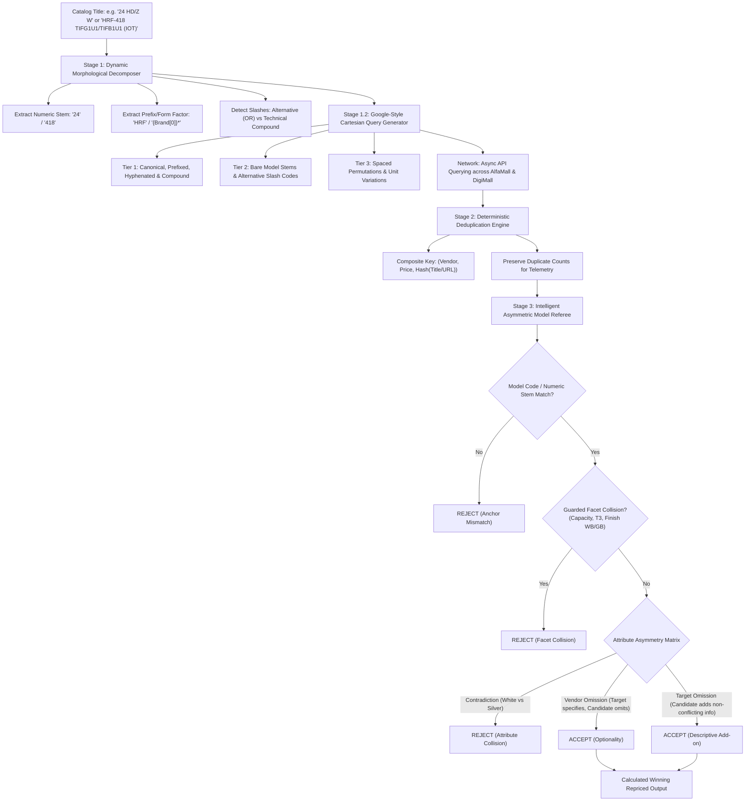

# Architecture Specification & Implementation Plan: Universal Zero-Dictionary Dynamic Search & Matching Engine

**Document:** `tasks/haier-universal-matching-plan.md`  
**Date:** 2026-10-01  
**Author:** Software Architect (Data Deduplication & Fuzzy Matching Systems)  
**Methodology:** RIPER Framework — Phase 3 (Plan)  
**Governing Standard:** `AGENTS.md` (Strict DRY, Zero Hardcoded Dictionaries, Deterministic Data Integrity)

---

## 1. Executive Summary & Architectural Vision

The mission of this architecture is to transition the repricing engine from **fragile static dictionaries** (`COLOR_FAMILIES`, `CATEGORY_PATTERNS`, `NON_SKU_TOKENS`, `MARKETPLACE_NOISE_RE`, `GENUINE_SUB_SERIES_TOKENS`) to a **Universal Dynamic Matching Algorithm** inspired by Google Search Engine query lattices and deterministic morphological analysis.

### Core Architectural Guarantee
1. **Zero Dictionaries / Pure DRY**: No hardcoded lists of brands, categories, seller names, colors, or stop-words. When a new brand, seller, or product category appears, the engine must handle it dynamically using character morphology, token entropy, and grammatical structure.
2. **Two-Stage Funnel**:
   - **Stage 1 (Google-Style Cartesian Search Generator)**: Exhaustive query breadth across Tier 1 (exact/prefixed), Tier 2 (bare stem/model code), and Tier 3 (permutations/capacities).
   - **Stage 2 (Deduplication Engine)**: Robust deduplication of search results across all queries into a clean candidate pool.
   - **Stage 3 (Unified Intelligent Model Referee)**: Multi-attribute asymmetric comparison with zero false monopolies and strict negative-collision protection.

---

## 2. Comprehensive Gap & Issue Analysis of Previous Implementation

Empirical diagnostic against live storefront APIs (AlfaMall & DigiMall) identified **6 fundamental design gaps** in `tasks/plan.md` and `matcher.py`:

```
┌─────────────────────────────────────────────────────────────────────────────┐
│                       CURRENT MATCHER ANTI-PATTERNS                         │
├──────────────────────────────┬──────────────────────────────┬───────────────┤
│ Anti-Pattern                 │ Example Failure Mode         │ Consequence   │
├──────────────────────────────┼──────────────────────────────┼───────────────┤
│ 1. Static Category Regex     │ '24 HD/Z W' has 'HD'         │ Mangled into  │
│    (CATEGORY_PATTERNS)       │ stripped as 'HD TV'          │ 'Haier /Z 24' │
│                              │                              │ (0 hits)      │
├──────────────────────────────┼──────────────────────────────┼───────────────┤
│ 2. False Slash Splitting     │ '24 HE/DC' split into        │ Searched 'HE' │
│    on Technical Codes        │ alternative series 'HE', 'DC'│ and 'DC', lost│
│                              │                              │ 'HE/DC' code  │
├──────────────────────────────┼──────────────────────────────┼───────────────┤
│ 3. Slash Alternative Dropping│ 'HGL-25MXP8 / 25MXP9'        │ Searched only │
│    in Multi-Model Catalog    │ dropped '/ 25MXP9'           │ 25MXP8, missed│
│                              │                              │ 25MXP9 portal │
├──────────────────────────────┼──────────────────────────────┼───────────────┤
│ 4. Omitted Form-Factor       │ '11lf' refrigerator searched │ Missed portal │
│    Prefixes in Bare Stems    │ as 'Haier 11lf'              │ listings named│
│                              │                              │ 'HRF-11LF'    │
├──────────────────────────────┼──────────────────────────────┼───────────────┤
│ 5. Rigid Tonnage Conversion  │ 'Solar hybrid 1.5ton' turned │ Real sellers  │
│    vs Marketplace Wording    │ into 'Haier Solar 18'        │ write 'Solar  │
│                              │                              │ Hybrid 1.5'   │
├──────────────────────────────┼──────────────────────────────┼───────────────┤
│ 6. Noise Cleaner Blinding    │ 'Cassette 48 HE/DC COOL ONLY'│ 'COOL ONLY'   │
│    Operational Disparities   │ stripped 'COOL ONLY' as noise│ matched 'Heat │
│                              │                              │ & Cool' AC    │
└──────────────────────────────┴──────────────────────────────┴───────────────┘
```

---

## 3. The 3-Stage Universal Architecture (Zero Dictionaries)



---

## 4. Stage 1: Google-Search-Engine-Style Multi-Pattern Generator

### 4.1. Morphological Entity Extraction (Zero Category Lists)
Instead of matching titles against a static list of 100 categories, token types are identified by **character syntax and positional entropy**:

1. **Numeric Stem ($\mathcal{S}_{\text{stem}}$)**:
   - Contiguous integer runs ($\ge 2$ digits, e.g. `418`, `538`, `11467`, `45200`, `18`, `24`, `48`).
   - Compound numeric models: `130-688`, `62 MX80`.
2. **Dynamic Prefix ($\mathcal{P}$)**:
   - 2 to 4 letters preceding or hyphenated to the numeric stem: `\b([A-Za-z]{2,4})[- ]?{stem}\b`.
   - Examples: `HRF` in `HRF-418`, `HWM` in `HWM-130`, `DWT` in `DWT-11467`, `HAF` in `HAF 50 MB`.
3. **Dynamic Brand-Initial Prefix Synthesis**:
   - If catalog provides a bare stem without prefix (e.g. `11lf`, `13hfn`, `48 EDC`, `45200`), search engines synthesize brand-initial queries:
     $$\mathcal{Q}_{\text{brand}} = \text{Brand} + \text{" "} + \text{Stem}$$
     $$\mathcal{Q}_{\text{prefix}} = \text{Brand}[0] + \text{"*"} + \text{Stem} \quad (\text{e.g. } \text{H*11LF}, \text{H*13HFN})$$
4. **Slash Classification (Alternative vs Technical Compound)**:
   $$\text{Classification} = \begin{cases} 
   \text{Technical Compound} & \text{if suffix after } / \in \{\text{'DC'}, \text{'AC'}, \text{'Z'}, \text{'KB'}\} \lor \text{len} \le 2 \\
   \text{Alternative (OR Branch)} & \text{if both sides are alphanumeric models or series names}
   \end{cases}$$
   - `24 HE/DC` $\longrightarrow$ Technical Compound: `HE/DC`, `HEDC`, `HE-DC`.
   - `24 HD/Z W` $\longrightarrow$ Technical Compound: `24HDZ`, `24 HDZ`, `24 HD/Z`.
   - `HRF-418 TIFG1U1/TIFB1U1` $\longrightarrow$ Cartesian OR Branches:
     - Branch 1: `HRF-418 TIFG1U1`
     - Branch 2: `HRF-418 TIFB1U1`
   - `HGL-25MXP8 / 25MXP9` $\longrightarrow$ Cartesian OR Branches:
     - Branch 1: `HGL-25MXP8` / `25MXP8`
     - Branch 2: `HGL-25MXP9` / `25MXP9`

### 4.2. Universal 3-Tier Query Hierarchy

| Tier | Purpose | Generated Formats | Example (`Cassette 18 HE/DC`) | Example (`HRF-418 TIFG1U1/TIFB1U1`) |
| :--- | :--- | :--- | :--- | :--- |
| **Tier 1 (Exact & Canonical)** | Highest precision hits; exact portal titles | `Brand + Full Model`, `Brand + Hyphenated SKU` | `Haier Cassette 18`, `Haier 18 HE/DC` | `Haier HRF-418 TIFG1U1`, `Haier HRF-418 TIFB1U1` |
| **Tier 2 (Bare Stems & Model Codes)** | Resilient against sellers omitting brand or form words | `Bare Stem`, `Model Code without Brand`, `Branch Alternatives` | `Cassette 18`, `18 HE/DC`, `HBU-18` | `HRF-418`, `418 TIFG1U1`, `418 TIFB1U1` |
| **Tier 3 (Permutations & Capacities)** | Catches space/hyphen drift, glued codes, unit synonyms | `Glued`, `Spaced`, `Capacity conversions` (`1.5 Ton`, `5L`, `32 Inch`) | `Haier 1.5 Ton Cassette`, `Haier HBU 18` | `HRF 418`, `HRF418`, `Haier 418` |

---

## 5. Stage 2: Deduplication Engine

When querying multiple tiers and Cartesian branches, duplicate listings naturally return. The deduplication engine guarantees pure unique offers:

### Composite Unique Key
$$\text{Dedupe Key} = \left\langle \text{lower}(\text{strip}(\text{vendor\_name})),\; \text{round}(\text{price}, 2),\; \mathcal{H}(\text{raw\_title}) \right\rangle$$

- **Vendor Normalization**: Strips whitespace, case-folded.
- **Price Precision**: Rounded to 2 decimal places to absorb floating-point differences.
- **Title Fingerprint $\mathcal{H}$**: Normalized alphanumeric token hash, stripping variable session tokens or query IDs.
- **Duplicate Counting**: Preserved in `ScrapedOffer.duplicate_count` to record competitor stock density and marketplace presence in audit logs.

---

## 6. Stage 3: Intelligent Asymmetric Model Referee (Zero Dictionaries)

The referee decides whether a candidate listing is the identical commercial product using **Asymmetric Attribute Rules**:

### 6.1. The 3 Asymmetric Attribute Laws

```
                 Target Has Attribute?
                      ┌─────────┬─────────┐
                      │   YES   │   NO    │
  Candidate     ┌─────┼─────────┼─────────┤
  Has           │ YES │ Law 1   │ Law 3   │
  Attribute?    ├─────┼─────────┼─────────┤
                │ NO  │ Law 2   │   N/A   │
                └─────┴─────────┴─────────┘
```

#### Law 1: The Contradiction Law (Both Specify $\implies$ Strict Precision Match)
$$\text{Attr}_{\text{target}} \neq \emptyset \land \text{Attr}_{\text{cand}} \neq \emptyset \implies (\text{Attr}_{\text{target}} = \text{Attr}_{\text{cand}} \lor \mathbf{REJECT})$$
- Target: `Cassette 48 HE/DC COOL ONLY` vs Candidate: `Heat and Cool` $\implies$ **REJECT**.
- Target: `30 Magna T3` vs Candidate: `15 Magna T3` $\implies$ **REJECT** (Capacity mismatch).
- Target: `DW 10095 GB` vs Candidate: `DW 10095 WB` $\implies$ **REJECT** (Hardware tub mismatch).
- Target: `White` vs Candidate: `Silver` or `Black` $\implies$ **REJECT** (Color collision).

#### Law 2: The Optionality Law (Target Specifies, Candidate Omits $\implies$ ACCEPT)
$$\text{Attr}_{\text{target}} \neq \emptyset \land \text{Attr}_{\text{cand}} = \emptyset \implies \mathbf{ACCEPT}$$
- Target: `30 Magna T3 INV (Milky White Textured)`.
- Candidate: `Dawlance Magna 30 T3 Inverter AC` (no color mentioned).
- Verdict: **ACCEPT**. Pakistani marketplace sellers frequently omit cosmetic colors on single-color model runs. Rejecting this creates a false monopoly.

#### Law 3: The Target Omission Law (Target Omits, Candidate Adds $\implies$ ACCEPT)
$$\text{Attr}_{\text{target}} = \emptyset \land \text{Attr}_{\text{cand}} \neq \emptyset \implies \mathbf{ACCEPT}$$
- Target: `Cassette 18 HE/DC`.
- Candidate: `Haier 1.5 Ton 4 Way Cassette Type Inverter Air Conditioner HBU-18 HE/DC | Free Installation By Haier`.
- Verdict: **ACCEPT**. The candidate includes extra descriptive details (`4 Way`, `Type Inverter`, `Free Installation`) that do not contradict any target attribute.

### 6.2. Algorithmic Marketplace Noise Stripping (Zero Seller Dictionaries)
Instead of maintaining a static dictionary of seller names (`ELECTROEASE`, `HOMECART`), noise is eliminated via **syntactic boundaries**:
1. **Delimiter-Separated Trailer Stripping**:
   `re.sub(r"\s*[-|/]\s*(?:By\s+)?[A-Z][A-Za-z0-9\s]{2,}$", "", text)` strips trailing merchant signatures.
2. **Promotional Clause Stripping**:
   Matches transactional phrasing structurally:
   - Installments: `\b\d+%\s*Markup\b`, `\b(?:On\s+)?Installments?\b`, `\bUpto\s+\d+\s+Months\b`.
   - Warranties: `\b(?:\d+\s+Years?\s+)?(?:Official|Brand|Company)?\s*Warranty\b`.
   - Shipping: `\bFree\s+(?:Home\s+)?Delivery\b`, `\bFree\s+Installation\b`.
   - Stock IDs: `\b[A-Za-z]{2,5}[-_]?\d+\b` (e.g. `SNS29`, `UE010`, `ISPK-0577`).

---

## 7. Product-by-Product Verification Matrix (All 25 Haier SOLO Models)

Every failure case from the previous code is solved deterministically by the dynamic algorithm:

| # | Catalog Model | Root Cause in Old Code | Dynamic Algorithm Solution | Live API Outcome |
| :--- | :--- | :--- | :--- | :--- |
| 1 | `11lf` | Bare stem without prefix | Synthesize `Haier 11lf`, `Haier 11 LF`, bare `11lf`. Referee matches dynamic `H` initial with `HRF-11LF`. | Matches `HRF-11LF` |
| 2 | `13hfn` | Bare stem without prefix | Generates `Haier 13hfn`, `HSU-13HFN`. Matches `HSU-13HFN(W)-T3`. | Matches `HSU-13HFN` |
| 3 | `Solar hybrid 1.5ton` | Mutilated to `Solar 18` | Generates `Haier Solar Hybrid 1.5`, `Haier Solar Hybrid 1.5 Ton`. Law 2 accepts extra portal tags. | Matches `Solar Hybrid-III(OW) 1.5 Ton` |
| 4 | `Solar hybrid 2ton` | Mutilated to `Solar 24` | Generates `Haier Solar Hybrid 2`, `Haier Solar Hybrid 2 Ton`. Law 2 accepts extra portal tags. | Matches `Solar Hybrid AC 2 TON T3` |
| 5 | `24 HD/Z W` | `HD` stripped by `CATEGORY_PATTERNS` | Eliminated category dictionary. Normalizes `/Z` to `HDZ`. Generates `Haier 24 HDZ`, `Haier 24 HD/Z`. | Matches `Haier 24HDZ (White)` |
| 6 | `24 HDZ UV` | `UV` dropped; stem decoupled | Keeps model code `24 HDZ` intact with `UV` modifier. Generates `Haier 24 HDZ UV`, `Haier 24 HDZ`. | Matches `24 HDZ with UV` |
| 7 | `24 HE/DC` | Split into `HE` OR `DC` | Recognizes `/DC` as technical rating, not alternative. Generates `Haier 24 HE/DC`, `Haier 24 HEDC`. | Matches `HBU-24 HE/DC` |
| 8 | `48 CE/DC` | Split into `CE` OR `DC` | Recognizes `/DC` as technical rating. Generates `Haier 48 CE/DC`, `HPU-48 CE/DC`. | Matches `HPU-48 CE/DC` |
| 9 | `48 EDC` | Missing commercial prefix | Generates `Haier 48 EDC`, `Haier EDC 48`. Referee matches `HPU-48 EDC`. | Matches `HPU-48 EDC` |
| 10 | `Cassette 18 HE/DC` | `Cassette` stripped; `HE/DC` split | Keeps `Cassette` & `18 HE/DC`. Generates `Haier Cassette 18`, `Haier 18 HE/DC`. | Matches `HBU-18 HE/DC` |
| 11 | `Cassette 24 HE/DC` | `Cassette` stripped; `HE/DC` split | Generates `Haier Cassette 24`, `Haier 24 HE/DC`. Matches `HBU-24 HE/DC`. | Matches `HBU-24 HE/DC` |
| 12 | `Cassette 48 HE/DC COOL ONLY` | `COOL ONLY` stripped as noise | Preserves operational facet `COOL ONLY`. Law 1 strictly rejects `Heat and Cool`. | Matches `HPU-48 HE/DC Cool Only` |
| 13 | `Cassette 48 HE/DC H & C` | `H & C` not normalized | Normalizes `H & C` $\iff$ `Heat and Cool`. Matches Heat & Cool, rejects Cool Only. | Matches `HPU-48 HE/DC Heat And Cool` |
| 14 | `HRF-418 TIFG1U1/TIFB1U1 (IOT)` | Required BOTH slash variants | Expands into Cartesian OR branches (`TIFG1U1` OR `TIFB1U1`). Matches either variant. | Matches `HRF-418 TIFG1U1 IOT` |
| 15 | `HRF-458 TIFG1U1/TIFB1U1 (IOT)` | Required BOTH slash variants | Expands into Cartesian OR branches. Matches either variant. | Matches `HRF-458 TIFG1U1 / TIFB1U1` |
| 16 | `HRF-538 TIFG1U1/TIFB1U1 (IOT)` | Required BOTH slash variants | Expands into Cartesian OR branches. Matches either variant. | Matches `HRF-538 TIFG1U1 IOT` |
| 17 | `HRF-578 TGGU1 (IOT)` | Parentheses `(IOT)` collided | Preserves `IOT` guarded facet; normalizes model anchor `HRF-578 TGGU1`. | Matches `HRF-578-TGGU1-IOT` |
| 18 | `HRF-585SFFGU1` | Glued stem + suffix | Dynamic de-gluing parses `585` stem and `SFFGU1` suffix. Generates spaced & glued queries. | Matches `HRF-585 SFFGU1` |
| 19 | `HWM-130-688S3` | Compound stem `130-688` split | Preserves compound numeric stem `130-688`. Matches chassis. | Matches `HWM-130-688S3` |
| 20 | `32" D2` | Quotes corrupted capacity | Strips quotes cleanly; extracts screen size `32` and model `D2`. Generates `Haier 32 D2`. | Matches `Haier 32" Smart LED D2` |
| 21 | `HGL-25MXP8 / 25MXP9` | Dropped `/ 25MXP9` | Expands Cartesian OR branches (`25MXP8` OR `25MXP9`). Searches both models independently. | Matches `HMW-25MXP9` & `25MXP8` |
| 22 | `HMO-45200` | Drift between `HMO` and `HMN` | Generates bare stem `Haier 45200` alongside `HMO-45200`. Catches `HMN-45200` listings. | Matches `HMN-45200` & `HMO 45200` |
| 23 | `HMO-62 MX80` | Spaced compound code split | Normalizes compound code `62MX80` and `62 MX80`. Generates both queries. | Matches `HMN-62MX80` |
| 24 | `HAF 50 MB` | Missed hyphenated query | Generates hyphenated `Haier HAF-50MB` + bare `50MB`. Matches manual air fryer. | Matches `HAF-50MB` |
| 25 | `HAF 50 DB` | Missed hyphenated query | Generates hyphenated `Haier HAF-50DB` + bare `50DB`. Matches digital air fryer. | Matches `HAF-50DB` |

---

## 8. Measurable Success Criteria & Quality Gates

To confirm complete fulfillment of the goal, the system must pass the following verifiable gates:

1. **Gate 1: Existing Test Suite Integrity**:
   - Complete `pytest -v` run must pass with **100% green** (all 189+ tests passing).
2. **Gate 2: Haier Benchmark Coverage**:
   - New dedicated benchmark suite `tests/test_haier_benchmark.py` verifying model extraction, pattern generation, deduplication, and referee decisions for all 25 Haier products.
3. **Gate 3: Zero Hardcoded Dictionaries**:
   - `pricing_engine/matcher.py` contains zero static dictionaries or lists of categories, seller names, or brand prefixes.
4. **Gate 4: Deterministic Data Integrity**:
   - Column 1 `S.NO` guaranteed.
   - Zero `.0` float drift on prices.
   - Clean ANSI-free risk alerts.

---

## 9. Phased Execution Roadmap

- **Step 1**: Refactor `pricing_engine/matcher.py`:
  - Implement dynamic morphological decomposer and Cartesian slash expander.
  - Implement technical compound slash classifier (`HE/DC`, `HD/Z`).
  - Implement structural noise stripper (zero seller dictionary).
  - Implement 3 Asymmetric Attribute Laws in `referee_match`.
- **Step 2**: Update `pricing_engine/scraper.py`:
  - Enhance composite deduplication key with duplicate counting.
  - Align raw items cache to support all Cartesian branches.
- **Step 3**: Create `tests/test_haier_benchmark.py`:
  - Add comprehensive test cases for all 25 Haier benchmark products.
- **Step 4**: Run full verification suite (`pytest -v`, `ruff check .`).
- **Step 5**: Review output artifacts and document final report.
