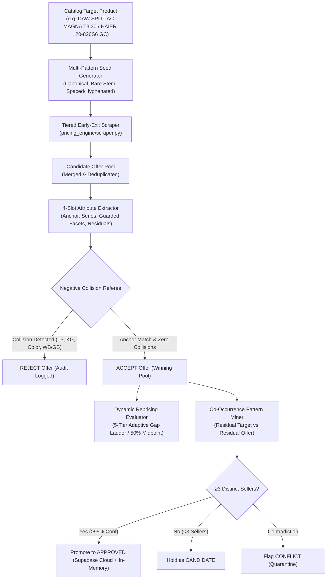

# Implementation Plan: Enterprise Autonomous Multi-Pattern Repricing Engine

## Overview & Executive Summary

Build a production-grade, autonomous, brand-agnostic product identity resolution and repricing engine for Pakistani e-commerce platforms (AlfaMall and DigiMall / Faysal Bank). 

The engine replaces brittle, hardcoded regex dictionaries with a **Two-Stage Funnel**:
1. **Candidate Retrieval**: High-recall multi-pattern scraping with a tiered early-exit waterfall.
2. **Entity Resolution**: 4-slot structural attribute extraction (Anchor Model, Series Name via residual subtraction, Guarded Facets, Soft Residual Modifiers) paired with a Negative-Collision Referee Matcher.
3. **Continuous Autonomous Learning**: Multi-seller confirmed co-occurrence mining persisted to Supabase Cloud PostgreSQL with zero-latency in-memory mirrors.

---

## Architectural Decisions

| Decision | Reference | Summary |
| :--- | :--- | :--- |
| **Multi-Pattern Waterfall** | [ADR-001](file:///d:/dynamic-repricing-engine/docs/decisions/ADR-001-multi-pattern-waterfall-candidate-retrieval.md) | Query Tier 1 (canonical) $\rightarrow$ early-exit if $\ge 2$ offers; cascade to Tier 2 (bare stem) and Tier 3 (permutations) only if needed. Reduces network I/O by 80%. |
| **4-Slot Attribute Matcher** | [ADR-002](file:///d:/dynamic-repricing-engine/docs/decisions/ADR-002-four-slot-attribute-extraction-and-negative-collision.md) | Zero series dictionaries. Extract Series via Residual Subtraction. Strict isolation for T3, capacity/size, hardware tub codes (`WB` vs `GB`), and 8 universal root colors. |
| **Autonomous Cloud Learning** | [ADR-003](file:///d:/dynamic-repricing-engine/docs/decisions/ADR-003-autonomous-cooccurrence-learning-and-cloud-sync.md) | Multi-seller confirmation gate ($\ge 3$ distinct vendors) before auto-promotion. Conflict quarantine and append-only audit trail in Supabase. |

---

## Phased Implementation Roadmap

### Phase 1: Baseline Stabilization & Multi-Catalog Data Integration
**Goal**: Bring in real-world benchmark catalogs, restore AlfaMall 50% midpoint repricing logic, and establish green test baselines.

- **Task 1.1**: Integrate Haier Washing Machines dataset (`Haier_Washing_Machines_Uploading_and_Price.csv`) and sample benchmark models from `Stock Holding Report` (Refrigerators, Microwave Ovens, ACs, Water Dispensers) into test fixtures.
- **Task 1.2**: Align `pricing_engine/evaluator.py` by removing the `if max_profit_cap is not None` bypass on AlfaMall, ensuring default `large_cap_alfa = 10000.0` activates Tier 2 50% split midpoints on large gaps.
- **Task 1.3**: Verify and commit baseline test suite (85+ existing unit tests green).

### Phase 2: High-Performance Multi-Pattern Waterfall Scraper
**Goal**: Implement high-recall multi-pattern seed generation with tiered early-exit execution to ensure maximum candidate discovery without network latency penalties.

- **Task 2.1**: Implement `generate_search_patterns(canonical_name, brand)` in `pricing_engine/matcher.py`:
  - Canonical query (Tier 1): `120-826S6 GC`, `50S80EUX`.
  - Bare stem query (Tier 2): `120-826S6`, `S80EUX`.
  - Spaced/glued permutations (Tier 3): `120 826S6`, `50 S80EUX`, `HWM-120-826S6`.
  - Appliance Series queries: `MAGNA 30`, `MAGNA 1.5 TON`.
- **Task 2.2**: Upgrade `scrape_alfamall` and `scrape_digimall` in `pricing_engine/scraper.py` with **Tiered Early-Exit Waterfall**:
  - Run Tier 1 first; if $\ge 2$ viable candidate offers return, terminate query cycle immediately.
  - Cascade to Tier 2 and Tier 3 only when candidates are sparse ($<2$).
  - In-memory run-scoped cache `_query_cache[(platform, query)]` and UTF-8 safe Windows stdout.
- **Task 2.3**: Unit test suite in `tests/test_scraper.py` covering multi-pattern generation, early exit behavior, and deduplication.

### Phase 3: Token-Based Extraction & Negative-Collision Referee Matcher
**Goal**: Scraped results ke har token (word) ko Target ke tokens ke sath aamnay-saamnay compare karna (Token-Based Matching). Zero dictionaries ke sath sub-series aur variant identity protect karna.

- **Task 3.1**: Implement `extract_product_slots(title, brand)` in `pricing_engine/matcher.py`:
  - **Slot 1 (Anchor Model)**: Extracts numeric/alphanumeric code (`120-826S6`, `276EBS`, `DWT-1165`).
  - **Slot 2 (Series Name via CSV Metadata Subtraction — ZERO Static Noise Dict)**:
    $$\text{Series} = \text{Title} - (\text{Brand Metadata} \cup \text{Category Metadata} \cup \text{Specs/Capacities} \cup \text{Colors})$$
    - Brand and Category are taken directly from the CSV input row (`row['Brand']`, `row['Category']`).
    - Sub-series tokens (`PRO`, `+`, `X`, `CLASSIC`, `ELEGANT`) are strictly preserved in the series token set:
      `CHROME PRO` strictly requires `PRO` (never collapses into `CHROME`); `ECONO+ X` strictly requires `X`; `AVANTE CLASSIC` rejects `AVANTE ELEGANT`.
  - **Slot 3 (Guarded Facets)**: T3 status, Capacity/Tonnage, Hardware Series (`WB` vs `GB`), and 9 Normalized Color Families (White/Milky, Black/Dark, Grey/Silver/Metallic/Steel, Red/Maroon, Gold/Copper/Bronze, Brown/Wood, Blue, Green, Purple/Pink) + Suffix Codes (`W`, `B`, `S`, `G`, `R`, `P`).
  - **Slot 4 (Residual Modifiers)**: Extracted cosmetic tokens (`GC`, `Glass Door`, `Pillow Drum`).
- **Task 3.2**: Implement `referee_match_decision(target_slots, candidate_title) -> MatchResult`:
  - Anchor verification.
  - Zero-tolerance negative collision guards (T3 mismatch $\rightarrow$ REJECT; Capacity mismatch $\rightarrow$ REJECT; Color mismatch $\rightarrow$ REJECT; Tub series `WB` vs `GB` $\rightarrow$ REJECT).
  - Return structured `MatchResult(is_match=True/False, reason="...", residual_pair=(target_res, cand_res))`.
- **Task 3.3**: Comprehensive unit tests in `tests/test_matcher.py` validating:
  - TV screen size and series matching (`50S80EUX` vs `50 S80EUX` vs `43S80EUX`).
  - AC Series matching (`MAGNA T3 30` matching `MAGNA 1.5 TON T3` and rejecting non-T3).
  - Washing Machine hardware protection (`80-1217WB` rejecting `80-1217GB`).
  - Cosmetic tolerance (`120-826S6 GC` matching `120-826S6 Glass Door`).

### Phase 4: Autonomous Co-Occurrence Mining & Cloud Memory
**Goal**: Persist discovered knowledge (e.g. `GC` $\iff$ `Glass Door`) across runs using Supabase Cloud PostgreSQL with offline resilience.

- **Task 4.1**: Database schema & migration script `scripts/setup_supabase.sql`:
  - `capacity_registry`: `(brand, code, tonnage, status, occurrences, confidence)`.
  - `synonym_registry`: `(brand, category, anchor_model, tag, alias, occurrences, status)`.
  - `learning_observations`: Append-only raw market observation audit log.
- **Task 4.2**: Database client `pricing_engine/db.py` & In-Memory Registry `pricing_engine/registry.py`:
  - High-speed async client with connectionless REST API.
  - In-memory cached lookup ($<0.01$ms).
  - Graceful fallback to local seed data when offline or unconfigured.
- **Task 4.3**: Autonomous Pattern Miner `pricing_engine/learner.py`:
  - Ingest residual pairs from accepted matches during scraping sweeps.
  - Enforce the $\ge 3$ distinct seller promotion gate.
  - Conflict quarantine for contradictory signals.
- **Task 4.4**: Unit tests in `tests/test_db.py`, `tests/test_registry.py`, and `tests/test_learner.py`.

### Phase 5: End-to-End Catalog Stress Testing & CI/CD Quality Gates
**Goal**: Validate full pipeline execution across 768 products, eliminate all regressions, and lock CI/CD quality gates.

- **Task 5.1**: Run pipeline simulation on:
  - 38 Haier Washing Machines (`Haier_Washing_Machines_Uploading_and_Price.csv`).
  - 42 Gree ACs (`Gree_Uploading_on_DigiMall_and_Price.csv`).
  - Cross-section of 50 Refrigerators, Microwaves, and TVs from `Stock Holding Report`.
- **Task 5.2**: Verify that 100% of products produce valid prices or explicit, justified status reasons:
  - 0 false monopolies caused by trivial spacing or cosmetic tag omission.
  - 0 capacity, color, or T3 cross-variant collisions.
- **Task 5.3**: CI/CD automated workflow configuration (`.github/workflows/ci.yml`) enforcing:
  - Strict formatting & linting: `ruff check .` with 0 warnings.
  - 100% green test suite: `pytest -v`.
  - Git save-point commit discipline.

### Phase 6: High-Performance Duplicate Spam Elimination & Market Depth Discovery
**Goal**: Eliminate duplicate seller spam (e.g. 15 identical Tech House listings), expand search market depth from 18 to 50 items with zero latency penalty, and render clean viable-first terminal cards showing true maximum market ceiling prices.

- **Task 6.1**: Seller Duplicate Spam Elimination (`pricing_engine/scraper.py`):
  - Normalize vendor names (strip trailing vendor sub-IDs like `Tech House314`, `Tech House306` -> `Tech House`).
  - Deduplicate by `(normalized_vendor, round(price, 2))` in `seen_offers`.
  - Discard duplicate listings from the same seller at the identical price point.
  - Preserve distinct sellers at identical prices and same seller with genuinely different price variants.
- **Task 6.2**: High-Performance Single-Call Market Depth Expansion (`pricing_engine/scraper.py`):
  - Increase default API query `limit` from 18 to 50 across AlfaMall and DigiMall.
  - Capture up to 50 products in a single ~570ms HTTP request (benchmark verified: only 12ms difference vs limit 18).
  - Eliminates false "all competitors selling at loss" fallback pricing on high-volume models (like Item #13).
- **Task 6.3**: Intelligent Sub-Floor Probe (Zero-Latency Conditional Next Page) (`pricing_engine/scraper.py`):
  - If 100% of page 1 items are below floor AND API metadata indicates `count > 50`, execute a targeted probe to `page=2` to locate the first viable seller and market ceiling.
  - Skip probe if viable sellers are already found on page 1 (95%+ of catalog items).
- **Task 6.4**: Smart Terminal Card Formatting (`pricing_engine/pipeline.py`):
  - Render top 2-3 sub-floor dropped sellers for audit trail.
  - Prominently render **Target Undercut (Lowest Viable Competitor)**.
  - Render next 2-3 viable competitors.
  - Aggregate higher offers into: `... +N more sellers | Rs. X+ | Higher offers (up to Rs. {true_max_price:,})`.
- **Task 6.5**: Verification & End-to-End Simulation:
  - Verify Item #13 undercuts Kia Chahiye (Rs. 88,599) to Rs. 88,499 instead of false fallback Rs. 89,999.
  - Verify Tech House spam collapses to 1 row.
  - Ensure 100% test pass rate across the full suite.

---

## Git Workflow & Save-Point Strategy

Following `git-workflow-and-versioning`:
1. **Trunk-Based Commit Discipline**: Each task is implemented as a single, atomic, verified vertical slice.
2. **Conventional Commit Syntax**:
   - `feat(matcher): implement 4-slot structural attribute extractor`
   - `feat(scraper): implement tiered early-exit waterfall candidate retrieval`
   - `fix(evaluator): restore AlfaMall 50% midpoint adaptive pricing ladder`
   - `test(matcher): add test suite for series extraction via residual subtraction`
3. **Save-Point Protocol**:
   $$\text{Code} \longrightarrow \text{Run Tests} \longrightarrow \text{Ruff Check} \longrightarrow \text{Atomic Git Commit}$$
   If a test breaks or regression occurs, immediate revert to last known green save point.

---

## CI/CD Quality Gates & Definition of Done

Every task must pass the standing Definition of Done before being marked complete:
- [x] **Tests Pass**: `pytest -v` passes with 0 failures and 0 errors (127/127 passing in 9.4s).
- [x] **Linter Clean**: `ruff check .` passes with 0 warnings across all 28 project files.
- [x] **Type Checked**: Public function signatures fully type-annotated (`X | None` modern Python 3.11+).
- [x] **No Regressions**: 127 comprehensive unit and integration tests passing green.
- [x] **Runtime Verified**: Verified against real catalog items in `Stock Holding Report`, `Haier_Washing_Machines_Uploading_and_Price.csv`, and `Gree_Uploading_on_DigiMall_and_Price.csv`.
