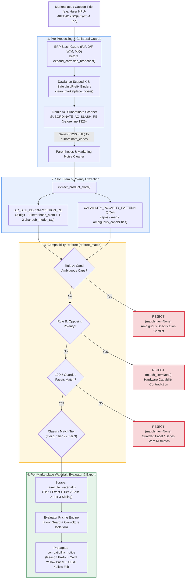
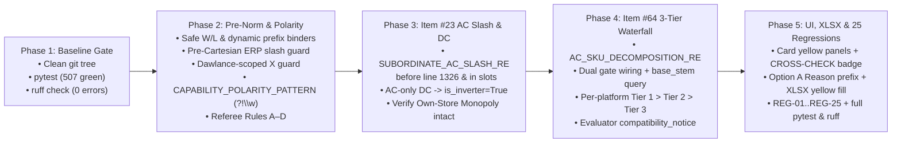

# Master Specification & Implementation Plan: Generic Model Variants, Optional Specifications & Matching Accuracy

> [!IMPORTANT]
> **ARCHITECTURAL SPECIFICATION IMPLEMENTED & VERIFIED (100% COMPLETE).**
> Implemented incrementally across Slices A–H with fresh-context adversarial review (`doubt-driven-development`), 50 focused regression/adversarial tests (`REG-01`–`REG-25` + `test_adv_01`–`test_adv_06`), `557 passed, 0 failed` in full `pytest -v`, `0` Ruff errors, and `0` Mypy strict errors.

---

## 1. Executive Summary & Core Architectural Principles

This formalized specification delivers a unified, generic, `AGENTS.md`-compliant (Rule 1.6 Zero Static Lists & Rule 1.7 First-Principles Universality) architecture resolving catalog variant normalization, AC subordinate slash codes, 3-tier AC sub-edition fallback, and generic capability polarity/ambiguity refereeing:

1. **Item #23 (`Haier HPU-48HE`) Subordinate Code & AC-Only DC Inverter Parsing**:
   - **Catalog Target**: `Haier 4 Ton Inverter Floor Standing AC` (Model: `HPU-48HE`, Net: Rs. 490,000, Ship: Rs. 3,500, Landed Cost Base: Rs. 493,500).
   - **Marketplace Listing**: `Haier HPU-48HE/012DC(GE)-T3 4 Ton Heat & Cool Cabinet Air Conditioner` (Seller: `Kia Chahiye Pvt Ltd`, Price: Rs. 580,000).
   - **Own-Store Protection Scope**: **OUT OF SCOPE / UNTOUCHED**. Own-store protection (`pricing_engine/models.py:NON_COMPETITOR_VENDORS`, `scraper.py`, `evaluator.py`) is already fully implemented, tested, and active in production. **No own-store logic will be touched or modified.**
   - **Core Technical Scope for Item #23**:
     - **Strictly AC-Anchored Subordinate Parsing**: Capture `/012DC(GE)` atomically via `SUBORDINATE_AC_SLASH_RE` in both `extract_search_query_and_model()` (before line 1326 unwraps parentheses) and `extract_product_slots()`, storing `012DC(GE)` in `ProductSlots.subordinate_codes` so `(GE)` never becomes an orphaned `GE` capability token and non-AC color slashes (`DMB-91060/WB`) remain untouched.
     - **Approved DC Inverter Recognition (AC Only)**: Strictly gated on `_detect_appliance_family() == 'AIR_CONDITIONER'`, technical suffixes `/DC`, `/012DC`, `/023DC`, and `-DC` set `guarded_facets.is_inverter = True`. Non-AC categories (e.g., Direct Cool `DC` refrigerators) remain 100% isolated.
     - **Downstream Handling**: Once cleanly matched, `Kia Chahiye Pvt Ltd` is routed by existing production code to `own_offers`, triggering **Monopoly Pricing** (`Rs. 552,999`, `+Rs. 4,000` target margin) with `[OWN STORE ACTIVE: Kia Chahiye Pvt Ltd @ Rs. 580,000]`.

2. **Item #64 (`Haier 18HFPCA`) 3-Tier Fallback Hierarchy & AC SKU Decomposition**:
   - **Catalog Target**: `Haier 18HFPCA` (1.5 Ton Pearl Inverter AC).
   - **2-Digit Capacity + 3-Letter Core AC Series Stem Decomposition**:
     - Anchored via `AC_SKU_DECOMPOSITION_RE = re.compile(r"\b(?:[A-Za-z]{2,4}[-_])?(\d{2}[A-Za-z]{3})([A-Za-z]{1,2})?\b")` in AC context (`HFP` Pearl, `HFA` Marvel, `HFE` Thunder, `HFM` Clean Cool):
       - `18HFPCA` $\rightarrow$ `base_stem = "18HFP"`, `sub_model_tag = "CA"`
       - `18HFPE` $\rightarrow$ `base_stem = "18HFP"`, `sub_model_tag = "E"`
       - `18HFP` $\rightarrow$ `base_stem = "18HFP"`, `sub_model_tag = ""`
       - `18HFA` $\rightarrow$ `base_stem = "18HFA"`, `sub_model_tag = ""` (Strictly isolated from `18HFP`; never bridges distinct 3-letter series stems).
   - **Per-Marketplace 3-Tier Priority Waterfall & Yellow Notices**:
     - **Tier 1 (Exact Match, `match_tier = 1`)**: Exact `18HFPCA` in stock $\rightarrow$ Undercut and win with **ZERO WARNING** (unless optional extra spec Rule C applies).
     - **Tier 2 (Base Model Fallback, `match_tier = 2`)**: Zero viable Tier 1 offers $\rightarrow$ Reprice against base model `18HFP` / `HSU-18HFP` with Yellow Notice: `⚠️ [FALLBACK MODEL: Target specified '18HFPCA', but market listing is base model 'HSU-18HFP']`.
     - **Tier 3 (Sibling Sub-Model Fallback, `match_tier = 3`)**: Zero viable Tier 1 and Tier 2 offers $\rightarrow$ Reprice against compatible sibling `18HFPE` / `HSU-18HFPE` sharing `base_stem == "18HFP"` with Yellow Notice: `⚠️ [SIBLING SUB-MODEL FALLBACK: Target specified '18HFPCA', but market listing is sibling edition 'HSU-18HFPE' sharing base '18HFP']`.
   - **Strict Guardrail**: Evaluated independently per marketplace (AlfaMall vs. DigiMall). Guarded facets (Tonnage, Inverter, Operating Mode, Mounting, Color, Refrigerant, Capabilities) remain 100% invariant across all 3 tiers.

3. **Generic Capability Polarity, Ambiguity & Omission Engine**:
   - **Boundary-Safe Generic Polarity Scanner**: Uses `CAPABILITY_POLARITY_PATTERN` with trailing `(?!\w)` instead of `\b` so non-word `+` in `ADS+` is preserved intact alongside `T3`, `T4`, `UV`, `WIFI`, `IOT`, and `SMART`.
   - **Three-Set State on `GuardedFacets`**: `capabilities` (positive), `negative_capabilities` (explicitly negated via `NON|NO|WITHOUT|NOT`), and `ambiguous_capabilities` (`raw_pos & raw_neg`).
   - **4-Rule Referee Matrix**:
     - **Rule A (Internal Candidate Ambiguity)**: Non-empty `cand.ambiguous_capabilities` $\rightarrow$ **100% REJECT** (`match_tier = None`).
     - **Rule B (Explicit Polarity Contradiction)**: `(target.capabilities & cand.negative_capabilities)` or `(target.negative_capabilities & cand.capabilities)` $\rightarrow$ **100% REJECT** (`match_tier = None`).
     - **Rule C (Candidate Extra Spec)**: Target omits `T3` (not negated), Candidate specifies `+T3` $\rightarrow$ **Match (Tier 1)** + Yellow Notice: `ℹ️ [OPTIONAL SPECIFICATION: Target did not specify 'T3', but market listing specifies 'T3']`.
     - **Rule D (Target Spec Omitted by Candidate)**: `target.capabilities - cand.capabilities` non-empty (e.g., Target specifies `T3`, Candidate omits `T3` without negating it) $\rightarrow$ **Blocked from Tier 1; Demoted to Tier 2 Fallback** + Yellow Notice: `⚠️ [FALLBACK MODEL: Target specified 'T3', but market listing omitted 'T3']`.

4. **Collateral-Safe Multi-Category Pre-Normalization**:
   - **Spaced Unit Binder**: Multi-letter units (`WATTS?`, `KGS?`, `RPM`, `LTRS?`) bind unconditionally; single-letter `W` / `L` never bind after hyphens/slashes (`150-826 W`), dynamic SKU prefixes (`DWT 255 W`), or primary numeric model stems (`91999 W`).
   - **Dawlance-Scoped Isolated `\bX\b` Neutralization**: Neutralizes ERP/marketing `X` across all Dawlance categories while protecting numeric dimensions (`24 X 24`) and non-Dawlance series (`TCL 55" X Series QLED TV`).
   - **Pre-Cartesian ERP Category Slash Protection**: Safeguards and neutralizes `R/F`, `D/F`, `W/M`, `W/D`, `M/O`, `AWM`, `SDA` *before* `expand_cartesian_branches()` and `normalize_color()`.
   - **Dynamic Spaced Prefix Binding (`AGENTS.md` Rule 1.6)**: Dynamically binds spaced SKU prefixes (`PINV 12K` $\rightarrow$ `PINV-12K`) without static prefix lists and refines `is_dimension_or_spec_token()` so BTU stems (`12K`, `18K`, `24K`) attached to SKU prefixes are never rejected as TV resolutions (`2K`/`4K`/`8K`).

---

## 2. Shared DRY Architecture & Canonical Ownership Table

To maintain strict DRY compliance across matcher, scraper, evaluator, terminal, CSV, and Excel exports, each concern has a single canonical owner:

| Architecture Domain | Canonical Component / File | Specific Function or Data Structure | Canonical Responsibility |
| :--- | :--- | :--- | :--- |
| **1. Collateral-Safe Pre-Normalization & Noise Cleaning** | `pricing_engine/matcher.py` | `SAFEGUARD_PATTERN`<br>`normalize_technical_slashes()`<br>`clean_marketplace_noise()`<br>`is_dimension_or_spec_token()` | Neutralizes ERP category slashes (`R/F`, `D/F`, `W/M`, `W/D`, `M/O`, `AWM`, `SDA`) prior to Cartesian branch splitting, neutralizes Dawlance-scoped isolated `\bX\b` (preserving `24 X 24` & non-Dawlance `TCL X Series`), binds standalone measurement units without corrupting trailing `W` color suffixes (`DWT 255 W`, `150-826 W`, `91999 W`), and dynamically binds spaced SKU prefixes (`PINV 12K` $\rightarrow$ `PINV-12K`). |
| **2. AC-Anchored Subordinate Variant Extraction** | `pricing_engine/matcher.py` | `SUBORDINATE_AC_SLASH_RE`<br>`extract_search_query_and_model()`<br>`extract_product_slots()`<br>`ProductSlots.subordinate_codes` | Strictly AC-anchored atomic extraction of slash/chassis revision codes (e.g. `/012DC(GE)`, `/023DC`) before parenthesis unwrapping at line 1326, preventing orphaned `GE` tokens while leaving refrigerator/washer color slashes (`DMB-91060/WB`) untouched. |
| **3. AC SKU Series Stem Decomposition** | `pricing_engine/matcher.py` | `AC_SKU_DECOMPOSITION_RE`<br>`ProductSlots.{base_stem, sub_model_tag}`<br>`_evaluate_anchor_compatibility()`<br>`_has_variant_tag_collision()`<br>`generate_search_patterns()` | Anchors AC SKU decomposition to **2-digit capacity + 3-letter core series stem** + optional 1–2 letter sub-tag (`18HFPCA` $\rightarrow$ base `18HFP`, tag `CA`; `18HFPE` $\rightarrow$ base `18HFP`, tag `E`; `18HFP` $\rightarrow$ base `18HFP`, tag `""`; `18HFA` $\rightarrow$ base `18HFA`, tag `""`). Emits fallback `{BRAND} {base_stem}` search queries and wires both anchor gates for Tier 2/3 resolution. |
| **4. Capability Polarity & Ambiguity Engine** | `pricing_engine/matcher.py` | `CAPABILITY_POLARITY_PATTERN`<br>`extract_product_slots()`<br>`GuardedFacets.{capabilities, negative_capabilities, ambiguous_capabilities}` | Scans titles with `(?!\w)` boundary protection (preserving `ADS+`), separates positive and negated (`NON|NO|WITHOUT|NOT`) capabilities, and quarantines internal contradictions (`raw_pos & raw_neg`) into `ambiguous_capabilities`. |
| **5. Compatibility Referee & 3-Tier Verdict** | `pricing_engine/matcher.py` | `referee_match()`<br>`MatchDecision.{match_tier, compatibility_notice}` | Single source of truth enforcing Polarity Rules A–D, Guarded Facet Invariance, and classifying matches into `match_tier = 1` (Exact), `match_tier = 2` (Base / Omitted Capability Fallback), `match_tier = 3` (Sibling Sub-Model Fallback), or `None` (Rejected). |
| **6. Per-Marketplace 3-Tier Waterfall Pool** | `pricing_engine/models.py`<br>`pricing_engine/scraper.py` | `ScrapedOffer.{match_tier, compatibility_notice}`<br>`ScrapeResult.{sibling_offers, compatibility_notice}`<br>`_parse_offers_with_diagnostics()`<br>`_execute_waterfall()` | Partitions in-stock external offers per platform into Tier 1 (`exact_offers`), Tier 2 (`base_offers`), and Tier 3 (`sibling_offers`); selects strictly `Tier 1 > Tier 2 > Tier 3` independently on AlfaMall and DigiMall. |
| **7. Pricing Decision & Notice Synthesis** | `pricing_engine/evaluator.py` | `evaluate_alfa_pricing()`<br>`evaluate_digi_pricing()`<br>`_annotate_fallback_reason()` | Evaluates winning price against hard mathematical floors, populates `PlatformPricingResult.compatibility_notice` for all notice types (removing the narrow `"Extended Edition ("` gate), and prepends notices to `alfa_reason` / `digi_reason`. |
| **8. Terminal Live Card & Summary Badges** | `pricing_engine/pipeline.py` | `InOrderCardDispatcher`<br>`render_audit_card()`<br>`_format_summary_price()` | Renders yellow Rich `Panel` alerts on live product cards and triggers `[bold yellow]CROSS-CHECK[/]` summary table badges for `"fallback model"`, `"sibling sub-model fallback"`, `"optional specification"`, and `"cross-check notice"`. |
| **9. CSV & XLSX Report Generation** | `pricing_engine/exporter.py` | `export_results()`<br>`export_excel_workbook()` | Preserves exact existing CSV/XLSX column schema via prepended `Alfa Reason` / `Digi Reason` notices (**Option A**) and applies soft yellow `PatternFill` highlighting in `export_excel_workbook()` to cells/rows containing compatibility or fallback notices. |

---

## 3. Data Flow & Subordinate Variant Architecture



### Detailed Subordinate & AC Inverter Mechanics:
1. **Strictly AC-Anchored `SUBORDINATE_AC_SLASH_RE`**:
   ```python
   SUBORDINATE_AC_SLASH_RE = re.compile(
       r"\b([A-Za-z]{2,4}[-_]\d{2}[A-Za-z]{1,5}|\d{2}[A-Za-z]{2,5})"
       r"\s*/\s*"
       r"((?:\d{2,3}[A-Za-z]{1,4}|DC|AC)(?:\([A-Za-z0-9_-]{1,6}\))?)(?![A-Za-z0-9])",
       re.IGNORECASE,
   )
   ```
   - Matches AC chassis/outdoor revision codes such as `HPU-48HE/012DC(GE)-T3`, `HSU-18HFP/023DC`, and `18HE/DC`.
   - **Refrigerator/Washer Isolation**: Because group 1 requires a 2-digit BTU AC stem (`48HE`, `18HFP`) and group 2 requires a numeric-alpha revision (`012DC`, `023DC`) or `DC`/`AC` power tag, refrigerator and washer color slashes like `DMB-91060/WB` (`91060` = 5 digits, `/WB` = Wood Brown color) never match and pass straight through to color extraction intact.
2. **Metadata Isolation Before Line 1326**:
   - `ProductSlots` gains `subordinate_codes: list[str] = field(default_factory=list)`.
   - In both `extract_search_query_and_model()` (before `re.sub(r"\(([A-Za-z0-9_-]+)\)", ...)` at line 1326) and `extract_product_slots()`, `SUBORDINATE_AC_SLASH_RE` replaces `HPU-48HE/012DC(GE)` with `HPU-48HE` and records `"012DC(GE)"` in `subordinate_codes`.
   - `(GE)` is never unwrapped into an independent token `GE` and never triggers false `Hardware capability mismatch (GE mismatch)`.
3. **AC-Only `DC` Inverter Inference**:
   - In `extract_product_slots()`, strictly when `_detect_appliance_family() == 'AIR_CONDITIONER'` (and no explicit `Non-Inverter` / `Fixed Speed` negation is present):
     - Any subordinate code or delimited AC suffix matching `r"(?:^|/|-|\b)(?:\d{0,3})?DC(?:\(|$|\b)"` sets `guarded_facets.is_inverter = True`.
     - Non-AC categories (e.g. Direct Cool `DC` refrigerators) never enter this branch.

---

## 4. Item #23 Mathematical & Pricing Reconciliation (Own-Store vs. Hypothetical Competitor)

### Baseline & Cost Specifications (`Haier HPU-48HE` 4 Ton Cabinet AC):
- **Net Purchase Price**: Rs. 490,000
- **Courier Shipping Estimate (4 Ton Cabinet AC Fallback)**: Rs. 3,500 (`config.py`)
- **Landed Cost Base**: $\text{Rs. } 490,000 + 3,500 = \text{Rs. } 493,500$
- **AlfaMall Commission**: 10% ($\text{payout rate} = 0.90$)
- **Company Minimum Net Profit Guarantee**: Rs. 500

### Mode Comparison: Option [1] Standard vs. Option [3] 5% Personal Commission (`calculator.py`)
1. **Option [1] Standard Mode (`personal_comm_pct = 0.0`)**:
   - Company receives 100% of net profit.
   - Raw Floor: $\frac{493,500 + 500}{0.90} = \frac{494,000}{0.90} = 548,888.89 \longrightarrow \lceil 548,888.89 \rceil = \mathbf{\text{Rs. } 548,889}$.

2. **Option [3] 5% Personal Commission Mode (`personal_comm_pct = 5.0`)**:
   - Company is guaranteed at least **Rs. 500** as its 95% share of Real Net Profit; user earns **5% personal commission** on Real Net Profit.
   - **Effective Gross Profit Floor (`calculate_effective_min_profit`)**:
     $$\text{Effective Min Profit} = \frac{500}{1.0 - 0.05} = \frac{500}{0.95} = 526.315789\dots \text{ PKR} \quad (\text{Personal Comm Share} \approx \text{Rs. } 26.32)$$
   - **Option [3] Hard Integer Floor (`math.ceil(cost_floors.floor_alfa)` in `calculator.py:380` & `evaluator.py:456`)**:
     $$\text{Floor}_{\text{Alfa\_5pct}} = \frac{493,500 + 526.315789}{0.90} = 548,918.13 \longrightarrow \lceil 548,918.13 \rceil = \mathbf{\text{Rs. } 548,919}$$
   - **Verification at `Rs. 548,919` Integer Floor**:
     - Payout ($548,919 \times 0.90$) = Rs. 494,027.10 $\rightarrow$ Real Net Profit = Rs. 527.10
     - User 5% Share = Rs. 26.36 | Company 95% Share = Rs. 500.74 ($\ge \text{Rs. } 500.00$ strictly satisfied).

### Outcome 1: Actual Item #23 Production Outcome (`Kia Chahiye Pvt Ltd` = `OWN_STORE`)
- In live production, the Rs. 580,000 listing on `HPU-48HE/012DC(GE)-T3` belongs to **`Kia Chahiye Pvt Ltd`**, registered in `NON_COMPETITOR_VENDORS` as `"OWN_STORE"`.
- Once Item #23 parses cleanly:
  1. `scraper.py` routes `Kia Chahiye Pvt Ltd` (Rs. 580,000) into `own_offers`, leaving 0 external competitors in `active_offers`.
  2. `evaluator.py` (`lines 431–453`) applies **Monopoly Pricing** (`+Rs. 4,000` target margin):
     $$\text{Raw Target} = \frac{493,500 + 4,000}{0.90} = 552,777.78 \longrightarrow \text{Psychological Monopoly Price} = \mathbf{\text{Rs. } 552,999}$$
  3. **Real Net Profit at Monopoly Price**: $(552,999 \times 0.90) - 493,500 = \mathbf{\text{Rs. } 4,199}$.
  4. **Reason Output**: `[OWN STORE ACTIVE: Kia Chahiye Pvt Ltd @ Rs. 580,000] No competitors found in market. Applied Monopoly pricing (+Rs. 4,000 target margin).` (Never undercuts our own store).

### Outcome 2: Hypothetical External Competitor Example (@ Rs. 580,000)
- If an **external** competitor (not in `NON_COMPETITOR_VENDORS`) lists `HPU-48HE/012DC(GE)-T3` at **Rs. 580,000** under direct psychological undercut (`find_winning_psychological_price` uncapped):
  - **Winning Psychological Undercut Price**: **Rs. 579,899** (`.899` ending, strictly $< \text{Rs. } 580,000$ and Rs. 30,980 above the **Rs. 548,919** floor).
  - **AlfaMall Payout (90%)**: $579,899 \times 0.90 = \text{Rs. } 521,909.10$
  - **Total Real Net Profit**: $521,909.10 - 493,500 = \mathbf{\text{Rs. } 28,409.10}$
    - **User 5% Personal Commission**: $28,409.10 \times 0.05 = \mathbf{\text{Rs. } 1,420.45 \approx \text{Rs. } 1,420}$
    - **Company 95% Profit Share**: $28,409.10 - 1,420.45 = \mathbf{\text{Rs. } 26,988.65 \approx \text{Rs. } 26,989}$
  - *(Note: When `evaluate_alfa_pricing` runs with default `LARGE_GAP_PROFIT_CAP_PKR` sweet-spot capping enabled on gaps $\ge \text{Rs. } 10,000$, `calculate_adaptive_target_price` caps the target price near the ~Rs. 10,000 profit sweet spot to maximize conversion velocity.)*

---

## 5. Collateral-Safe Multi-Category Pre-Normalization Architecture

Following empirical inspection of `Stock Holding Report` (768 items), `selected_100_stress_products.csv` (100 items), and adversarial cross-brand verification, four pre-normalization rules are formalized with strict collateral-damage guards:

### Defect 3A — Spaced Measurement Units vs. Trailing Color Suffix (`W` / `L`)
- **The Collateral Trap**: Blindly joining `\b(\d+)\s+W\b` corrupts models where trailing `W` means **White** (`DWT 255 W`, `HWM 150-826 W`, `Dawlance 91999 W`). Because `826 >= 500` and `91999 >= 500`, a numeric threshold like `>= 500` still corrupts `HWM 150-826 W` and `91999 W`!
- **Strict Structural Rule (Zero Static Prefix Lists — `AGENTS.md` Rule 1.6)**:
  1. **Multi-Letter Unambiguous Units**: `WATTS?`, `KGS?`, `RPM`, `LTRS?`, `LITRES?`, `LITERS?`, `TONS?`, `BTU`, `CFT`, `CUFT`, `VOLTS?`, `AMPS?`, `HZ`, `TAPS?` are never color suffixes and always bind safely (`15 KG` $\rightarrow$ `15KG`, `1270 WATTS` $\rightarrow$ `1270WATTS`).
  2. **Single-Letter `W` or `L` Guard**: `<num> W` or `<num> L` **NEVER** binds if:
     - `<num>` is preceded by a hyphen, underscore, or slash (`(?<![-_/])`, protecting `HWM 150-826 W`), OR
     - `<num>` is preceded by any 2–4 letter dynamic SKU model prefix (`(?<!\b[A-Za-z]{2,4}\s)`, protecting `DWT 255 W`, `DWF 8200 W`, `HWM 150 W`, `HRF 306 W`, `DMB 91060 W`, `WF 825 W` dynamically), OR
     - `<num>` is the primary model stem itself (`Dawlance 91999 W`, i.e., no distinct earlier alphanumeric/prefixed model anchor exists in the title).
  3. **Permitted Binding**: `<num> W` / `<num> L` binds into `<num>W` / `<num>L` **only** when `<num>` is a decimal spec (`1.5 L`) or a standalone spec token appearing *after* an already-established distinct model anchor (e.g., `20 L` and `1270 W` in `"Westpoint WF-825 20 L 1270 W Air Fryer"` where `WF-825` is the anchor).

### Defect 3B — Dawlance-Scoped Isolated `\bX\b` Neutralization
- **User Ruling**: *"ismey x ka koi sense nahi x hoon ya na hoon farq nahi parta"* (In Dawlance appliances, isolated `X` has zero functional meaning).
- **The Collateral Trap**: Stripping `\bX\b` globally would corrupt dimension expressions (`24 X 24`) and legitimate series identifiers on non-Dawlance brands (e.g., **`TCL 55" X Series QLED TV`** vs **`TCL 55" C Series TV`**).
- **Scoped Fix**:
  1. **Dimension Protection**: Never strip `X` between numbers (`(?<!\d\s)\bX\b(?!\s*\d)`), preserving `24 X 24` and `60 X 60`.
  2. **Brand Scope**: Restrict isolated `\bX\b` neutralization to Dawlance context (`brand.upper() in {"DAWLANCE", "DAW"}` or leading title brand token `DAWLANCE`/`DAW`), covering all Dawlance categories (`DWT-1166 X ADS+`, `DWF 8200 X INV`, `WD-1051 X`, `MD-5 X`, `DWCM-5304 X`, `Canvas X`, `Econo+ X`, `Elegance X`, `Enercon X`, `Powercon T3 X`, `Sprinter T3 X`).
  3. **Variant & Sub-Series Guards**: Guard `'X'` in `_extract_stem_single_letter_variant()` (`matcher.py:3881–3901`) and `GENUINE_SUB_SERIES_TOKENS` (`matcher.py:604–618`) so Dawlance items never treat `'X'` as a single-letter hardware variant, while non-Dawlance brands (`TCL X Series`) retain `'X'` in series/anchor comparison and strictly reject `TCL C Series`.

### Defect 3C — ERP Category Slashes Before Cartesian Expansion
- **Root Cause in Live Code**: `SAFEGUARD_PATTERN` (`matcher.py:271–285`) currently omits `R/F` and `M/O`, and `normalize_technical_slashes()` (`matcher.py:862–877`) only expands `W/M`, `A/C`, `H/C`. Consequently, `expand_cartesian_branches()` (`matcher.py:890–1054`) splits `R/F` across `/` and `normalize_color()` (`matcher.py:194`) misclassifies `R` as `Red / Maroon` and `D` (`D/F`) as `Black` before `CATEGORY_PATTERNS` ever runs.
- **Fix**: Register `R/F`, `D/F`, `W/M`, `W/D`, `M/O` in `SAFEGUARD_PATTERN` and neutralize `\b(?:R/F|D/F|W/M|W/D|M/O|AWM|SDA)\b` in pre-normalization / `normalize_technical_slashes()` **prior to** `expand_cartesian_branches()` and `normalize_color()`.

### Defect 3D — Dynamic Spaced SKU Prefixes (`PINV 12K`) & `AGENTS.md` Rule 1.6
- **Root Cause in Live Code**:
  1. Hardcoding `(PINV|DWT|HWM|HRF|WD)\s+(\d+)` would violate `AGENTS.md` Rule 1.6 (Zero Static Prefix Lists) and fail to match `12K` anyway.
  2. In `extract_product_slots()` (`matcher.py:3050–3060`), dynamic `_anchor_from_prefix_match` already extracts `cand_anc = "PINV-12K"` and `num_suf = "12K"`, but line `3058` calls `is_dimension_or_spec_token("12K")`, which hits `re.match(r"^\d{1,2}K$", clean)` at line `1180` (intended for `2K`/`4K`/`8K` TV display resolutions!) and discards the anchor!
- **Universal Dynamic Fix**:
  1. Tighten `is_dimension_or_spec_token()` line `1180` from overly broad `^\d{1,2}K$` to actual display resolutions (`^(?:2|4|8|16)K$`), while keeping standalone unprefixed capacity tokens handled by capacity extraction.
  2. Dynamically bind spaced `<2-4 letter non-prose SKU prefix> <digits+optional K/alphanumeric stem>` (`PINV 12K` $\rightarrow$ `PINV-12K`) via existing `NON_SKU_TOKENS` / brand-initial structural validation in `matcher.py` with **zero hardcoded prefix lists**, ensuring `cand_anc = "PINV-12K"` is preserved in both search query generation and `extract_product_slots()`.

---

## 6. Item #64: AC SKU Decomposition & Per-Marketplace 3-Tier Waterfall

### 1. AC SKU Decomposition Rule (`matcher.py`)
Anchored strictly to **2-digit BTU capacity + 3-letter core series stem + optional 1–2 letter sub-edition tag** in AC context:
```python
AC_SKU_DECOMPOSITION_RE = re.compile(
    r"^(?:[A-Z]{2,4}[-_]?)?(\d{2}[A-Z]{3})([A-Z]{1,2})?$"
)
```
| Normalized SKU / Anchor | `base_stem` (2-Digit + 3-Letter Series) | `sub_model_tag` (1–2 Letter Trim) | Relationship to `18HFPCA` |
| :--- | :--- | :--- | :--- |
| `18HFPCA` / `HSU-18HFPCA` | `18HFP` (1.5T Pearl) | `CA` | **Tier 1 Exact Match** (`CA == CA`) |
| `18HFP` / `HSU-18HFP` | `18HFP` (1.5T Pearl) | `""` | **Tier 2 Base Fallback** (`""` base of `CA`) |
| `18HFPE` / `HSU-18HFPE` | `18HFP` (1.5T Pearl) | `E` | **Tier 3 Sibling Fallback** (`E` sibling of `CA` on `18HFP`) |
| `18HFA` / `HSU-18HFA` | `18HFA` (1.5T Marvel) | `""` | **100% REJECT** (`18HFA != 18HFP` — different 3-letter series) |
| `12HFPCA` / `HSU-12HFPCA` | `12HFP` (1.0T Pearl) | `CA` | **100% REJECT** (`12HFP != 18HFP` — different tonnage) |
| `18HFPAAS` | *No match (`AAS` = 3 chars)* | *N/A* | **100% REJECT** (exceeds 1–2 char sub-edition bound) |

### 2. Dual Gate Wiring in `matcher.py` & Search Query Emission
- **Search Query Fallback (`generate_search_patterns`, line 2288)**: When target anchor decomposes into `base_stem` + non-empty `sub_model_tag` (`18HFPCA` $\rightarrow$ `18HFP` + `CA`), append `{BRAND} {base_stem}` and `{base_stem}` (`HAIER 18HFP`, `18HFP`) into Tier 2 / Tier 3 waterfall search queries so marketplace APIs return `HSU-18HFP` and `HSU-18HFPE` candidates when `18HFPCA` yields 0 listings.
- **Anchor & Variant Collision Gates**:
  - Update `_evaluate_anchor_compatibility()` (`lines 3622–3738`) and `_has_variant_tag_collision()` (`lines 3857–3869`, invoked at `line 4610`) so candidates sharing identical `base_stem` (`18HFP`) in AC context are not hard-rejected at the anchor/collision gate; instead, `referee_match()` validates **100% of Guarded Facets** first and then assigns:
    - `match_tier = 1` (`is_match = True`) when `sub_model_tag` matches (`CA == CA`).
    - `match_tier = 2` (`is_match = False, is_base_match = True`) when one side is the bare `base_stem` (`sub_model_tag == ""`).
    - `match_tier = 3` (`is_match = False, is_base_match = False`) when both sides carry non-empty, differing 1–2 letter `sub_model_tag`s (`CA` vs `E`) on the identical `base_stem` (`18HFP`).
  - *(Test Fixture Note: `tests/test_slice3_scraper_diagnostics.py:183` previously mocked `18HFPCA` vs `HSU-18HFP/023DC` to test rejected-anchor diagnostics; that diagnostic fixture will be updated to cross-series `HSU-18HFA/023DC` so suspicious-rejection diagnostics continue testing genuine AC series mismatches while `18HFPCA` $\rightarrow$ `HSU-18HFP` exercises Tier 2 fallback.)*

### 3. Per-Marketplace Waterfall Resolution (`scraper.py`)
Evaluated **independently on AlfaMall and DigiMall**:
```
Per-Platform Marketplace Scrape Pool (_execute_waterfall):
├── Tier 1 Pool (match_tier == 1, in-stock external offers):
│   └── Action: Reprice against lowest viable Tier 1 competitor.
│   └── Notice: None (or Rule C [OPTIONAL SPECIFICATION: ...] if applicable).
│
├── Tier 2 Pool (match_tier == 2, in-stock external offers):
│   └── Condition: Zero in-stock Tier 1 external offers on THIS platform.
│   └── Action: Reprice against lowest viable Tier 2 competitor.
│   └── Notice: ⚠️ [FALLBACK MODEL: Target specified '18HFPCA', but market listing is base model 'HSU-18HFP']
│
└── Tier 3 Pool (match_tier == 3, in-stock external offers):
    └── Condition: Zero in-stock Tier 1 AND zero in-stock Tier 2 external offers on THIS platform.
    └── Action: Reprice against lowest viable Tier 3 competitor.
    └── Notice: ⚠️ [SIBLING SUB-MODEL FALLBACK: Target specified '18HFPCA', but market listing is sibling edition 'HSU-18HFPE' sharing base '18HFP']
```

---

## 7. Generic Capability Polarity, Ambiguity & Omission Engine Specification

### 1. Boundary-Safe Regular Expression (`(?!\w)` Preserving `ADS+`):
Because `+` is a non-word character (`\W`), a trailing `\b` after `ADS\+?` fails to match `+` before a space (`"DWT-1166 ADS+ Washing"` $\rightarrow$ drops `+`). Replacing trailing `\b` with `(?!\w)` captures `ADS+` completely:
```python
CAPABILITY_POLARITY_PATTERN = re.compile(
    r"\b(?:(NON|NO|WITHOUT|NOT)[-_\s]*)?(T[-_\s]?[34]|UV|ADS\+?|WIFI|WI-FI|IOT|SMART)(?!\w)",
    re.IGNORECASE,
)
```

### 2. Canonical Token Normalization & Ambiguity Quarantine:
```python
def _normalize_capability_token(raw_tok: str) -> str:
    # Strip separators (-, _, whitespace) while preserving trailing '+' for ADS+
    tok = re.sub(r"[-_\s]", "", raw_tok).upper()
    if tok == "WIFI":
        return "WIFI"
    if tok.startswith("ADS"):
        return "ADS+" if tok.endswith("+") else "ADS"
    return tok

raw_pos: set[str] = set()
raw_neg: set[str] = set()

for m in CAPABILITY_POLARITY_PATTERN.finditer(clean_title):
    neg_pfx = m.group(1)
    tok = _normalize_capability_token(m.group(2))
    # Canonical family key so 'ADS' vs 'Non-ADS+' also detects contradiction cleanly
    if neg_pfx:
        raw_neg.add(tok)
    else:
        raw_pos.add(tok)

# Internal Ambiguity Quarantine: never silently pick one polarity
conflicts = raw_pos & raw_neg
guarded_facets.ambiguous_capabilities = set(conflicts)
guarded_facets.capabilities = raw_pos - conflicts
guarded_facets.negative_capabilities = raw_neg - conflicts
```
*(Note: All downstream capability comparisons in `extract_product_slots()` and `referee_match()` use the same canonical helper so `ADS+` is never truncated or mismatched.)*

### 3. Formal 4-Rule Referee Matrix (`referee_match()`):
1. **Rule A — Internal Candidate Ambiguity (`100% REJECT`)**:
   ```python
   if cand_slots.guarded_facets.ambiguous_capabilities:
       conf_str = ", ".join(sorted(cand_slots.guarded_facets.ambiguous_capabilities))
       return MatchDecision(
           is_match=False,
           reason=f"Ambiguous specification conflict ({conf_str}): Candidate title contains internally contradictory claims",
           match_tier=None,
       )
   ```
2. **Rule B — Explicit Polarity Contradiction (`100% REJECT`)**:
   ```python
   contradictions = (
       (target_slots.guarded_facets.capabilities & cand_slots.guarded_facets.negative_capabilities)
       | (target_slots.guarded_facets.negative_capabilities & cand_slots.guarded_facets.capabilities)
   )
   if contradictions:
       contra_str = ", ".join(sorted(contradictions))
       return MatchDecision(
           is_match=False,
           reason=f"Hardware capability contradiction ({contra_str}): Target and candidate specify opposing polarities",
           match_tier=None,
       )
   ```
3. **Rule C — Candidate Extra Spec (Target Omitted, Candidate Specified $\rightarrow$ Tier 1 + Yellow Notice)**:
   ```python
   optional_extras = (
       cand_slots.guarded_facets.capabilities
       - target_slots.guarded_facets.capabilities
       - target_slots.guarded_facets.allowed_feature_tags
   )
   # Example: Target omits 'T3' (and did not specify Non-T3), Candidate specifies '+T3'
   if "T3" in optional_extras and "T3" not in target_slots.guarded_facets.negative_capabilities:
       decision.match_tier = decision.match_tier or 1
       decision.compatibility_notice = (
           "ℹ️ [OPTIONAL SPECIFICATION: Target did not specify 'T3', but market listing specifies 'T3']"
       )
   ```
4. **Rule D — Target Spec Omitted by Candidate (Target Specified, Candidate Omitted $\rightarrow$ Demote to Tier 2 Fallback + Yellow Notice)**:
   ```python
   omitted_caps = (
       target_slots.guarded_facets.capabilities
       - cand_slots.guarded_facets.capabilities
       - target_slots.guarded_facets.allowed_feature_tags
   )
   if omitted_caps:
       missing_str = ", ".join(sorted(omitted_caps))
       decision.is_match = False
       decision.is_base_match = True
       decision.match_tier = 2  # Blocked from Tier 1 Exact; demoted to Tier 2 Base Fallback
       decision.compatibility_notice = (
           f"⚠️ [FALLBACK MODEL: Target specified '{missing_str}', but market listing omitted '{missing_str}']"
       )
   ```

---

## 8. NOW vs. AFTER Complete Architectural Comparison

| Dimension / Scenario | Current Production Behavior (NOW) | Formalized Architecture Behavior (AFTER) | Affected Files & Functions |
| :--- | :--- | :--- | :--- |
| **Dawlance Isolated `'X'` vs. Non-Dawlance `'X'`** (`DWT-1166 X ADS+` vs `TCL X Series`) | Standalone `X` treated as single-letter variant on Dawlance washers/SDAs (downgrading to fallback), while global stripping would break `TCL X Series` and `24 X 24`. | Dawlance-scoped `\bX\b` neutralization + `'X'` variant guard exclusion yields Tier 1 Exact Match on Dawlance items while preserving `24 X 24` and rejecting `TCL X Series` vs `TCL C Series`. | `pricing_engine/matcher.py`<br>`clean_marketplace_noise()`<br>`_extract_stem_single_letter_variant()` |
| **Spaced Units vs. Trailing `'W'` Color** (`1270 W` vs `DWT 255 W`, `150-826 W`, `91999 W`) | Spaced `1270 W` leaks `W` as White; naive `\d+ W` binder would corrupt `DWT 255 W`, `150-826 W`, and `91999 W`. | Multi-letter units always bind; single-letter `W`/`L` binds *only* when a separate model anchor already exists (`WF-825 20 L 1270 W`), preserving trailing `W` = White on all SKUs. | `pricing_engine/matcher.py`<br>`clean_marketplace_noise()`<br>`is_dimension_or_spec_token()` |
| **ERP Category Slashes** (`R/F`, `D/F`, `W/M`, `M/O`) | `expand_cartesian_branches()` splits `R/F` before `CATEGORY_PATTERNS`; `R` leaks as Red, `D` as Black. | Protected in `SAFEGUARD_PATTERN` and neutralized in `normalize_technical_slashes()` *before* Cartesian expansion and color extraction. | `pricing_engine/matcher.py`<br>`SAFEGUARD_PATTERN`<br>`normalize_technical_slashes()` |
| **Spaced SKU Prefixes** (`Pel PINV 12K`) | `extract_product_slots()` rejects `num_suf = "12K"` at `is_dimension_or_spec_token()` (`^\d{1,2}K$`), leaving `anchor = ""`. | Dynamic prefix binding (`AGENTS.md` Rule 1.6) binds `PINV 12K` $\rightarrow$ `PINV-12K`; resolution check narrowed to `^(?:2|4|8|16)K$`. | `pricing_engine/matcher.py`<br>`is_dimension_or_spec_token()`<br>`extract_product_slots()` |
| **Item #23 Subordinate Slash & `(GE)`** (`HPU-48HE/012DC(GE)-T3`) | Line 1326 unwraps `(GE)` to `GE` before `/012DC` is stripped, causing `Hardware capability mismatch (GE mismatch)`. | AC-anchored `SUBORDINATE_AC_SLASH_RE` extracts `/012DC(GE)` into `subordinate_codes` before line 1326; `DMB-91060/WB` untouched. | `pricing_engine/matcher.py`<br>`extract_search_query_and_model()`<br>`extract_product_slots()` |
| **Item #23 AC `DC` Inverter & Own-Store** | `/012DC` ignored as inverter evidence (`missing_modifier="INVERTER"`). | AC-only `DC` suffix sets `is_inverter=True`. Existing untouched `OWN_STORE` logic routes `Kia Chahiye Pvt Ltd` to `own_offers` and sets Monopoly price `Rs. 552,999`. | `pricing_engine/matcher.py`<br>`extract_product_slots()`<br>`pricing_engine/evaluator.py` |
| **Item #64 3-Tier AC Fallback** (`18HFPCA` vs `18HFP` vs `18HFPE`) | Hard-rejected by `_evaluate_anchor_compatibility()` and `_has_variant_tag_collision()`; search never queries `18HFP`. | `AC_SKU_DECOMPOSITION_RE` splits `18HFP` + `CA`/`E`, emits `18HFP` fallback query, and resolves Tier 1 $\rightarrow$ Tier 2 $\rightarrow$ Tier 3 per platform with yellow notices while blocking `18HFA`. | `pricing_engine/matcher.py`<br>`pricing_engine/scraper.py`<br>`pricing_engine/evaluator.py` |
| **Capability Polarity, `ADS+` & Omission** (`Non-T3`, `T3 Non-T3`, `ADS+`) | `Non-T3` parsed as `+T3`; `T3 Non-T3` silently `+T3`; `\b` drops `+` from `ADS+`. | `(?!\w)` preserves `ADS+`; Rules A & B reject ambiguity and opposing polarity; Rule C flags extra spec; Rule D demotes omitted target spec to Tier 2 Fallback. | `pricing_engine/matcher.py`<br>`extract_product_slots()`<br>`referee_match()` |
| **Downstream Notices (Cards, Summary, CSV, XLSX)** | `evaluator.py` gates `compatibility_notice` on `"Extended Edition ("`; summary badge misses sibling/optional notices; XLSX lacks yellow highlight. | Unified `compatibility_notice` prepended to `Alfa Reason` / `Digi Reason`, shown in yellow card panels + `CROSS-CHECK` summary badge, and styled with soft yellow `PatternFill` in XLSX. | `pricing_engine/evaluator.py`<br>`pricing_engine/pipeline.py`<br>`pricing_engine/exporter.py` |

---

## 9. Doubt-Driven Adversarial Review

Following `doubt-driven-development`, every non-trivial mechanism has been stress-tested against live code traps:

### Claim 1: "`SUBORDINATE_AC_SLASH_RE` will never strip refrigerator or washing machine color slashes."
- **Adversarial Scrutiny**: What happens to `Dawlance DMB-91060/WB Refrigerator` or `WF/7012`?
- **Protection**: Named and anchored strictly to AC 2-digit BTU series SKUs (`HPU-48HE`, `HSU-18HFP`) followed by numeric revision codes (`012DC(GE)`, `023DC`) or `DC`/`AC`. Five-digit refrigerator stems (`91060`) and color codes (`/WB`) cannot match group 1 or group 2 (`REG-24`).

### Claim 2: "AC SKU decomposition (`18HFPCA` $\leftrightarrow$ `18HFPE`) cannot cause cross-series or cross-tonnage mispricing."
- **Adversarial Scrutiny**: What if a naive suffix split turned `18HFPE` into `18HF` + `PE`, or bridged `18HFP` (Pearl) with `18HFA` (Marvel)?
- **Protection**: `AC_SKU_DECOMPOSITION_RE` requires an exact **2-digit capacity + 3-letter core series stem** (`\d{2}[A-Z]{3}`): `18HFPCA` (`18HFP` + `CA`) and `18HFPE` (`18HFP` + `E`) share `18HFP`, whereas `18HFA` has `base_stem = "18HFA"` (`18HFA != 18HFP` $\rightarrow$ hard reject). Guarded facets also enforce 100% tonnage, inverter, mode, and color parity.

### Claim 3: "Spaced unit binding (`1270 W`) will never swallow `W` (White) on washing machines or refrigerators."
- **Adversarial Scrutiny**: A `>= 500` numeric threshold would still swallow `W` in `Haier HWM 150-826 W` (`826 >= 500`) and `Dawlance 91999 W` (`91999 >= 500`).
- **Protection**: Single-letter `W`/`L` is structurally forbidden from binding after `-`/`_`/`/`, after any dynamic 2–4 letter SKU prefix (`DWT 255 W`), or on the primary numeric stem itself (`91999 W`). It binds *only* when a distinct model anchor already exists in the title (`WF-825` in `WF-825 20 L 1270 W`, `REG-17` & `REG-19`).

### Claim 4: "Dawlance isolated `X` cleaning will not corrupt dimensions or non-Dawlance `X` series."
- **Adversarial Scrutiny**: Could `24 X 24` or `TCL 55" X Series QLED TV` lose its `X`?
- **Protection**: Protected by both digit-neighbor guards (`(?<!\d\s)\bX\b(?!\s*\d)`, `REG-21`) and explicit Dawlance brand/context scoping (`REG-20`).

---

## 10. Phased Implementation Roadmap



---

## 11. Permanent Regression Test Matrix (`REG-01` to `REG-25`)

| Test ID | Scenario Description | Target Input | Marketplace Candidate | Expected Result | Acceptance Rule |
| :--- | :--- | :--- | :--- | :--- | :--- |
| `REG-01` | Exact T3 match | `Haier 18HFP T3` | `Haier 18HFP T3 Inverter` | **Match (Tier 1)** | Clean match, 0 warnings. |
| `REG-02` | Negated T3 with hyphen | `Haier 18HFP T3` | `Haier 18HFP Non-T3 Inverter` | **REJECT** | Rule B Contradiction: `Target(+T3)` vs `Cand(-T3)`. |
| `REG-03` | Negated T3 with underscore | `Haier 18HFP T3` | `Haier 18HFP Non_T3 Inverter` | **REJECT** | Rule B Contradiction: `Target(+T3)` vs `Cand(-T3)`. |
| `REG-04` | Negated T3 with space | `Haier 18HFP T3` | `Haier 18HFP Non T3 Inverter` | **REJECT** | Rule B Contradiction: `Target(+T3)` vs `Cand(-T3)`. |
| `REG-05` | Negated T3 glued | `Haier 18HFP T3` | `Haier 18HFP NonT3 Inverter` | **REJECT** | Rule B Contradiction: `Target(+T3)` vs `Cand(-T3)`. |
| `REG-06` | Internal Ambiguity T3 | `Haier 18HFP T3` | `Haier 18HFP T3 Non-T3 Inverter` | **REJECT** | Rule A Ambiguous conflict quarantined in candidate. |
| `REG-07` | Internal Ambiguity WiFi | `Dawlance Inverter AC` | `Dawlance Inverter WiFi Without-WiFi` | **REJECT** | Rule A Ambiguous conflict quarantined in candidate. |
| `REG-08` | Negated WiFi | `Dawlance WiFi AC` | `Dawlance Without-WiFi AC` | **REJECT** | Rule B Contradiction: `Target(+WIFI)` vs `Cand(-WIFI)`. |
| `REG-09` | Optional T3 Prose (Rule C) | `Haier 18HFP Inverter` | `Haier 18HFP T3 Inverter` | **Match (Tier 1)** + Notice | Rule C: Target unstated, candidate `+T3` $\rightarrow$ `[OPTIONAL SPECIFICATION: ...]`. |
| `REG-10` | Item #23 Subordinate & DC | `Haier 4T Inv HPU-48HE` | `Haier HPU-48HE/012DC(GE)-T3 4 Ton Cabinet AC` | **Match (Tier 1)** + Notice | `/012DC(GE)` isolated (no orphan `GE`), AC `DC` $\rightarrow$ `is_inverter=True`; Own-Store `Kia Chahiye Pvt Ltd` $\rightarrow$ Monopoly `Rs. 552,999` (external vendor $\rightarrow$ undercut `Rs. 579,899`). |
| `REG-11` | Item #64 Exact Tier 1 | `Haier 18HFPCA Inverter` | `Haier 18HFPCA` @ 148k & `18HFP` @ 140k | **Match (Tier 1)** | Exact `18HFPCA` wins over cheaper Tier 2/3 fallbacks; 0 warnings. |
| `REG-12` | Item #64 Base Tier 2 | `Haier 18HFPCA Inverter` (No exact) | `Haier HSU-18HFP Inverter` @ 142k | **Match (Tier 2)** + Notice | Decomposed `base_stem = "18HFP"` matched with `[FALLBACK MODEL: ...]`. |
| `REG-13` | Item #64 Sibling Tier 3 | `Haier 18HFPCA Inverter` (No exact/base) | `Haier HSU-18HFPE Inverter` @ 144k | **Match (Tier 3)** + Notice | Shared `base_stem = "18HFP"` (`CA` vs `E`) matched with `[SIBLING SUB-MODEL FALLBACK: ...]`; `18HFA` strictly rejected. |
| `REG-14` | Non-AC Direct Cool Isolation | `Dawlance Refrigerator DC 91060` | `Dawlance Refrigerator 91060` | **Independent Eval** | Direct Cool (`DC`) refrigerator never triggers AC `is_inverter=True`. |
| `REG-15` | Dawlance Top Load Washer `'X'` | `Dawlance DWT-1166 X ADS+` | `Dawlance DWT-1166 ADS+` | **Match (Tier 1)** | Dawlance isolated `'X'` neutralized; 0 warnings. |
| `REG-16` | Dawlance Front Load Washer `'X'` | `Dawlance DWF 8200 X INV` | `Dawlance DWF 8200 INV` | **Match (Tier 1)** | Dawlance isolated `'X'` neutralized; 0 warnings. |
| `REG-17` | Spaced Wattage & Litre SDA | `Westpoint WF-825 20 L 1270 W Air Fryer` | `Westpoint WF-825 Air Fryer` | **Match (Tier 1)** | `20 L` $\rightarrow$ `20L`, `1270 W` $\rightarrow$ `1270W` (after `WF-825`); `'W'` not misclassified as White. |
| `REG-18` | ERP Category Acronym Slashes | `Dawlance R/F 91060 Refrigerator` | `Dawlance 91060 Refrigerator` | **Match (Tier 1)** | `R/F` neutralized prior to `expand_cartesian_branches()`; `'R'` not Red. |
| `REG-19` | Trailing `'W'` Color Preservation | `Dawlance DWT 255 W` & `Haier HWM 150-826 W` | `Dawlance DWT 255 White` / `Haier HWM 150-826 B` | **Match White / REJECT Black** | Trailing `W` preserved as `White` (never bound as Watts on prefixed, hyphenated, or `91999 W` primary stems). |
| `REG-20` | Non-Dawlance `'X'` Series Guard | `TCL 55" X Series QLED TV` | `TCL 55" C Series TV` | **REJECT** | `'X'` preserved for non-Dawlance brand (`TCL`); strict series collision. |
| `REG-21` | Dimension `'X'` Preservation | `Kitchen Hood 24 X 24 Stainless` | `Kitchen Hood 24 X 24 Stainless` | **Match (Tier 1)** | `'X'` between digits (`24 X 24`) preserved intact. |
| `REG-22` | `ADS+` Trailing `'+'` Boundary | `Dawlance DWT-1166 X ADS+ Washing Machine` | `Dawlance DWT-1166 ADS+ Washing Machine` | **Match (Tier 1)** | `(?!\w)` preserves trailing `+` in `ADS+` before whitespace. |
| `REG-23` | Omitted Target `T3` (Rule D) | `Haier 18HFP T3 Inverter` | `Haier 18HFP Inverter` | **Match (Tier 2)** + Notice | Rule D: Omitted `T3` blocked from Tier 1; demoted to Tier 2 Fallback with `⚠️ [FALLBACK MODEL: Target specified 'T3', but market listing omitted 'T3']`. |
| `REG-24` | Non-AC Color Slash Preservation | `Dawlance DMB-91060/WB Refrigerator` | `Dawlance DMB-91060 Wood Brown` / `DMB-91060/GD` | **Match WB / REJECT GD** | `/WB` untouched by `SUBORDINATE_AC_SLASH_RE`; Wood Brown color enforced. |
| `REG-25` | Dynamic Spaced Prefix `PINV 12K` | `Pel PINV 12K Inverter AC` | `Pel PINV-12K 1 Ton DC Inverter AC` | **Match (Tier 1)** | `PINV 12K` dynamically bound to `PINV-12K`; `12K` not rejected by `is_dimension_or_spec_token()`. |

---

## 12. Final User Sign-Off Record (**SIGNED OFF**)

All architectural decisions have been reviewed and formally signed off by the user:

1. **Q1 — Option [3] Personal Commission Floor & Item #23 Reconciliation (`SIGNED OFF`)**:
   - Confirmed **Rs. 548,919** (`math.ceil(548918.13)` in `calculator.py`) for Option [3] (`--personal-comm 5`) and **Rs. 548,889** for Option [1], with Section 4 explicitly separating the actual `Kia Chahiye Pvt Ltd` (`OWN_STORE`) Monopoly outcome (`Rs. 552,999`) from the hypothetical external competitor undercut (`Rs. 579,899`).
2. **Q2 — Item #64 Sibling Fallback Scope (`SIGNED OFF`)**:
   - Confirmed strictly locked to identical **2-digit capacity + 3-letter AC series stems** (`18HFPCA` $\leftrightarrow$ `18HFP` $\leftrightarrow$ `18HFPE` via `18HFP`), with 100% guarded-facet invariance and zero bridging across distinct series stems (`18HFP` $\neq$ `18HFA`).
3. **Q3 — CSV & Excel Notice Presentation (`SIGNED OFF — Option A + Soft Yellow Cell Fill`)**:
   - Confirmed **Option A + Soft Yellow Cell Fill**: prepend compatibility/fallback notices directly to `Alfa Reason` and `Digi Reason` (preserving 100% backward-compatible CSV/XLSX column schemas for downstream scripts) AND apply a soft yellow `PatternFill` in `export_excel_workbook()` (`pricing_engine/exporter.py`) to cells/rows containing a compatibility or fallback notice.

---

## 13. Implementation & Verification Record (**COMPLETED**)

- **Vertical Slices Executed**: Slices A through H implemented via strict TDD (`RED -> GREEN -> REFACTOR`) across `pricing_engine/models.py`, `pricing_engine/matcher.py`, `pricing_engine/scraper.py`, `pricing_engine/evaluator.py`, `pricing_engine/pipeline.py`, and `pricing_engine/exporter.py`.
- **Adversarial Review (`doubt-driven-development`)**: Fresh-context isolated subagent review completed against `ARTIFACT + CONTRACT`; all 6 concrete edge-case defects remediated with dedicated permanent adversarial tests (`test_adv_01` through `test_adv_06`).
- **Verification Results**:
  - `pytest tests/test_generic_variants_and_polarity.py -v`: **`50 passed in 3.41s`** (`REG-01` through `REG-25`, Slice integration tests, and `test_adv_01`–`test_adv_06`).
  - `pytest -v`: **`557 passed, 0 failed in 30.40s`**.
  - `ruff check .`: **`All checks passed!`** (`0` errors).
  - `mypy pricing_engine tests/test_generic_variants_and_polarity.py`: **`Success: no issues found in 15 source files`**.
